# Probing-data validity test of folding models and folding-window size (TRP4P6_DMS_0007, HOXA9_STD_0000, HOXA5_STD_0000, CSDE1_DMS_0000, HIV3PR_DMS_0001, RNASEP_DMS_0000)

*This file is generated by `run_test.py`; re-running the command below regenerates it.*

## 1. Purpose

When an RNA is folded computationally, one often folds only a window around the region of interest (e.g. the 5' end of an mRNA) instead of the full molecule. This test answers two questions with chemical-probing data:

1. How well does each folding model's per-nucleotide unpaired probability agree with the measured reactivity?
2. How much does that agreement degrade when the folding context is truncated to a window of size $W$, and what is the smallest window that loses (almost) nothing?

Three models are compared: ViennaRNA RNAfold (thermodynamic partition function), CONTRAfold (probabilistic, trained) and MXfold2 (deep learning with thermodynamic integration).

## 2. Method

**Notation.** $s$ is the probed sequence (5'→3', RNA alphabet, T→U), length $N$,
positions $1..N$ (1-based in the text, tables and figures; code is 0-based and
converts at its boundaries). $r_i$ is the reactivity at position $i$ (NaN where there
are no data).

1. **Region of interest** $R=[r_\text{start}, r_\text{end}]$: the part of the RNA whose
   structure we care about.
2. **Windows.** For each size $W$ in a grid, a window $[a,b]$ with $a\le r_\text{start}$,
   $b\ge r_\text{end}$, $W=b-a+1$:
   * `five_prime`: $a=1$, $b=W$ (the mRNA use case: 5'UTR + Kozak + start of CDS);
   * `centered`: extend symmetrically around $R$ (extra nucleotide on the 3' side),
     shifted to stay inside $1..N$.
   The grid runs from the smallest $W$ that contains $R$ up to $N$ (always included).
   The actual $[a,b]$ used for each $W$ is listed in `summary.csv`.
3. **Folding.** The subsequence $s[a..b]$ is folded in isolation with each model.
   From its base-pair probability matrix $p_{ij}$,
   $$u_i^{(W)} = 1-\sum_j p_{ij}, \qquad i\in[a,b]$$
   is the probability that $i$ is unpaired. The reference $u_i^{(N)}$ comes from
   folding the full sequence with the same model and parameters.
4. **Evaluation set**
   $$E=\{\,i\in R : s_i\in\mathcal{N}_\text{eval},\ r_i \text{ finite}\,\},$$
   where $\mathcal{N}_\text{eval}$ depends on the reagent (DMS → {A, C}; SHAPE-type →
   {A, C, G, U}; overridable). Because $R$ is inside every window, $E$ is the same
   set for every $W$, every model and the full fold (checked at run time).
5. **Agreement with experiment.** Reactivity is high for *unpaired* nucleotides, so it
   is correlated with $u$ (not with the paired probability):
   $$\rho_W=\operatorname{Spearman}\big(u^{(W)}_E,\ r_E\big),\qquad \rho_N=\operatorname{Spearman}\big(u^{(N)}_E,\ r_E\big)$$
   (ties get average ranks, `scipy.stats.spearmanr`).
6. **Cost of truncation**, within each model:
   $$\Delta\rho(W)=\rho_N-\rho_W .$$
   Positive values mean the truncated fold agrees *less* with the data than the full fold.
7. **Model-internal convergence** (no experimental data):
   $\operatorname{Spearman}(u^{(W)}_E, u^{(N)}_E)$ and $\max_{i\in E}|u_i^{(W)}-u_i^{(N)}|$.
8. **Uncertainty: paired block bootstrap.** Neighbouring positions are correlated
   (helices), so positions are resampled in blocks of $L$ consecutive nucleotides of
   $R$ (random starts, circular inside $R$); the members of $E$ in the drawn blocks
   are concatenated until $|E|$ positions are collected. $\rho_N$, $\rho_W$ (all $W$,
   all models) are computed on the **same** resample, so the CI of $\Delta\rho$ accounts
   for their correlation. 95 % percentile intervals; RNG is a seeded
   `numpy.random.Generator`.
9. **Suggested window (heuristic).** For each model,
   $$W^*=\min\{W:\ \Delta\rho(W)\le\varepsilon\}.$$
   This is a heuristic decision rule, not a statistical test. Two companion values
   are reported: $W^*_\text{stable}$, the smallest $W$ from which *all* larger grid
   sizes satisfy the rule (robust to non-monotone curves), and $W^*_\text{CI}$, the
   smallest $W$ whose upper 95 % CI bound on $\Delta\rho$ is $\le\varepsilon$
   (conservative). Note that $\Delta\rho<0$ (the truncated fold agrees *better*
   with the data than the full fold) also satisfies the rule. That happens when the
   full-length fold predicts long-range pairs that the probing data do not support;
   in that case the rule says only that truncation does not hurt, and the
   model-internal convergence (step 7) shows how far the truncated fold actually is
   from the full one.
10. **Several RNAs/datasets** (when run): per-RNA $\Delta\rho$ is in each dataset's
    `summary.csv`, and a Wilcoxon signed-rank test across RNAs of $\Delta\rho(W)$
    (equivalently paired $\rho_N$ vs $\rho_W$) is written to `cross_dataset_wilcoxon.csv`
    for every $W$ shared by all datasets.

## Overview across datasets

One row per dataset and model. ρ_N: full-fold agreement; Δρ(W_min): cost at the smallest window; 'Δρ CI > 0 at': windows where truncation significantly lowers agreement; W_conv: smallest W from which max |Δu| over E stays ≤ 0.1. Details per dataset below.

| Dataset | N | reagent | R (1-based) | |E| | Model | ρ_N [95 % CI] | Δρ(W_min) [95 % CI] | Δρ CI > 0 at | W* | W*_stable | W*_CI | W_conv |
|---|---|---|---|---|---|---|---|---|---|---|---|---|
| TRP4P6_DMS_0007 | 202 | DMS | 11–51 | 22 | RNAfold | 0.572 [0.18, 0.82] | -0.142 [-0.44, 0.04] (W=51) | none | 51 | 51 | 90 | 170 |
| TRP4P6_DMS_0007 | 202 | DMS | 11–51 | 22 | CONTRAfold | 0.640 [0.26, 0.88] | -0.121 [-0.45, 0.09] (W=51) | none | 51 | 140 | 150 | 180 |
| TRP4P6_DMS_0007 | 202 | DMS | 11–51 | 22 | MXfold2 | 0.522 [0.16, 0.83] | -0.077 [-0.51, 0.36] (W=51) | none | 51 | 140 | 200 | 170 |
| HOXA9_STD_0000 | 1266 | 1M7 | 1–100 | 100 | RNAfold | 0.201 [0.03, 0.39] | -0.185 [-0.50, 0.17] (W=100) | none | 100 | 1250 | 1266 | 1266 |
| HOXA9_STD_0000 | 1266 | 1M7 | 1–100 | 100 | CONTRAfold | 0.294 [0.02, 0.57] | -0.124 [-0.49, 0.25] (W=100) | [300] | 100 | 1266 | 350 | 1266 |
| HOXA9_STD_0000 | 1266 | 1M7 | 1–100 | 100 | MXfold2 | 0.330 [0.14, 0.50] | 0.031 [-0.26, 0.32] (W=100) | [350] | 150 | 1266 | 1266 | 1266 |
| HOXA5_STD_0000 | 237 | DMS | 1–50 | 31 | RNAfold | 0.192 [-0.22, 0.63] | 0.215 [-0.41, 0.79] (W=50) | [90, 150, 160, 170] | 60 | 200 | 210 | 230 |
| HOXA5_STD_0000 | 237 | DMS | 1–50 | 31 | CONTRAfold | 0.063 [-0.20, 0.47] | 0.205 [-0.06, 0.50] (W=50) | none | 60 | 180 | 190 | 200 |
| HOXA5_STD_0000 | 237 | DMS | 1–50 | 31 | MXfold2 | 0.392 [0.19, 0.60] | 0.272 [-0.11, 0.65] (W=50) | none | 90 | 190 | 140 | 220 |
| CSDE1_DMS_0000 | 197 | DMS | 1–50 | 39 | RNAfold | 0.054 [-0.21, 0.38] | 0.066 [-0.34, 0.82] (W=50) | [130] | 120 | 197 | 197 | 197 |
| CSDE1_DMS_0000 | 197 | DMS | 1–50 | 39 | CONTRAfold | 0.186 [-0.16, 0.39] | 0.324 [-0.10, 0.76] (W=50) | [70, 80, 90, 100, 120, 130] | 170 | 170 | 197 | 197 |
| CSDE1_DMS_0000 | 197 | DMS | 1–50 | 39 | MXfold2 | 0.075 [-0.27, 0.35] | 0.477 [-0.01, 0.89] (W=50) | [60, 70, 80, 90, 130, 180] | 170 | 197 | 197 | 197 |
| HIV3PR_DMS_0001 | 261 | DMS | 34–83 | 20 | RNAfold | 0.753 [0.49, 0.89] | -0.029 [-0.19, 0.18] (W=83) | [160, 170, 180, 190] | 83 | 240 | 220 | 240 |
| HIV3PR_DMS_0001 | 261 | DMS | 34–83 | 20 | CONTRAfold | 0.832 [0.66, 0.91] | 0.195 [-0.02, 0.41] (W=83) | [160, 170, 190] | 220 | 220 | 240 | 220 |
| HIV3PR_DMS_0001 | 261 | DMS | 34–83 | 20 | MXfold2 | 0.702 [0.53, 0.81] | 0.235 [0.00, 0.52] (W=83) | [83] | 100 | 200 | 240 | 200 |
| RNASEP_DMS_0000 | 265 | DMS | 4–53 | 22 | RNAfold | 0.656 [0.24, 0.85] | 0.440 [0.03, 0.69] (W=53) | [53, 60, 70, 80, 90, 100, 120, 130, 140, 150, 170, 190, 200, 230, 240] | 265 | 265 | 265 | 265 |
| RNASEP_DMS_0000 | 265 | DMS | 4–53 | 22 | CONTRAfold | 0.676 [0.44, 0.85] | 0.533 [0.04, 0.89] (W=53) | [53, 60, 70, 80, 90, 100, 110, 120, 130, 140, 150, 160, 170, 180, 190, 220, 230, 240, 250] | 265 | 265 | 265 | 265 |
| RNASEP_DMS_0000 | 265 | DMS | 4–53 | 22 | MXfold2 | 0.549 [0.13, 0.87] | 0.320 [-0.11, 0.78] (W=53) | none | 265 | 265 | 265 | 265 |

### Overview figures

**Overview A.** (a) Agreement of each model's full-length fold with the probing data, with 95 % CI. (b) Window needed as a fraction of the RNA length: filled = the model's own prediction in R has converged (max |Δu| ≤ 0.1), open = data criterion W*_stable (Δρ ≤ ε for all larger W).

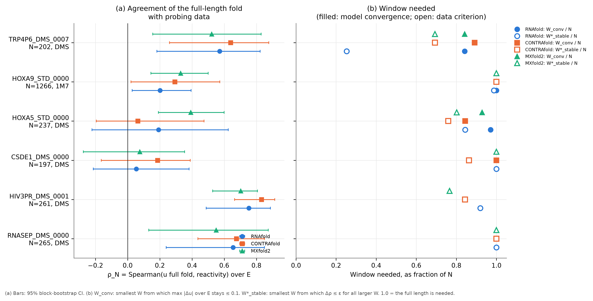

**Overview B.** Δρ(W) for every dataset (panels) and model (lines), with 95 % CI bands.

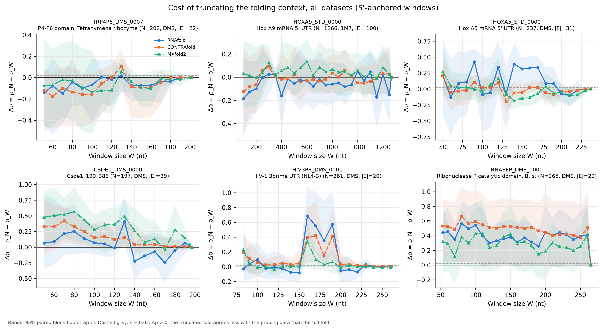

**Overview C.** Model-internal convergence (max |Δu| over E) for every dataset and model.

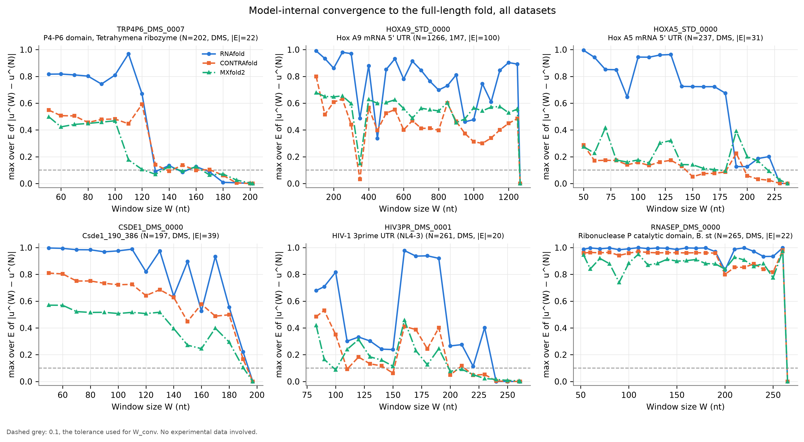

**Overview D.** The same curves against relative window size W/N, one panel per model and one line per dataset, so RNAs of different lengths can be compared directly.

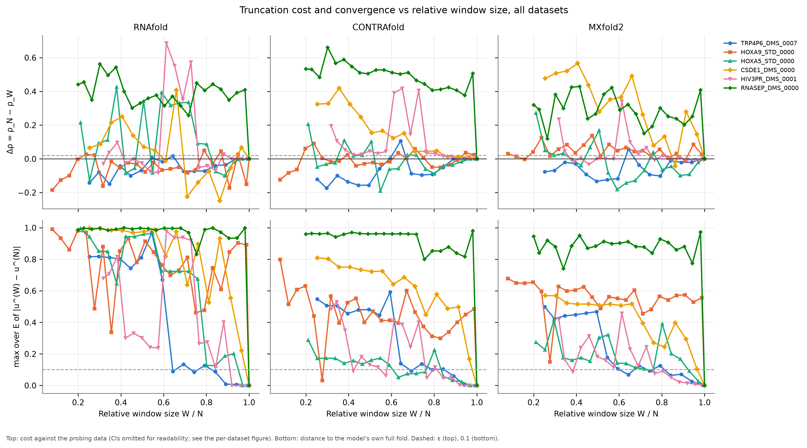

# Dataset TRP4P6_DMS_0007

## 3. Data

* **Source:** https://rmdb.stanford.edu/detail/TRP4P6_DMS_0007/ — file `TRP4P6_DMS_0007.rdat` downloaded from https://github.com/DasLab/rmdb.github.io/releases/download/data-rna-structures/TRP4P6_DMS_0007.rdat on 2026-11-04T16:42:08+00:00 (SHA-256 `337ffa4ebf180836de9ad8ad1c845326cdc720be07f3d56a48d41ae3b9adbab4`).
* **Construct:** P4-P6 domain of the Tetrahymena group I intron (RDAT NAME: 'P4-P6 domain, Tetrahymena ribozyme'), mutate-and-map experiment (DMS, MaP readout); only the wild-type row is used.
* **Sequence:** N = 202 nt, RDAT/source numbering 90–291 (1-based position = source − 89).
* **Row used:** 1 of 203 data rows, selected by annotation match `{'annotation': {'mutation': 'WT'}}` (row annotations: `{'mutation': ['WT']}`). The selection fails loudly if it matches zero or several rows.
* **Reagent:** DMS. **Conditions (from file annotations):** 37.0 °C, Mg²⁺ 10.0 mM, buffer Na-cacodylate:300mM(pH7.0); all annotations: `Na-cacodylate:300mM(pH7.0), MgCl2:10mM`.
* **Evaluation nucleotides:** AC (reagent mapping (DMS)).
* **Excluded positions (set to NaN):** source 272-291 (1-based 183-202). Reason: 3' primer-binding tail (AAAGAAACAACAACAACAAC): reactivities ~1e-4, no structural information. Stored as numbers in the RDAT, set to NaN here. NaN already present in the source: none.
* **Region of interest:** source 100–140 (1-based 11–51), anchoring `five_prime`. R = 100-140 (RDAT numbering) contains the 5' arms of P4 (107-112) and P5 (116-121) and the start of P5a (127-138); their partners lie at 200-214 and 180-195, i.e. outside small 5'-anchored windows. This mimics the mRNA use case (5'-anchored window growing toward 3').
* **Evaluation set:** |E| = 22; source positions 100-101, 104-105, 109, 113-115, 121-125, 127-128, 132-133, 136-140.
* **Window grid:** 51, 60, 70, 80, 90, 100, 110, 120, 130, 140, 150, 160, 170, 180, 190, 200, 202.
* Positions 90-92 have reactivity exactly 0 and 93-99 are near 0 (possible low read coverage near the 5' end); they lie outside R and do not enter E.
* Low DMS signal in the first positions of R (100-103) is part of E; it may reflect coverage rather than structure.

## 4. Models and parameters

| Model | Version | Parameters | Temperature | Salt | Mg²⁺ / tertiary |
|---|---|---|---|---|---|
| RNAfold | 2.7.2 | turner2004, dangles=2, partition function (`fc.pf()`, `fc.bpp()`) | 37 °C | standard 1.021 M monovalent (correction off) | not representable |
| CONTRAfold | CONTRAFold version 2.01 - RNA secondary structure prediction (bioconda package 2.02) | `contrafold predict --posteriors 1e-05`, built-in default parameters | not representable | not representable | not representable |
| MXfold2 | 0.1.2 | `mxfold2 predict --bpp`, bundled default (TrainSetAB.conf, model MixC), seed 0 | not representable | not representable | not representable |

**CONTRAfold threshold bias.** CONTRAfold only writes pairs with posterior ≥ 1e-05. Omitted pairs are counted as 'unpaired', so $u_i$ is biased **upward** by at most (number of omitted partners of $i$) × 1e-05 ≤ $(N-1)$ × 1e-05 = 0.0020 for the full fold (less for windows). **Measured on this dataset** by re-folding with threshold 1e-09: W = 51: max |Δu| = 0, |Δρ| = 0; W = 202: max |Δu| = 0, |Δρ| = 0.

**MXfold2 rounding.** MXfold2 writes $p_{ij}$ with 5 decimals; the resulting error on $u_i$ is ≤ $N\times5\cdot10^{-6}$ (≈0.001 here). Values of $u$ are clipped to [0, 1]; the maximal clipped amount per call is in `run_metadata.json`.

**Condition mismatches flagged at run time:**

* 10 mM Mg²⁺ in the experiment: no model represents Mg²⁺ or tertiary structure.
* Experiment at 37 °C: RNAfold folds at 37 °C; CONTRAfold and MXfold2 have no temperature parameter.
* Buffer Na-cacodylate:300mM(pH7.0): RNAfold uses standard 1.021 M monovalent salt (correction off); CONTRAfold/MXfold2 have no salt dependence.

## 5. Results

|E| = 22 positions. ε = 0.02. Bootstrap: B = 2000, block = 10 nt, seed = 0.

### Summary table

$\rho_W$ [95 % CI] and $\Delta\rho(W)$ [95 % CI] per model. Full numbers: `TRP4P6_DMS_0007_summary.csv` (long) and `TRP4P6_DMS_0007_summary_wide.csv`.

| W | window (1-based) | RNAfold ρ_W | RNAfold Δρ | CONTRAfold ρ_W | CONTRAfold Δρ | MXfold2 ρ_W | MXfold2 Δρ |
|---|---|---|---|---|---|---|---|
| 51 | 1–51 | 0.714 [0.52, 0.86] | -0.142 [-0.44, 0.04] | 0.761 [0.64, 0.88] | -0.121 [-0.45, 0.09] | 0.599 [0.32, 0.75] | -0.077 [-0.51, 0.36] |
| 60 | 1–60 | 0.651 [0.45, 0.87] | -0.079 [-0.54, 0.20] | 0.814 [0.69, 0.91] | -0.174 [-0.48, 0.04] | 0.591 [0.40, 0.70] | -0.069 [-0.44, 0.27] |
| 70 | 1–70 | 0.721 [0.53, 0.85] | -0.149 [-0.43, 0.05] | 0.739 [0.57, 0.89] | -0.099 [-0.45, 0.10] | 0.543 [0.38, 0.66] | -0.020 [-0.38, 0.32] |
| 80 | 1–80 | 0.614 [0.24, 0.84] | -0.042 [-0.27, 0.16] | 0.775 [0.62, 0.89] | -0.136 [-0.46, 0.10] | 0.552 [0.30, 0.71] | -0.029 [-0.40, 0.34] |
| 90 | 1–90 | 0.673 [0.38, 0.89] | -0.101 [-0.25, -0.01] | 0.797 [0.67, 0.91] | -0.157 [-0.46, 0.04] | 0.615 [0.32, 0.77] | -0.093 [-0.50, 0.28] |
| 100 | 1–100 | 0.641 [0.40, 0.82] | -0.069 [-0.43, 0.18] | 0.796 [0.62, 0.91] | -0.156 [-0.43, 0.03] | 0.656 [0.33, 0.81] | -0.133 [-0.53, 0.26] |
| 110 | 1–110 | 0.566 [0.25, 0.82] | 0.006 [-0.24, 0.16] | 0.697 [0.47, 0.87] | -0.058 [-0.34, 0.08] | 0.645 [0.35, 0.82] | -0.123 [-0.32, 0.04] |
| 120 | 1–120 | 0.589 [0.39, 0.74] | -0.017 [-0.27, 0.17] | 0.637 [0.40, 0.86] | 0.002 [-0.22, 0.13] | 0.640 [0.41, 0.81] | -0.117 [-0.33, 0.03] |
| 130 | 1–130 | 0.555 [0.21, 0.83] | 0.017 [-0.13, 0.13] | 0.534 [0.15, 0.82] | 0.106 [-0.07, 0.26] | 0.465 [0.14, 0.80] | 0.058 [-0.13, 0.19] |
| 140 | 1–140 | 0.644 [0.30, 0.82] | -0.072 [-0.22, 0.02] | 0.727 [0.48, 0.88] | -0.087 [-0.38, 0.02] | 0.558 [0.25, 0.80] | -0.036 [-0.14, 0.07] |
| 150 | 1–150 | 0.644 [0.30, 0.82] | -0.072 [-0.22, 0.02] | 0.736 [0.50, 0.89] | -0.096 [-0.38, 0.00] | 0.616 [0.36, 0.83] | -0.094 [-0.27, 0.03] |
| 160 | 1–160 | 0.644 [0.30, 0.82] | -0.072 [-0.22, 0.02] | 0.731 [0.51, 0.88] | -0.091 [-0.37, 0.00] | 0.624 [0.35, 0.81] | -0.102 [-0.28, 0.06] |
| 170 | 1–170 | 0.613 [0.29, 0.83] | -0.041 [-0.24, 0.01] | 0.691 [0.43, 0.84] | -0.051 [-0.25, 0.06] | 0.532 [0.20, 0.80] | -0.010 [-0.08, 0.08] |
| 180 | 1–180 | 0.607 [0.20, 0.83] | -0.035 [-0.09, 0.02] | 0.640 [0.30, 0.87] | 0.000 [-0.05, 0.02] | 0.544 [0.19, 0.80] | -0.021 [-0.07, 0.07] |
| 190 | 1–190 | 0.572 [0.18, 0.82] | 0.000 [0.00, 0.00] | 0.640 [0.26, 0.88] | 0.000 [0.00, 0.00] | 0.543 [0.18, 0.82] | -0.020 [-0.08, 0.04] |
| 200 | 1–200 | 0.572 [0.18, 0.82] | 0.000 [0.00, 0.00] | 0.640 [0.26, 0.88] | 0.000 [0.00, 0.00] | 0.522 [0.16, 0.83] | 0.000 [0.00, 0.00] |
| 202 (N) | 1–202 | 0.572 [0.18, 0.82] | 0.000 [0.00, 0.00] | 0.640 [0.26, 0.88] | 0.000 [0.00, 0.00] | 0.522 [0.16, 0.83] | 0.000 [0.00, 0.00] |

### Suggested window per model (heuristic)

| Model | ρ_N [95 % CI] | W* (first Δρ ≤ ε) | W*_stable | W*_CI (upper CI ≤ ε) |
|---|---|---|---|---|
| RNAfold | 0.572 [0.18, 0.82] | 51 | 51 | 90 |
| CONTRAfold | 0.640 [0.26, 0.88] | 51 | 140 | 150 |
| MXfold2 | 0.522 [0.16, 0.83] | 51 | 140 | 200 |

### Figures

**Figure 1.** $\rho_W$ vs $W$ (lines), each model's $\rho_N$ (dotted), 95 % bootstrap CI (band).

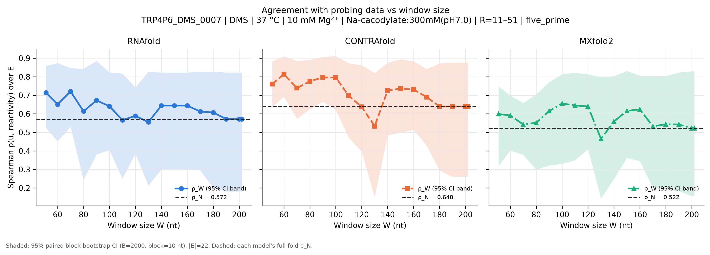

**Figure 2.** $\Delta\rho(W)$ with 95 % CI; dashed line: ε.

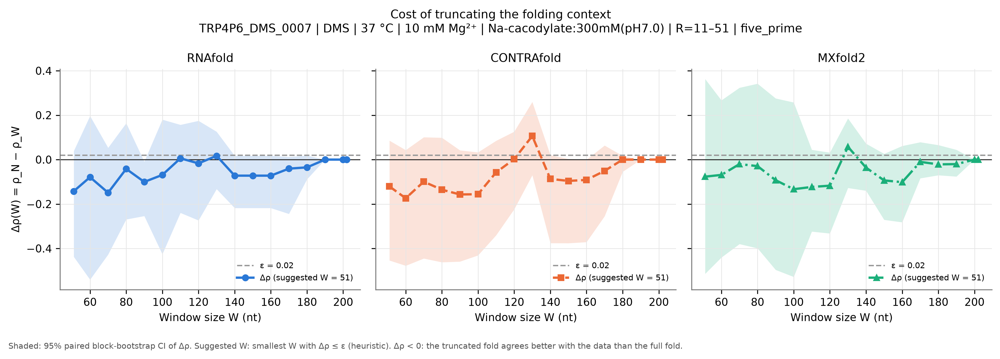

**Figure 3.** Model-internal convergence: Spearman of $u^{(W)}$ to $u^{(N)}$ over $E$ (left) and max $|\Delta u|$ over $E$ (right).

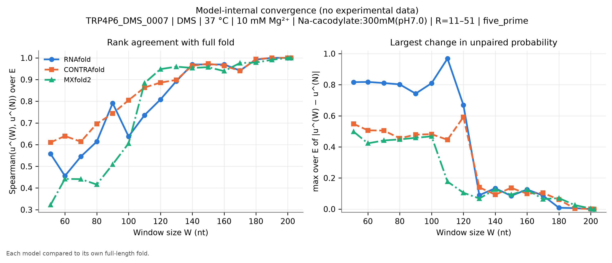

**Figure 4.** Reactivity (evaluation nucleotides dark, others grey, excluded positions ×) and $u$ for the full fold and three representative windows, one panel per model; yellow = $R$.

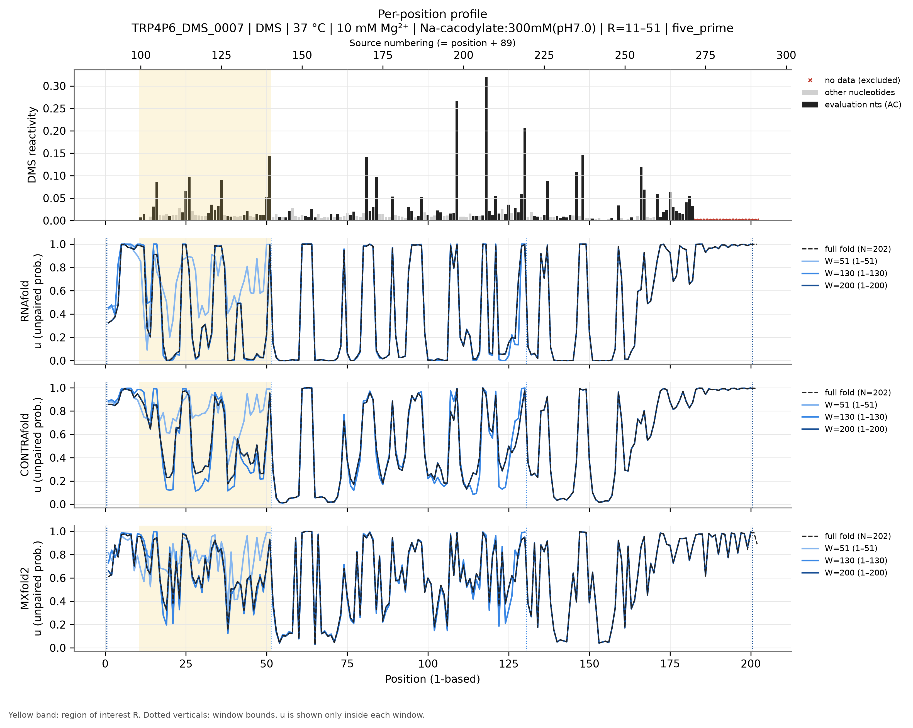

**Figure 5.** $|u_i^{(W)}-u_i^{(N)}|$; position on x, $W$ on y; grey = outside window.

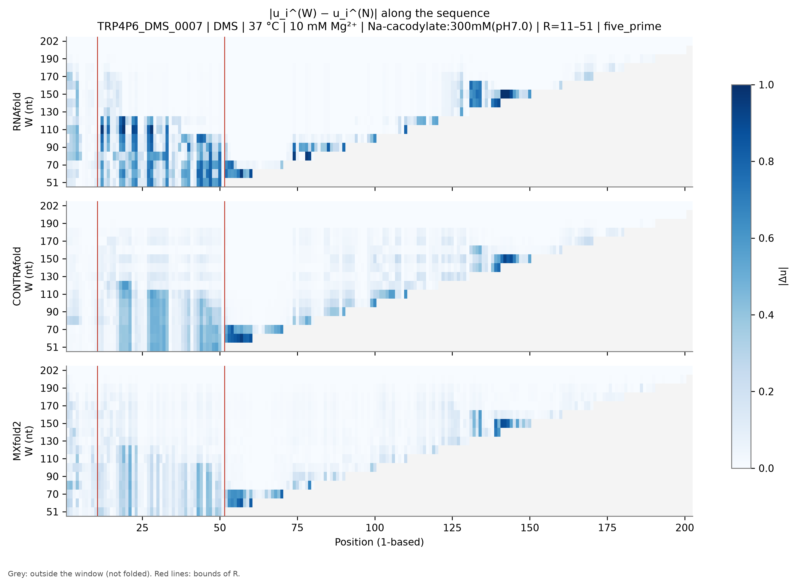

**Figure 6.** $u$ (full fold) vs reactivity over $E$, one panel per model.

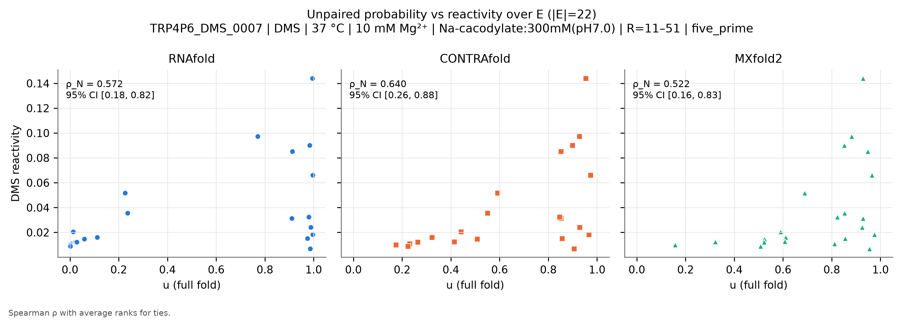

### Comparison of the three models

* **Absolute agreement (full fold):** CONTRAfold ρ_N = 0.640 [0.26, 0.88], RNAfold ρ_N = 0.572 [0.18, 0.82], MXfold2 ρ_N = 0.522 [0.16, 0.83]. Overlapping CIs mean the ranking is not resolved by these data.
* **Smallest window (W = 51):** RNAfold Δρ = -0.142 [-0.44, 0.04], CONTRAfold Δρ = -0.121 [-0.45, 0.09], MXfold2 Δρ = -0.077 [-0.51, 0.36].
* **Largest Δρ over the grid:** RNAfold 0.017 at W = 130, CONTRAfold 0.106 at W = 130, MXfold2 0.058 at W = 130.
* **Internal convergence** (smallest W from which max |Δu| over E stays ≤ 0.1): RNAfold W = 170, CONTRAfold W = 180, MXfold2 W = 170.
* **RNAfold: Δρ CI excludes 0** below 0 (truncated fold agrees *better* with data) at W = [90].
* **CONTRAfold:** the 95 % CI of Δρ includes 0 at every W.
* **MXfold2:** the 95 % CI of Δρ includes 0 at every W.
* **Suggested W (ε = 0.02):** RNAfold W* = 51 (stable 51, CI-based 90), CONTRAfold W* = 51 (stable 140, CI-based 150), MXfold2 W* = 51 (stable 140, CI-based 200).

**Interpretation (generated from the numbers above).**
For no model and no window is truncation shown to cost agreement with the data (no Δρ CI lies entirely above 0). W* therefore equals the smallest window tested, which says only that the data do not penalise truncation; it is not evidence that small windows reproduce the full-length structure. The model-internal convergence (Figures 3 and 5) shows where the predicted structure inside R actually stops changing, and W*_CI / W*_stable give more conservative choices.

# Dataset HOXA9_STD_0000

## 3. Data

* **Source:** https://rmdb.stanford.edu/detail/HOXA9_STD_0000/ — file `HOXA9_STD_0000.rdat` downloaded from https://github.com/DasLab/rmdb.github.io/releases/download/data-rna-structures/HOXA9_STD_0000.rdat on 2026-11-04T17:32:31+00:00 (SHA-256 `1ee9008cd773b2b76a789cb0bddbb59bc677823360ece4404facfdffe1cad7ee`).
* **Construct:** Hox A9 mRNA 5' UTR (1266 nt), 1M7 SHAPE, ligation-based readout (ligSHAPE), PAGE-purified RNA (row 1 of 2; row 2 is non-PAGE). Data were normalised over a 350-nt window (file comment).
* **Sequence:** N = 1266 nt, RDAT/source numbering 1–1266 (1-based position = source − 0).
* **Row used:** 1 of 2 data rows, selected by annotation match `{'annotation': {'sequenceSource': 'PAGE'}}` (row annotations: `{'modifier': ['1M7'], 'sequenceSource': ['PAGE'], 'MAPseq': ['ligSHAPE']}`). The selection fails loudly if it matches zero or several rows.
* **Reagent:** 1M7. **Conditions (from file annotations):** 24.0 °C, Mg²⁺ 10.0 mM, buffer Na-HEPES:50mM(pH8.0); all annotations: `Na-HEPES:50mM(pH8.0), MgCl2:10mM`.
* **Evaluation nucleotides:** ACGU (reagent mapping (1M7)).
* **Excluded positions (set to NaN):** source 1258-1266 (1-based 1258-1266). Reason: Trailing run of 9 exact zeros at the 3' end (no data at the read end). NaN already present in the source: none.
* **Region of interest:** source 1–100 (1-based 1–100), anchoring `five_prime`. R = 1-100: the 5' end of the UTR. The region of interest is the 5'-most stretch with data (uniform rule across datasets: first 50 nt, 100 nt for the 1266-nt HOXA9 UTR), with 5'-anchored windows mimicking the mRNA use case.
* **Evaluation set:** |E| = 100; source positions 1-100.
* **Window grid:** 100, 150, 200, 250, 300, 350, 400, 450, 500, 550, 600, 650, 700, 750, 800, 850, 900, 950, 1000, 1050, 1100, 1150, 1200, 1250, 1266.
* RNA was heat-denatured, then folded at 37 °C for 20 min with 10 mM MgCl2; the annotated probing temperature is 24 °C. RNAfold folds at the annotated 24 °C.
* SHAPE reagent: all four nucleotides enter E.
* Window grid step is 50 nt because MXfold2 needs ~100 s per full-length fold.

## 4. Models and parameters

| Model | Version | Parameters | Temperature | Salt | Mg²⁺ / tertiary |
|---|---|---|---|---|---|
| RNAfold | 2.7.2 | turner2004, dangles=2, partition function (`fc.pf()`, `fc.bpp()`) | 24 °C | standard 1.021 M monovalent (correction off) | not representable |
| CONTRAfold | CONTRAFold version 2.01 - RNA secondary structure prediction (bioconda package 2.02) | `contrafold predict --posteriors 1e-05`, built-in default parameters | not representable | not representable | not representable |
| MXfold2 | 0.1.2 | `mxfold2 predict --bpp`, bundled default (TrainSetAB.conf, model MixC), seed 0 | not representable | not representable | not representable |

**CONTRAfold threshold bias.** CONTRAfold only writes pairs with posterior ≥ 1e-05. Omitted pairs are counted as 'unpaired', so $u_i$ is biased **upward** by at most (number of omitted partners of $i$) × 1e-05 ≤ $(N-1)$ × 1e-05 = 0.0127 for the full fold (less for windows). **Measured on this dataset** by re-folding with threshold 1e-09: W = 100: max |Δu| = 0, |Δρ| = 0; W = 1266: max |Δu| = 0, |Δρ| = 0.

**MXfold2 rounding.** MXfold2 writes $p_{ij}$ with 5 decimals; the resulting error on $u_i$ is ≤ $N\times5\cdot10^{-6}$ (≈0.001 here). Values of $u$ are clipped to [0, 1]; the maximal clipped amount per call is in `run_metadata.json`.

**Condition mismatches flagged at run time:**

* 10 mM Mg²⁺ in the experiment: no model represents Mg²⁺ or tertiary structure.
* Experiment at 24 °C: RNAfold folds at 24 °C; CONTRAfold and MXfold2 have no temperature parameter.
* Buffer Na-HEPES:50mM(pH8.0): RNAfold uses standard 1.021 M monovalent salt (correction off); CONTRAfold/MXfold2 have no salt dependence.

## 5. Results

|E| = 100 positions. ε = 0.02. Bootstrap: B = 2000, block = 10 nt, seed = 0.

### Summary table

$\rho_W$ [95 % CI] and $\Delta\rho(W)$ [95 % CI] per model. Full numbers: `HOXA9_STD_0000_summary.csv` (long) and `HOXA9_STD_0000_summary_wide.csv`.

| W | window (1-based) | RNAfold ρ_W | RNAfold Δρ | CONTRAfold ρ_W | CONTRAfold Δρ | MXfold2 ρ_W | MXfold2 Δρ |
|---|---|---|---|---|---|---|---|
| 100 | 1–100 | 0.386 [0.14, 0.58] | -0.185 [-0.50, 0.17] | 0.418 [0.17, 0.60] | -0.124 [-0.49, 0.25] | 0.299 [0.11, 0.46] | 0.031 [-0.26, 0.32] |
| 150 | 1–150 | 0.327 [0.13, 0.51] | -0.126 [-0.38, 0.14] | 0.377 [0.19, 0.53] | -0.083 [-0.31, 0.18] | 0.315 [0.12, 0.48] | 0.014 [-0.25, 0.29] |
| 200 | 1–200 | 0.301 [0.12, 0.45] | -0.100 [-0.30, 0.14] | 0.357 [0.18, 0.51] | -0.063 [-0.31, 0.22] | 0.332 [0.15, 0.48] | -0.002 [-0.25, 0.26] |
| 250 | 1–250 | 0.203 [-0.04, 0.44] | -0.002 [-0.24, 0.25] | 0.233 [0.03, 0.45] | 0.061 [-0.10, 0.28] | 0.288 [0.11, 0.45] | 0.041 [-0.17, 0.29] |
| 300 | 1–300 | 0.174 [-0.09, 0.45] | 0.027 [-0.15, 0.17] | 0.202 [-0.10, 0.53] | 0.091 [0.00, 0.20] | 0.204 [-0.06, 0.47] | 0.126 [-0.01, 0.27] |
| 350 | 1–350 | 0.180 [0.00, 0.37] | 0.022 [-0.04, 0.08] | 0.290 [0.02, 0.57] | 0.004 [-0.01, 0.02] | 0.313 [0.12, 0.49] | 0.017 [0.00, 0.04] |
| 400 | 1–400 | 0.362 [0.17, 0.53] | -0.161 [-0.43, 0.13] | 0.310 [0.12, 0.49] | -0.016 [-0.19, 0.22] | 0.273 [0.11, 0.43] | 0.057 [-0.17, 0.30] |
| 450 | 1–450 | 0.217 [0.03, 0.41] | -0.015 [-0.10, 0.06] | 0.307 [0.06, 0.54] | -0.014 [-0.13, 0.15] | 0.246 [0.08, 0.39] | 0.084 [-0.09, 0.29] |
| 500 | 1–500 | 0.255 [0.01, 0.49] | -0.054 [-0.23, 0.19] | 0.270 [-0.00, 0.56] | 0.024 [-0.15, 0.26] | 0.294 [0.11, 0.47] | 0.035 [-0.16, 0.27] |
| 550 | 1–550 | 0.224 [-0.08, 0.51] | -0.023 [-0.28, 0.23] | 0.335 [0.12, 0.55] | -0.042 [-0.20, 0.18] | 0.248 [0.08, 0.42] | 0.082 [-0.12, 0.27] |
| 600 | 1–600 | 0.232 [-0.01, 0.48] | -0.031 [-0.23, 0.16] | 0.322 [0.07, 0.56] | -0.028 [-0.13, 0.14] | 0.192 [0.01, 0.36] | 0.137 [-0.05, 0.33] |
| 650 | 1–650 | 0.278 [0.04, 0.50] | -0.077 [-0.28, 0.15] | 0.315 [0.07, 0.55] | -0.022 [-0.13, 0.15] | 0.312 [0.15, 0.46] | 0.018 [-0.14, 0.20] |
| 700 | 1–700 | 0.223 [0.01, 0.43] | -0.022 [-0.22, 0.22] | 0.326 [0.06, 0.58] | -0.032 [-0.15, 0.15] | 0.244 [0.06, 0.41] | 0.085 [-0.11, 0.31] |
| 750 | 1–750 | 0.268 [0.06, 0.48] | -0.067 [-0.24, 0.13] | 0.311 [0.04, 0.57] | -0.017 [-0.14, 0.16] | 0.281 [0.10, 0.44] | 0.048 [-0.14, 0.25] |
| 800 | 1–800 | 0.261 [0.02, 0.50] | -0.059 [-0.23, 0.13] | 0.258 [-0.05, 0.57] | 0.036 [-0.13, 0.20] | 0.263 [0.06, 0.46] | 0.067 [-0.13, 0.26] |
| 850 | 1–850 | 0.251 [0.04, 0.46] | -0.050 [-0.19, 0.12] | 0.292 [0.02, 0.56] | 0.001 [-0.15, 0.19] | 0.286 [0.07, 0.51] | 0.044 [-0.16, 0.22] |
| 900 | 1–900 | 0.284 [0.04, 0.52] | -0.083 [-0.24, 0.11] | 0.234 [-0.13, 0.58] | 0.060 [-0.13, 0.25] | 0.281 [0.01, 0.53] | 0.048 [-0.16, 0.24] |
| 950 | 1–950 | 0.267 [0.10, 0.44] | -0.066 [-0.16, 0.04] | 0.287 [0.01, 0.56] | 0.006 [-0.11, 0.14] | 0.314 [0.14, 0.47] | 0.016 [-0.14, 0.19] |
| 1000 | 1–1000 | 0.152 [-0.01, 0.33] | 0.050 [-0.02, 0.12] | 0.342 [0.10, 0.57] | -0.049 [-0.14, 0.09] | 0.273 [0.10, 0.44] | 0.056 [-0.12, 0.22] |
| 1050 | 1–1050 | 0.233 [0.07, 0.40] | -0.031 [-0.20, 0.16] | 0.344 [0.11, 0.57] | -0.050 [-0.15, 0.09] | 0.325 [0.16, 0.47] | 0.005 [-0.16, 0.19] |
| 1100 | 1–1100 | 0.156 [-0.06, 0.38] | 0.045 [-0.14, 0.24] | 0.328 [0.08, 0.56] | -0.035 [-0.14, 0.12] | 0.298 [0.12, 0.46] | 0.031 [-0.13, 0.22] |
| 1150 | 1–1150 | 0.373 [0.19, 0.54] | -0.172 [-0.43, 0.11] | 0.302 [0.04, 0.57] | -0.009 [-0.14, 0.15] | 0.341 [0.16, 0.52] | -0.011 [-0.18, 0.17] |
| 1200 | 1–1200 | 0.174 [-0.05, 0.39] | 0.027 [-0.20, 0.24] | 0.257 [-0.10, 0.58] | 0.036 [-0.13, 0.19] | 0.245 [-0.04, 0.50] | 0.085 [-0.15, 0.28] |
| 1250 | 1–1250 | 0.351 [0.15, 0.51] | -0.150 [-0.40, 0.14] | 0.269 [-0.02, 0.56] | 0.024 [-0.17, 0.28] | 0.304 [0.11, 0.49] | 0.026 [-0.15, 0.23] |
| 1266 (N) | 1–1266 | 0.201 [0.03, 0.39] | 0.000 [0.00, 0.00] | 0.294 [0.02, 0.57] | 0.000 [0.00, 0.00] | 0.330 [0.14, 0.50] | 0.000 [0.00, 0.00] |

### Suggested window per model (heuristic)

| Model | ρ_N [95 % CI] | W* (first Δρ ≤ ε) | W*_stable | W*_CI (upper CI ≤ ε) |
|---|---|---|---|---|
| RNAfold | 0.201 [0.03, 0.39] | 100 | 1250 | 1266 |
| CONTRAfold | 0.294 [0.02, 0.57] | 100 | 1266 | 350 |
| MXfold2 | 0.330 [0.14, 0.50] | 150 | 1266 | 1266 |

### Figures

**Figure 1.** $\rho_W$ vs $W$ (lines), each model's $\rho_N$ (dotted), 95 % bootstrap CI (band).

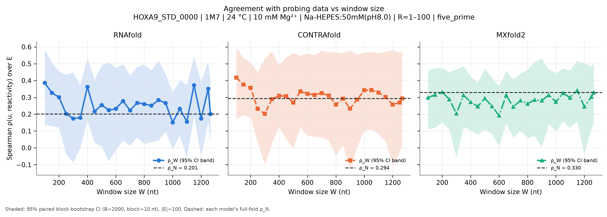

**Figure 2.** $\Delta\rho(W)$ with 95 % CI; dashed line: ε.

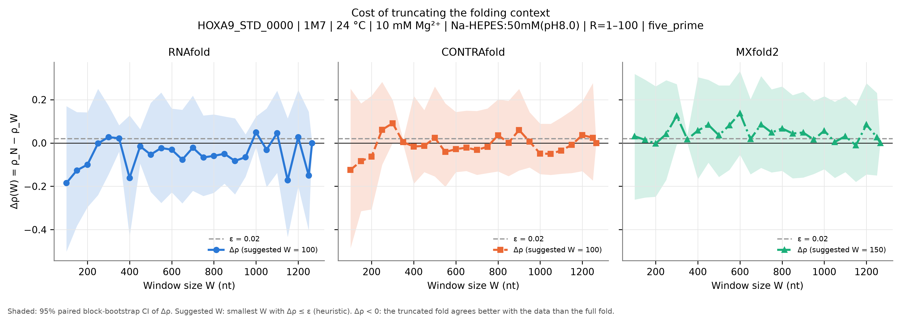

**Figure 3.** Model-internal convergence: Spearman of $u^{(W)}$ to $u^{(N)}$ over $E$ (left) and max $|\Delta u|$ over $E$ (right).

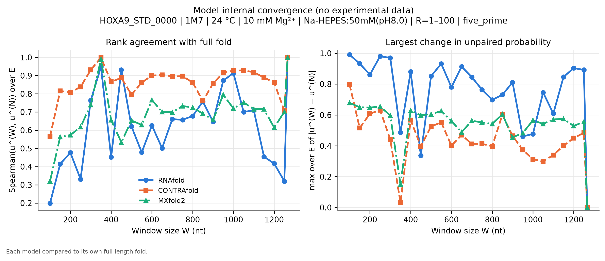

**Figure 4.** Reactivity (evaluation nucleotides dark, others grey, excluded positions ×) and $u$ for the full fold and three representative windows, one panel per model; yellow = $R$.

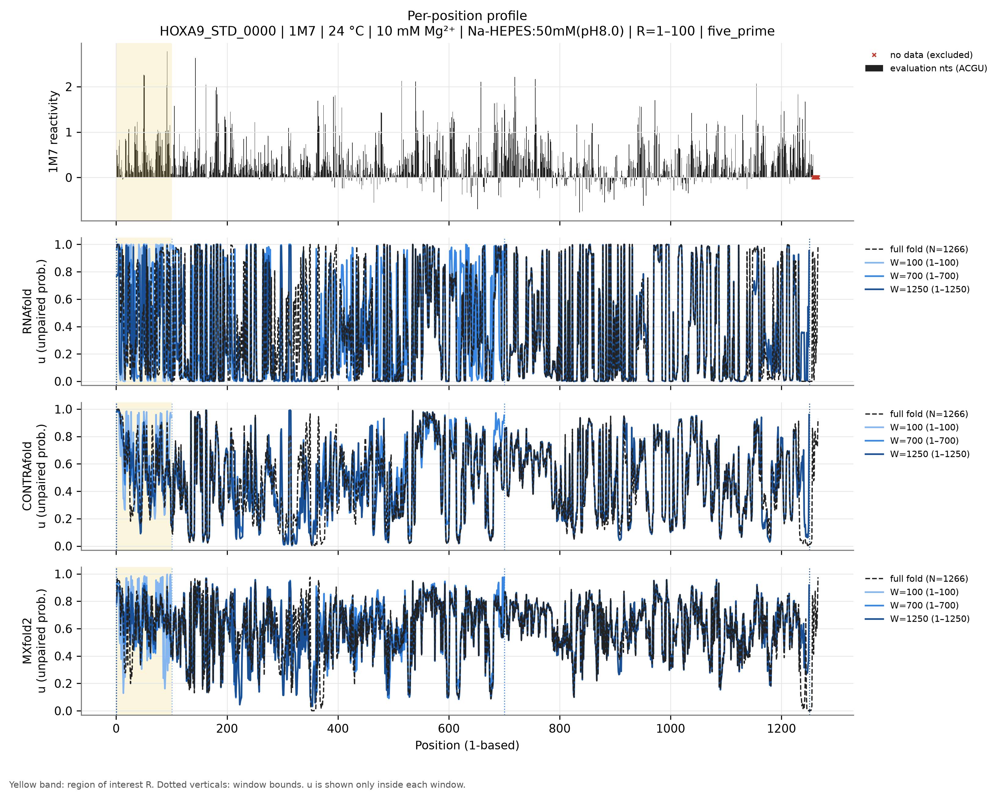

**Figure 5.** $|u_i^{(W)}-u_i^{(N)}|$; position on x, $W$ on y; grey = outside window.

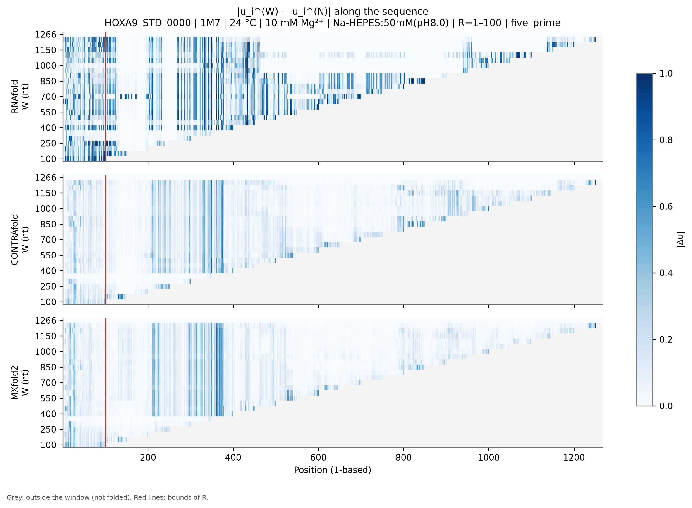

**Figure 6.** $u$ (full fold) vs reactivity over $E$, one panel per model.

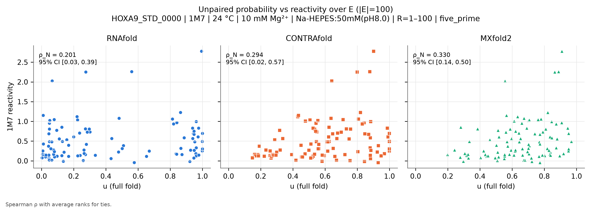

### Comparison of the three models

* **Absolute agreement (full fold):** MXfold2 ρ_N = 0.330 [0.14, 0.50], CONTRAfold ρ_N = 0.294 [0.02, 0.57], RNAfold ρ_N = 0.201 [0.03, 0.39]. Overlapping CIs mean the ranking is not resolved by these data.
* **Smallest window (W = 100):** RNAfold Δρ = -0.185 [-0.50, 0.17], CONTRAfold Δρ = -0.124 [-0.49, 0.25], MXfold2 Δρ = 0.031 [-0.26, 0.32].
* **Largest Δρ over the grid:** RNAfold 0.050 at W = 1000, CONTRAfold 0.091 at W = 300, MXfold2 0.137 at W = 600.
* **Internal convergence** (smallest W from which max |Δu| over E stays ≤ 0.1): RNAfold W = 1266, CONTRAfold W = 1266, MXfold2 W = 1266.
* **RNAfold:** the 95 % CI of Δρ includes 0 at every W.
* **CONTRAfold: Δρ CI excludes 0** above 0 (truncation costs agreement) at W = [300].
* **MXfold2: Δρ CI excludes 0** above 0 (truncation costs agreement) at W = [350].
* **Suggested W (ε = 0.02):** RNAfold W* = 100 (stable 1250, CI-based 1266), CONTRAfold W* = 100 (stable 1266, CI-based 350), MXfold2 W* = 150 (stable 1266, CI-based 1266).

**Interpretation (generated from the numbers above).**
Truncation measurably reduces agreement with the data for some windows (Δρ CI above 0); W*, W*_stable and W*_CI should be read together with the convergence figures.

# Dataset HOXA5_STD_0000

## 3. Data

* **Source:** https://rmdb.stanford.edu/detail/HOXA5_STD_0000/ — file `HOXA5_STD_0000.rdat` downloaded from https://github.com/DasLab/rmdb.github.io/releases/download/data-rna-structures/HOXA5_STD_0000.rdat on 2026-11-04T17:27:35+00:00 (SHA-256 `c6ce4224152eac930e9ca6d597c4e9eee22319e8dd344b0374755b39e6a8f5f0`).
* **Construct:** Hox A5 mRNA 5' UTR (237 nt); the DMS, PAGE-purified row (row 4 of 4: rows 1/3 are 1M7, row 2 DMS non-PAGE).
* **Sequence:** N = 237 nt, RDAT/source numbering 1–237 (1-based position = source − 0).
* **Row used:** 4 of 4 data rows, selected by annotation match `{'annotation': {'modifier': 'DMS', 'sequenceSource': 'PAGE'}}` (row annotations: `{'modifier': ['DMS'], 'sequenceSource': ['PAGE'], 'MAPseq': ['ligSHAPE']}`). The selection fails loudly if it matches zero or several rows.
* **Reagent:** DMS. **Conditions (from file annotations):** 24.0 °C, Mg²⁺ 10.0 mM, buffer Na-HEPES:50mM(pH8.0); all annotations: `Na-HEPES:50mM(pH8.0), MgCl2:10mM`.
* **Evaluation nucleotides:** AC (reagent mapping (DMS)).
* **Excluded positions (set to NaN):** source 230-237 (1-based 230-237). Reason: Trailing run of 8 exact zeros at the 3' end (no data at the read end). NaN already present in the source: none.
* **Region of interest:** source 1–50 (1-based 1–50), anchoring `five_prime`. R = 1-50: the 5' end of the UTR. The region of interest is the 5'-most stretch with data (uniform rule across datasets: first 50 nt, 100 nt for the 1266-nt HOXA9 UTR), with 5'-anchored windows mimicking the mRNA use case.
* **Evaluation set:** |E| = 31; source positions 1, 3-11, 13-18, 21, 25-27, 29, 34-36, 38, 40, 42, 46-47, 49-50.
* **Window grid:** 50, 60, 70, 80, 90, 100, 110, 120, 130, 140, 150, 160, 170, 180, 190, 200, 210, 220, 230, 237.
* RNA was heat-denatured, then folded at 37 °C for 20 min with 10 mM MgCl2; annotated probing temperature 24 °C.
* DMS data are normalised so that G/U are 0; G/U are outside E anyway.

## 4. Models and parameters

| Model | Version | Parameters | Temperature | Salt | Mg²⁺ / tertiary |
|---|---|---|---|---|---|
| RNAfold | 2.7.2 | turner2004, dangles=2, partition function (`fc.pf()`, `fc.bpp()`) | 24 °C | standard 1.021 M monovalent (correction off) | not representable |
| CONTRAfold | CONTRAFold version 2.01 - RNA secondary structure prediction (bioconda package 2.02) | `contrafold predict --posteriors 1e-05`, built-in default parameters | not representable | not representable | not representable |
| MXfold2 | 0.1.2 | `mxfold2 predict --bpp`, bundled default (TrainSetAB.conf, model MixC), seed 0 | not representable | not representable | not representable |

**CONTRAfold threshold bias.** CONTRAfold only writes pairs with posterior ≥ 1e-05. Omitted pairs are counted as 'unpaired', so $u_i$ is biased **upward** by at most (number of omitted partners of $i$) × 1e-05 ≤ $(N-1)$ × 1e-05 = 0.0024 for the full fold (less for windows). **Measured on this dataset** by re-folding with threshold 1e-09: W = 50: max |Δu| = 0, |Δρ| = 0; W = 237: max |Δu| = 0, |Δρ| = 0.

**MXfold2 rounding.** MXfold2 writes $p_{ij}$ with 5 decimals; the resulting error on $u_i$ is ≤ $N\times5\cdot10^{-6}$ (≈0.001 here). Values of $u$ are clipped to [0, 1]; the maximal clipped amount per call is in `run_metadata.json`.

**Condition mismatches flagged at run time:**

* 10 mM Mg²⁺ in the experiment: no model represents Mg²⁺ or tertiary structure.
* Experiment at 24 °C: RNAfold folds at 24 °C; CONTRAfold and MXfold2 have no temperature parameter.
* Buffer Na-HEPES:50mM(pH8.0): RNAfold uses standard 1.021 M monovalent salt (correction off); CONTRAfold/MXfold2 have no salt dependence.

## 5. Results

|E| = 31 positions. ε = 0.02. Bootstrap: B = 2000, block = 10 nt, seed = 0.

### Summary table

$\rho_W$ [95 % CI] and $\Delta\rho(W)$ [95 % CI] per model. Full numbers: `HOXA5_STD_0000_summary.csv` (long) and `HOXA5_STD_0000_summary_wide.csv`.

| W | window (1-based) | RNAfold ρ_W | RNAfold Δρ | CONTRAfold ρ_W | CONTRAfold Δρ | MXfold2 ρ_W | MXfold2 Δρ |
|---|---|---|---|---|---|---|---|
| 50 | 1–50 | -0.023 [-0.31, 0.32] | 0.215 [-0.41, 0.79] | -0.142 [-0.41, 0.37] | 0.205 [-0.06, 0.50] | 0.120 [-0.16, 0.38] | 0.272 [-0.11, 0.65] |
| 60 | 1–60 | 0.320 [-0.00, 0.62] | -0.128 [-0.72, 0.47] | 0.112 [-0.14, 0.46] | -0.048 [-0.32, 0.16] | 0.341 [0.07, 0.55] | 0.050 [-0.15, 0.29] |
| 70 | 1–70 | 0.100 [-0.18, 0.36] | 0.092 [-0.45, 0.60] | 0.094 [-0.11, 0.43] | -0.031 [-0.25, 0.14] | 0.371 [0.14, 0.59] | 0.020 [-0.19, 0.25] |
| 80 | 1–80 | 0.081 [-0.17, 0.34] | 0.111 [-0.41, 0.58] | 0.087 [-0.12, 0.43] | -0.024 [-0.24, 0.15] | 0.360 [0.13, 0.58] | 0.032 [-0.16, 0.25] |
| 90 | 1–90 | -0.235 [-0.45, 0.22] | 0.427 [0.05, 0.63] | -0.046 [-0.21, 0.41] | 0.109 [-0.09, 0.23] | 0.393 [0.17, 0.62] | -0.002 [-0.18, 0.17] |
| 100 | 1–100 | 0.278 [-0.03, 0.57] | -0.086 [-0.68, 0.52] | 0.046 [-0.16, 0.42] | 0.017 [-0.18, 0.17] | 0.431 [0.20, 0.65] | -0.040 [-0.21, 0.14] |
| 110 | 1–110 | 0.248 [-0.09, 0.52] | -0.056 [-0.61, 0.50] | 0.042 [-0.21, 0.43] | 0.021 [-0.10, 0.15] | 0.323 [0.11, 0.54] | 0.068 [-0.15, 0.25] |
| 120 | 1–120 | -0.151 [-0.50, 0.19] | 0.343 [-0.09, 0.74] | -0.039 [-0.34, 0.41] | 0.102 [-0.03, 0.26] | 0.223 [-0.16, 0.52] | 0.168 [-0.07, 0.50] |
| 130 | 1–130 | 0.274 [-0.01, 0.64] | -0.082 [-0.67, 0.38] | 0.254 [-0.02, 0.56] | -0.191 [-0.36, 0.03] | 0.473 [0.13, 0.68] | -0.082 [-0.25, 0.16] |
| 140 | 1–140 | -0.201 [-0.65, 0.53] | 0.393 [-0.00, 0.72] | 0.125 [-0.19, 0.53] | -0.062 [-0.19, 0.12] | 0.573 [0.37, 0.71] | -0.182 [-0.31, -0.02] |
| 150 | 1–150 | -0.125 [-0.45, 0.52] | 0.317 [0.03, 0.50] | 0.121 [-0.14, 0.44] | -0.057 [-0.13, 0.06] | 0.535 [0.35, 0.67] | -0.144 [-0.27, 0.02] |
| 160 | 1–160 | -0.140 [-0.44, 0.49] | 0.332 [0.06, 0.52] | 0.041 [-0.20, 0.41] | 0.022 [-0.05, 0.12] | 0.520 [0.32, 0.66] | -0.128 [-0.27, 0.07] |
| 170 | 1–170 | -0.143 [-0.44, 0.49] | 0.335 [0.06, 0.52] | 0.041 [-0.20, 0.41] | 0.022 [-0.05, 0.12] | 0.461 [0.29, 0.62] | -0.069 [-0.20, 0.09] |
| 180 | 1–180 | 0.101 [-0.35, 0.64] | 0.091 [-0.20, 0.34] | 0.123 [-0.22, 0.52] | -0.060 [-0.25, 0.14] | 0.352 [0.00, 0.64] | 0.040 [-0.11, 0.24] |
| 190 | 1–190 | 0.105 [-0.40, 0.66] | 0.087 [-0.12, 0.34] | 0.151 [-0.07, 0.51] | -0.088 [-0.22, 0.00] | 0.456 [0.18, 0.70] | -0.065 [-0.30, 0.16] |
| 200 | 1–200 | 0.267 [-0.20, 0.70] | -0.075 [-0.23, 0.04] | 0.103 [-0.14, 0.48] | -0.040 [-0.11, 0.00] | 0.436 [0.20, 0.67] | -0.045 [-0.17, 0.09] |
| 210 | 1–210 | 0.292 [-0.13, 0.70] | -0.100 [-0.27, 0.02] | 0.099 [-0.13, 0.46] | -0.036 [-0.12, 0.05] | 0.491 [0.31, 0.68] | -0.099 [-0.26, 0.03] |
| 220 | 1–220 | 0.211 [-0.24, 0.69] | -0.019 [-0.17, 0.13] | 0.080 [-0.18, 0.45] | -0.017 [-0.06, 0.05] | 0.484 [0.27, 0.68] | -0.092 [-0.16, -0.00] |
| 230 | 1–230 | 0.192 [-0.22, 0.63] | 0.000 [0.00, 0.00] | 0.063 [-0.20, 0.47] | 0.000 [0.00, 0.00] | 0.412 [0.21, 0.63] | -0.020 [-0.08, 0.01] |
| 237 (N) | 1–237 | 0.192 [-0.22, 0.63] | 0.000 [0.00, 0.00] | 0.063 [-0.20, 0.47] | 0.000 [0.00, 0.00] | 0.392 [0.19, 0.60] | 0.000 [0.00, 0.00] |

### Suggested window per model (heuristic)

| Model | ρ_N [95 % CI] | W* (first Δρ ≤ ε) | W*_stable | W*_CI (upper CI ≤ ε) |
|---|---|---|---|---|
| RNAfold | 0.192 [-0.22, 0.63] | 60 | 200 | 210 |
| CONTRAfold | 0.063 [-0.20, 0.47] | 60 | 180 | 190 |
| MXfold2 | 0.392 [0.19, 0.60] | 90 | 190 | 140 |

### Figures

**Figure 1.** $\rho_W$ vs $W$ (lines), each model's $\rho_N$ (dotted), 95 % bootstrap CI (band).

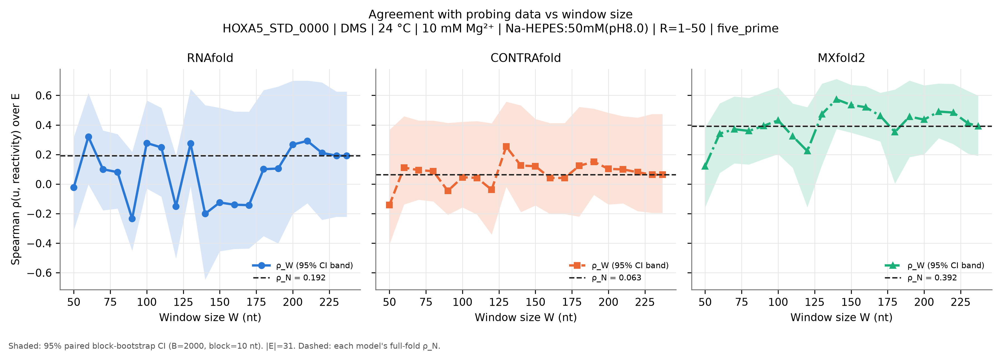

**Figure 2.** $\Delta\rho(W)$ with 95 % CI; dashed line: ε.

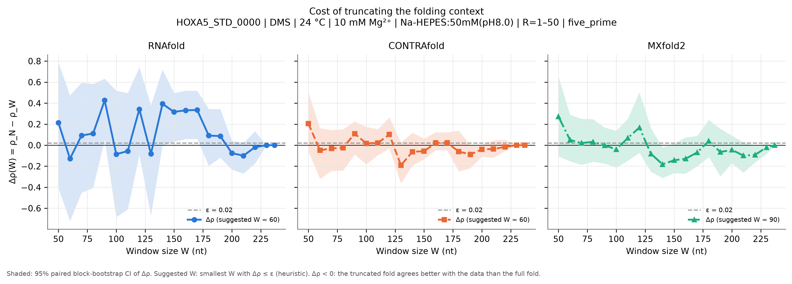

**Figure 3.** Model-internal convergence: Spearman of $u^{(W)}$ to $u^{(N)}$ over $E$ (left) and max $|\Delta u|$ over $E$ (right).

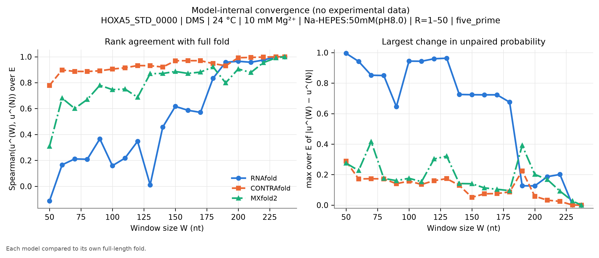

**Figure 4.** Reactivity (evaluation nucleotides dark, others grey, excluded positions ×) and $u$ for the full fold and three representative windows, one panel per model; yellow = $R$.

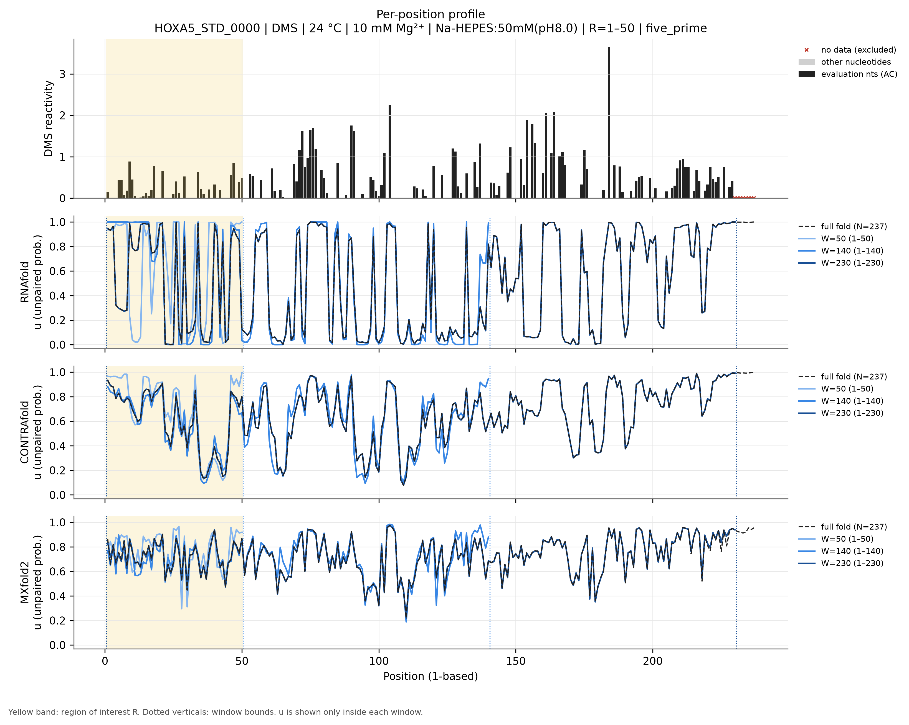

**Figure 5.** $|u_i^{(W)}-u_i^{(N)}|$; position on x, $W$ on y; grey = outside window.

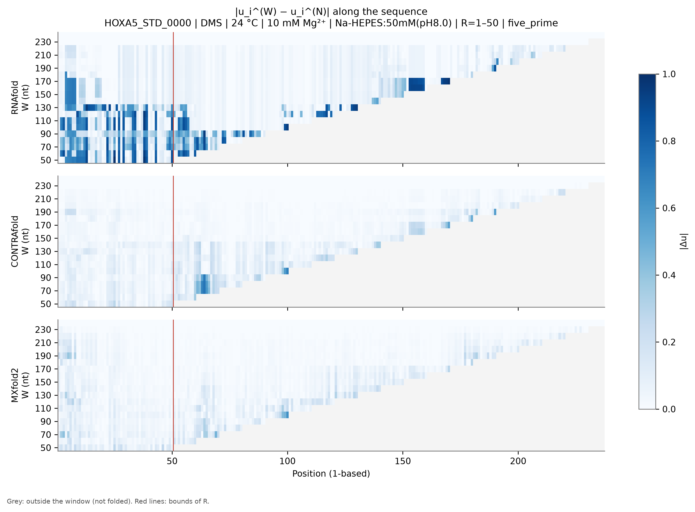

**Figure 6.** $u$ (full fold) vs reactivity over $E$, one panel per model.

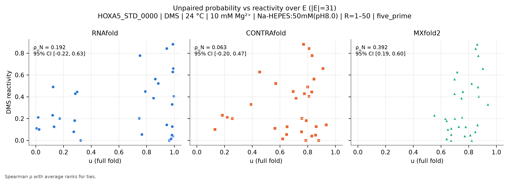

### Comparison of the three models

* **Absolute agreement (full fold):** MXfold2 ρ_N = 0.392 [0.19, 0.60], RNAfold ρ_N = 0.192 [-0.22, 0.63], CONTRAfold ρ_N = 0.063 [-0.20, 0.47]. Overlapping CIs mean the ranking is not resolved by these data.
* **Smallest window (W = 50):** RNAfold Δρ = 0.215 [-0.41, 0.79], CONTRAfold Δρ = 0.205 [-0.06, 0.50], MXfold2 Δρ = 0.272 [-0.11, 0.65].
* **Largest Δρ over the grid:** RNAfold 0.427 at W = 90, CONTRAfold 0.205 at W = 50, MXfold2 0.272 at W = 50.
* **Internal convergence** (smallest W from which max |Δu| over E stays ≤ 0.1): RNAfold W = 230, CONTRAfold W = 200, MXfold2 W = 220.
* **RNAfold: Δρ CI excludes 0** above 0 (truncation costs agreement) at W = [90, 150, 160, 170].
* **CONTRAfold:** the 95 % CI of Δρ includes 0 at every W.
* **MXfold2: Δρ CI excludes 0** below 0 (truncated fold agrees *better* with data) at W = [140, 220].
* **Suggested W (ε = 0.02):** RNAfold W* = 60 (stable 200, CI-based 210), CONTRAfold W* = 60 (stable 180, CI-based 190), MXfold2 W* = 90 (stable 190, CI-based 140).

**Interpretation (generated from the numbers above).**
Truncation measurably reduces agreement with the data for some windows (Δρ CI above 0); W*, W*_stable and W*_CI should be read together with the convergence figures.

# Dataset CSDE1_DMS_0000

## 3. Data

* **Source:** https://rmdb.stanford.edu/detail/CSDE1_DMS_0000/ — file `CSDE1_DMS_0000.rdat` downloaded from https://github.com/DasLab/rmdb.github.io/releases/download/data-rna-structures/CSDE1_DMS_0000.rdat on 2026-11-04T17:28:31+00:00 (SHA-256 `fef0d9f44954e9678910bb25d66d1007deb237f2476a54e6233a6c2da2a074ab`).
* **Construct:** Csde1 mRNA fragment, nucleotides 190-386 (RMDB name 'Csde1_190_386'), DMS mutate-and-map; only the WT row is used (CSDE1_DMS_0001 is a second entry of the same design with fewer data points).
* **Sequence:** N = 197 nt, RDAT/source numbering 1–197 (1-based position = source − 0).
* **Row used:** 1 of 198 data rows, selected by annotation match `{'annotation': {'mutation': 'WT'}}` (row annotations: `{'mutation': ['WT']}`). The selection fails loudly if it matches zero or several rows.
* **Reagent:** DMS. **Conditions (from file annotations):** None °C, Mg²⁺ None mM, buffer None; all annotations: ``.
* **Evaluation nucleotides:** AC (reagent mapping (DMS)).
* **Excluded positions (set to NaN):** source none (1-based none). Reason: No extra masking: positions without data are already NaN in the RDAT. NaN already present in the source: 5, 10, 31, 34, 36, 44, 47, 50, 60-62, 67, 74, 77, 81, 83, 86, 89, 93, 95, 100, 104, 106, 118, 121, 125, 128, 134, 144, 146, 149, 154, 156, 158, 162, 166-169, 172, 175, 178, 181, 194.
* **Region of interest:** source 1–50 (1-based 1–50), anchoring `five_prime`. R = 1-50: the 5' end of the fragment. The region of interest is the 5'-most stretch with data (uniform rule across datasets: first 50 nt, 100 nt for the 1266-nt HOXA9 UTR), with 5'-anchored windows mimicking the mRNA use case.
* **Evaluation set:** |E| = 39; source positions 1-4, 6-9, 11-30, 32-33, 35, 38-43, 48-49.
* **Window grid:** 50, 60, 70, 80, 90, 100, 110, 120, 130, 140, 150, 160, 170, 180, 190, 197.
* The RDAT annotations give no temperature, buffer or Mg2+; RNAfold uses 37 °C (default) and this is flagged.
* This is an internal fragment of the mRNA, so the 'full fold' is itself a truncation of the natural transcript.

## 4. Models and parameters

| Model | Version | Parameters | Temperature | Salt | Mg²⁺ / tertiary |
|---|---|---|---|---|---|
| RNAfold | 2.7.2 | turner2004, dangles=2, partition function (`fc.pf()`, `fc.bpp()`) | 37 °C | standard 1.021 M monovalent (correction off) | not representable |
| CONTRAfold | CONTRAFold version 2.01 - RNA secondary structure prediction (bioconda package 2.02) | `contrafold predict --posteriors 1e-05`, built-in default parameters | not representable | not representable | not representable |
| MXfold2 | 0.1.2 | `mxfold2 predict --bpp`, bundled default (TrainSetAB.conf, model MixC), seed 0 | not representable | not representable | not representable |

**CONTRAfold threshold bias.** CONTRAfold only writes pairs with posterior ≥ 1e-05. Omitted pairs are counted as 'unpaired', so $u_i$ is biased **upward** by at most (number of omitted partners of $i$) × 1e-05 ≤ $(N-1)$ × 1e-05 = 0.0020 for the full fold (less for windows). **Measured on this dataset** by re-folding with threshold 1e-09: W = 50: max |Δu| = 0, |Δρ| = 0; W = 197: max |Δu| = 0, |Δρ| = 0.

**MXfold2 rounding.** MXfold2 writes $p_{ij}$ with 5 decimals; the resulting error on $u_i$ is ≤ $N\times5\cdot10^{-6}$ (≈0.001 here). Values of $u$ are clipped to [0, 1]; the maximal clipped amount per call is in `run_metadata.json`.

**Condition mismatches flagged at run time:**

* No temperature in the data annotations; RNAfold uses 37 °C (default).

## 5. Results

|E| = 39 positions. ε = 0.02. Bootstrap: B = 2000, block = 10 nt, seed = 0.

### Summary table

$\rho_W$ [95 % CI] and $\Delta\rho(W)$ [95 % CI] per model. Full numbers: `CSDE1_DMS_0000_summary.csv` (long) and `CSDE1_DMS_0000_summary_wide.csv`.

| W | window (1-based) | RNAfold ρ_W | RNAfold Δρ | CONTRAfold ρ_W | CONTRAfold Δρ | MXfold2 ρ_W | MXfold2 Δρ |
|---|---|---|---|---|---|---|---|
| 50 | 1–50 | -0.012 [-0.46, 0.21] | 0.066 [-0.34, 0.82] | -0.139 [-0.46, 0.06] | 0.324 [-0.10, 0.76] | -0.402 [-0.63, -0.19] | 0.477 [-0.01, 0.89] |
| 60 | 1–60 | -0.033 [-0.42, 0.15] | 0.087 [-0.28, 0.78] | -0.142 [-0.42, 0.08] | 0.328 [-0.05, 0.68] | -0.433 [-0.68, -0.21] | 0.508 [0.03, 0.96] |
| 70 | 1–70 | -0.161 [-0.43, 0.07] | 0.215 [-0.12, 0.62] | -0.234 [-0.54, -0.01] | 0.419 [0.09, 0.66] | -0.446 [-0.60, -0.25] | 0.521 [0.14, 0.79] |
| 80 | 1–80 | -0.196 [-0.42, 0.02] | 0.250 [-0.11, 0.69] | -0.139 [-0.49, 0.10] | 0.324 [0.05, 0.54] | -0.491 [-0.73, -0.28] | 0.566 [0.10, 0.97] |
| 90 | 1–90 | -0.085 [-0.33, 0.11] | 0.139 [-0.10, 0.43] | -0.062 [-0.41, 0.20] | 0.248 [0.03, 0.41] | -0.363 [-0.60, -0.15] | 0.438 [0.06, 0.72] |
| 100 | 1–100 | -0.017 [-0.35, 0.18] | 0.071 [-0.10, 0.37] | 0.032 [-0.39, 0.26] | 0.154 [0.03, 0.39] | -0.204 [-0.48, 0.01] | 0.280 [-0.03, 0.51] |
| 110 | 1–110 | 0.003 [-0.34, 0.28] | 0.051 [-0.15, 0.35] | 0.019 [-0.40, 0.25] | 0.167 [-0.00, 0.43] | -0.277 [-0.54, -0.04] | 0.352 [-0.08, 0.61] |
| 120 | 1–120 | 0.066 [-0.31, 0.36] | -0.012 [-0.15, 0.27] | 0.063 [-0.36, 0.30] | 0.123 [0.02, 0.32] | -0.290 [-0.54, -0.08] | 0.365 [-0.03, 0.64] |
| 130 | 1–130 | -0.354 [-0.53, -0.15] | 0.408 [0.06, 0.81] | 0.034 [-0.40, 0.29] | 0.152 [0.01, 0.39] | -0.416 [-0.66, -0.14] | 0.491 [0.02, 0.76] |
| 140 | 1–140 | 0.278 [0.01, 0.49] | -0.224 [-0.51, 0.08] | 0.142 [-0.33, 0.40] | 0.044 [-0.14, 0.38] | -0.187 [-0.55, 0.10] | 0.262 [-0.05, 0.62] |
| 150 | 1–150 | 0.193 [-0.22, 0.38] | -0.139 [-0.34, 0.21] | 0.141 [-0.27, 0.34] | 0.045 [-0.04, 0.18] | -0.003 [-0.40, 0.21] | 0.079 [-0.19, 0.46] |
| 160 | 1–160 | 0.127 [-0.22, 0.39] | -0.073 [-0.30, 0.24] | 0.138 [-0.25, 0.36] | 0.048 [-0.03, 0.17] | -0.057 [-0.35, 0.13] | 0.133 [-0.11, 0.42] |
| 170 | 1–170 | 0.303 [0.00, 0.49] | -0.249 [-0.57, 0.17] | 0.174 [-0.14, 0.42] | 0.012 [-0.16, 0.15] | 0.118 [-0.19, 0.36] | -0.043 [-0.27, 0.20] |
| 180 | 1–180 | 0.107 [-0.04, 0.37] | -0.053 [-0.32, 0.11] | 0.173 [-0.24, 0.40] | 0.013 [-0.06, 0.13] | -0.205 [-0.51, 0.01] | 0.280 [0.01, 0.67] |
| 190 | 1–190 | -0.013 [-0.27, 0.37] | 0.067 [-0.08, 0.17] | 0.176 [-0.19, 0.39] | 0.010 [-0.04, 0.07] | -0.071 [-0.44, 0.31] | 0.146 [-0.05, 0.30] |
| 197 (N) | 1–197 | 0.054 [-0.21, 0.38] | 0.000 [0.00, 0.00] | 0.186 [-0.16, 0.39] | 0.000 [0.00, 0.00] | 0.075 [-0.27, 0.35] | 0.000 [0.00, 0.00] |

### Suggested window per model (heuristic)

| Model | ρ_N [95 % CI] | W* (first Δρ ≤ ε) | W*_stable | W*_CI (upper CI ≤ ε) |
|---|---|---|---|---|
| RNAfold | 0.054 [-0.21, 0.38] | 120 | 197 | 197 |
| CONTRAfold | 0.186 [-0.16, 0.39] | 170 | 170 | 197 |
| MXfold2 | 0.075 [-0.27, 0.35] | 170 | 197 | 197 |

### Figures

**Figure 1.** $\rho_W$ vs $W$ (lines), each model's $\rho_N$ (dotted), 95 % bootstrap CI (band).

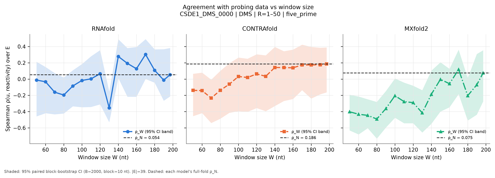

**Figure 2.** $\Delta\rho(W)$ with 95 % CI; dashed line: ε.

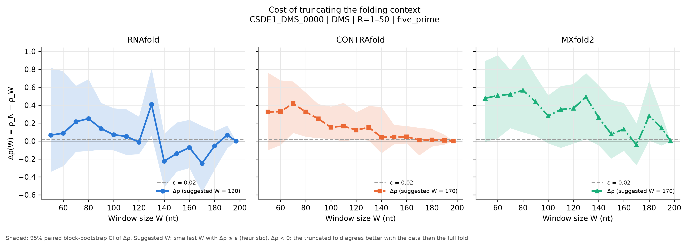

**Figure 3.** Model-internal convergence: Spearman of $u^{(W)}$ to $u^{(N)}$ over $E$ (left) and max $|\Delta u|$ over $E$ (right).

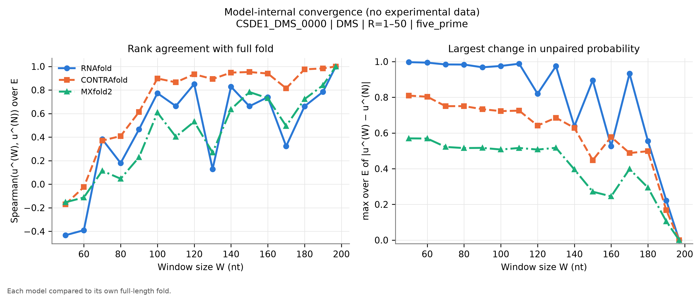

**Figure 4.** Reactivity (evaluation nucleotides dark, others grey, excluded positions ×) and $u$ for the full fold and three representative windows, one panel per model; yellow = $R$.

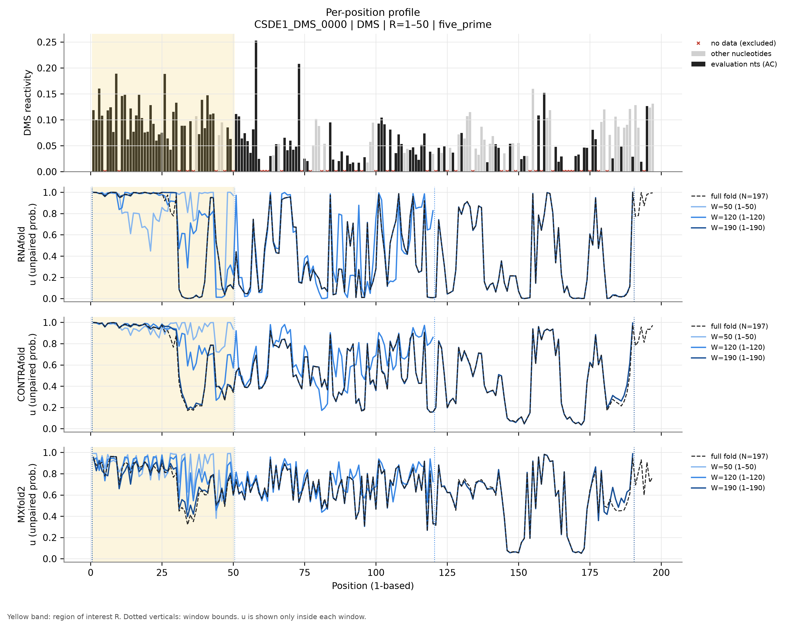

**Figure 5.** $|u_i^{(W)}-u_i^{(N)}|$; position on x, $W$ on y; grey = outside window.

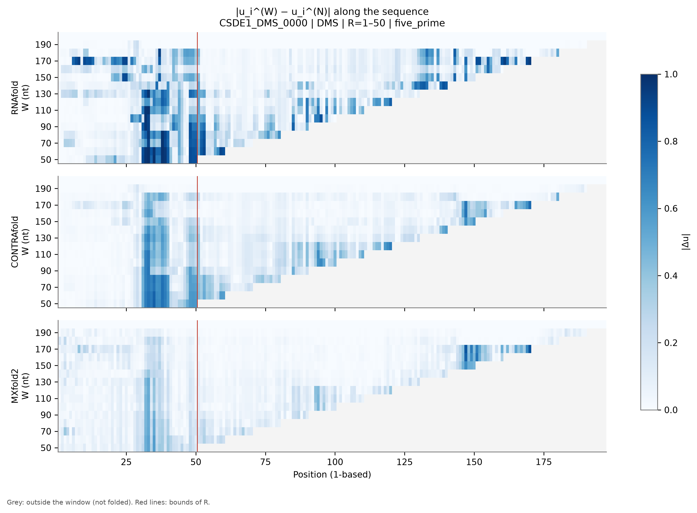

**Figure 6.** $u$ (full fold) vs reactivity over $E$, one panel per model.

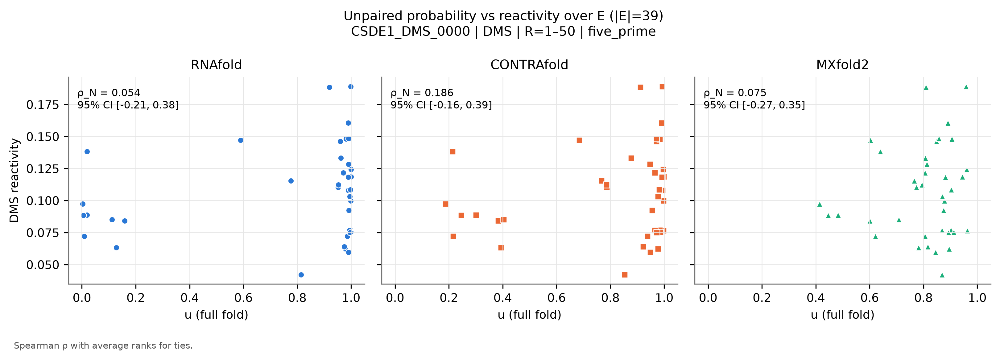

### Comparison of the three models

* **Absolute agreement (full fold):** CONTRAfold ρ_N = 0.186 [-0.16, 0.39], MXfold2 ρ_N = 0.075 [-0.27, 0.35], RNAfold ρ_N = 0.054 [-0.21, 0.38]. Overlapping CIs mean the ranking is not resolved by these data.
* **Smallest window (W = 50):** RNAfold Δρ = 0.066 [-0.34, 0.82], CONTRAfold Δρ = 0.324 [-0.10, 0.76], MXfold2 Δρ = 0.477 [-0.01, 0.89].
* **Largest Δρ over the grid:** RNAfold 0.408 at W = 130, CONTRAfold 0.419 at W = 70, MXfold2 0.566 at W = 80.
* **Internal convergence** (smallest W from which max |Δu| over E stays ≤ 0.1): RNAfold W = 197, CONTRAfold W = 197, MXfold2 W = 197.
* **RNAfold: Δρ CI excludes 0** above 0 (truncation costs agreement) at W = [130].
* **CONTRAfold: Δρ CI excludes 0** above 0 (truncation costs agreement) at W = [70, 80, 90, 100, 120, 130].
* **MXfold2: Δρ CI excludes 0** above 0 (truncation costs agreement) at W = [60, 70, 80, 90, 130, 180].
* **Suggested W (ε = 0.02):** RNAfold W* = 120 (stable 197, CI-based 197), CONTRAfold W* = 170 (stable 170, CI-based 197), MXfold2 W* = 170 (stable 197, CI-based 197).

**Interpretation (generated from the numbers above).**
Truncation measurably reduces agreement with the data for some windows (Δρ CI above 0); W*, W*_stable and W*_CI should be read together with the convergence figures.

# Dataset HIV3PR_DMS_0001

## 3. Data

* **Source:** https://rmdb.stanford.edu/detail/HIV3PR_DMS_0001/ — file `HIV3PR_DMS_0001.rdat` downloaded from https://github.com/DasLab/rmdb.github.io/releases/download/data-rna-structures/HIV3PR_DMS_0001.rdat on 2026-11-04T17:29:14+00:00 (SHA-256 `a9b0dcb7adae1d1fef70efc6c1d851f264a42eca995f704532a67b8f7e066d04`).
* **Construct:** HIV-1 NL4-3 3' UTR (RDAT numbering = NL4-3 genome), DMS mutate-and-map, WT row; the version without the A20 tail (HIV3PR_DMS_0003/0004 add one).
* **Sequence:** N = 261 nt, RDAT/source numbering 8932–9192 (1-based position = source − 8931).
* **Row used:** 1 of 262 data rows, selected by annotation match `{'annotation': {'mutation': 'WT'}}` (row annotations: `{'reads': ['398349'], 'mutation': ['WT']}`). The selection fails loudly if it matches zero or several rows.
* **Reagent:** DMS. **Conditions (from file annotations):** 37.0 °C, Mg²⁺ 10.0 mM, buffer Na-cacodylate:300mM(pH7.0); all annotations: `MgCl2:10mM, Na-cacodylate:300mM(pH7.0)`.
* **Evaluation nucleotides:** AC (reagent mapping (DMS)).
* **Excluded positions (set to NaN):** source 8932-8964, 9173-9192 (1-based 1-33, 242-261). Reason: 8932-8964: suppressed reactivity, used for priming (RDAT comment says 8931-8964; 8932 is the first position in the file). 9173-9192: the appended 20-nt Tail2 primer-binding sequence. NaN already present in the source: none.
* **Region of interest:** source 8965–9014 (1-based 34–83), anchoring `five_prime`. R = 8965-9014: the first 50 nt with data. The region of interest is the 5'-most stretch with data (uniform rule across datasets: first 50 nt, 100 nt for the 1266-nt HOXA9 UTR), with 5'-anchored windows mimicking the mRNA use case.
* **Evaluation set:** |E| = 20; source positions 8965, 8967-8970, 8974-8975, 8979-8980, 8982, 8988-8989, 8993-8995, 8999, 9002, 9007-9008, 9013.
* **Window grid:** 83, 90, 100, 110, 120, 130, 140, 150, 160, 170, 180, 190, 200, 210, 220, 230, 240, 250, 260, 261.
* Same buffer and temperature as TRP4P6_DMS_0007 (300 mM Na-cacodylate pH 7.0, 10 mM MgCl2, 37 °C).

## 4. Models and parameters

| Model | Version | Parameters | Temperature | Salt | Mg²⁺ / tertiary |
|---|---|---|---|---|---|
| RNAfold | 2.7.2 | turner2004, dangles=2, partition function (`fc.pf()`, `fc.bpp()`) | 37 °C | standard 1.021 M monovalent (correction off) | not representable |
| CONTRAfold | CONTRAFold version 2.01 - RNA secondary structure prediction (bioconda package 2.02) | `contrafold predict --posteriors 1e-05`, built-in default parameters | not representable | not representable | not representable |
| MXfold2 | 0.1.2 | `mxfold2 predict --bpp`, bundled default (TrainSetAB.conf, model MixC), seed 0 | not representable | not representable | not representable |

**CONTRAfold threshold bias.** CONTRAfold only writes pairs with posterior ≥ 1e-05. Omitted pairs are counted as 'unpaired', so $u_i$ is biased **upward** by at most (number of omitted partners of $i$) × 1e-05 ≤ $(N-1)$ × 1e-05 = 0.0026 for the full fold (less for windows). **Measured on this dataset** by re-folding with threshold 1e-09: W = 83: max |Δu| = 0, |Δρ| = 0; W = 261: max |Δu| = 0, |Δρ| = 0.

**MXfold2 rounding.** MXfold2 writes $p_{ij}$ with 5 decimals; the resulting error on $u_i$ is ≤ $N\times5\cdot10^{-6}$ (≈0.001 here). Values of $u$ are clipped to [0, 1]; the maximal clipped amount per call is in `run_metadata.json`.

**Condition mismatches flagged at run time:**

* 10 mM Mg²⁺ in the experiment: no model represents Mg²⁺ or tertiary structure.
* Experiment at 37 °C: RNAfold folds at 37 °C; CONTRAfold and MXfold2 have no temperature parameter.
* Buffer Na-cacodylate:300mM(pH7.0): RNAfold uses standard 1.021 M monovalent salt (correction off); CONTRAfold/MXfold2 have no salt dependence.

## 5. Results

|E| = 20 positions. ε = 0.02. Bootstrap: B = 2000, block = 10 nt, seed = 0.

### Summary table

$\rho_W$ [95 % CI] and $\Delta\rho(W)$ [95 % CI] per model. Full numbers: `HIV3PR_DMS_0001_summary.csv` (long) and `HIV3PR_DMS_0001_summary_wide.csv`.

| W | window (1-based) | RNAfold ρ_W | RNAfold Δρ | CONTRAfold ρ_W | CONTRAfold Δρ | MXfold2 ρ_W | MXfold2 Δρ |
|---|---|---|---|---|---|---|---|
| 83 | 1–83 | 0.782 [0.45, 0.89] | -0.029 [-0.19, 0.18] | 0.636 [0.38, 0.88] | 0.195 [-0.02, 0.41] | 0.468 [0.17, 0.69] | 0.235 [0.00, 0.52] |
| 90 | 1–90 | 0.717 [0.38, 0.87] | 0.036 [-0.18, 0.29] | 0.725 [0.43, 0.91] | 0.107 [-0.07, 0.35] | 0.656 [0.44, 0.84] | 0.047 [-0.09, 0.14] |
| 100 | 1–100 | 0.656 [0.31, 0.81] | 0.098 [-0.13, 0.33] | 0.777 [0.56, 0.92] | 0.054 [-0.12, 0.22] | 0.717 [0.54, 0.84] | -0.015 [-0.10, 0.04] |
| 110 | 1–110 | 0.779 [0.53, 0.87] | -0.026 [-0.17, 0.17] | 0.808 [0.59, 0.90] | 0.024 [-0.03, 0.11] | 0.701 [0.52, 0.81] | 0.002 [-0.07, 0.06] |
| 120 | 1–120 | 0.755 [0.53, 0.86] | -0.002 [-0.16, 0.21] | 0.805 [0.62, 0.91] | 0.027 [-0.08, 0.14] | 0.735 [0.55, 0.85] | -0.033 [-0.13, 0.06] |
| 130 | 1–130 | 0.779 [0.53, 0.87] | -0.026 [-0.17, 0.17] | 0.785 [0.57, 0.89] | 0.047 [-0.02, 0.17] | 0.701 [0.52, 0.81] | 0.002 [-0.07, 0.06] |
| 140 | 1–140 | 0.827 [0.60, 0.90] | -0.074 [-0.20, 0.04] | 0.800 [0.59, 0.90] | 0.032 [-0.04, 0.11] | 0.701 [0.52, 0.81] | 0.002 [-0.07, 0.06] |
| 150 | 1–150 | 0.836 [0.62, 0.90] | -0.083 [-0.22, 0.04] | 0.788 [0.49, 0.89] | 0.044 [-0.03, 0.23] | 0.704 [0.52, 0.82] | -0.002 [-0.04, 0.04] |
| 160 | 1–160 | 0.068 [-0.38, 0.48] | 0.686 [0.30, 1.08] | 0.441 [0.00, 0.79] | 0.391 [0.06, 0.80] | 0.361 [0.02, 0.71] | 0.341 [-0.00, 0.62] |
| 170 | 1–170 | 0.202 [-0.27, 0.59] | 0.552 [0.20, 1.00] | 0.414 [-0.09, 0.79] | 0.418 [0.05, 0.88] | 0.603 [0.40, 0.80] | 0.099 [-0.05, 0.21] |
| 180 | 1–180 | 0.403 [-0.14, 0.73] | 0.350 [0.02, 0.90] | 0.686 [0.41, 0.83] | 0.146 [-0.00, 0.36] | 0.674 [0.47, 0.79] | 0.029 [-0.04, 0.14] |
| 190 | 1–190 | 0.180 [-0.25, 0.54] | 0.573 [0.18, 1.03] | 0.426 [0.00, 0.76] | 0.406 [0.09, 0.79] | 0.636 [0.42, 0.81] | 0.066 [-0.08, 0.21] |
| 200 | 1–200 | 0.806 [0.58, 0.89] | -0.053 [-0.21, 0.13] | 0.797 [0.55, 0.89] | 0.035 [-0.03, 0.18] | 0.710 [0.52, 0.82] | -0.008 [-0.10, 0.07] |
| 210 | 1–210 | 0.794 [0.57, 0.87] | -0.041 [-0.20, 0.15] | 0.800 [0.59, 0.90] | 0.032 [-0.04, 0.11] | 0.683 [0.50, 0.80] | 0.020 [-0.03, 0.07] |
| 220 | 1–220 | 0.823 [0.62, 0.92] | -0.069 [-0.17, 0.00] | 0.815 [0.64, 0.90] | 0.017 [-0.02, 0.07] | 0.704 [0.52, 0.81] | -0.002 [-0.07, 0.04] |
| 230 | 1–230 | 0.725 [0.43, 0.90] | 0.029 [-0.04, 0.11] | 0.818 [0.64, 0.90] | 0.014 [-0.04, 0.07] | 0.695 [0.51, 0.80] | 0.008 [0.00, 0.04] |
| 240 | 1–240 | 0.753 [0.49, 0.89] | 0.000 [0.00, 0.00] | 0.833 [0.67, 0.92] | -0.002 [-0.02, 0.00] | 0.708 [0.53, 0.82] | -0.006 [-0.02, 0.00] |
| 250 | 1–250 | 0.753 [0.49, 0.89] | 0.000 [0.00, 0.00] | 0.832 [0.66, 0.91] | 0.000 [0.00, 0.00] | 0.708 [0.53, 0.82] | -0.006 [-0.02, 0.00] |
| 260 | 1–260 | 0.753 [0.49, 0.89] | 0.000 [0.00, 0.00] | 0.832 [0.66, 0.91] | 0.000 [0.00, 0.00] | 0.708 [0.53, 0.82] | -0.006 [-0.02, 0.00] |
| 261 (N) | 1–261 | 0.753 [0.49, 0.89] | 0.000 [0.00, 0.00] | 0.832 [0.66, 0.91] | 0.000 [0.00, 0.00] | 0.702 [0.53, 0.81] | 0.000 [0.00, 0.00] |

### Suggested window per model (heuristic)

| Model | ρ_N [95 % CI] | W* (first Δρ ≤ ε) | W*_stable | W*_CI (upper CI ≤ ε) |
|---|---|---|---|---|
| RNAfold | 0.753 [0.49, 0.89] | 83 | 240 | 220 |
| CONTRAfold | 0.832 [0.66, 0.91] | 220 | 220 | 240 |
| MXfold2 | 0.702 [0.53, 0.81] | 100 | 200 | 240 |

### Figures

**Figure 1.** $\rho_W$ vs $W$ (lines), each model's $\rho_N$ (dotted), 95 % bootstrap CI (band).

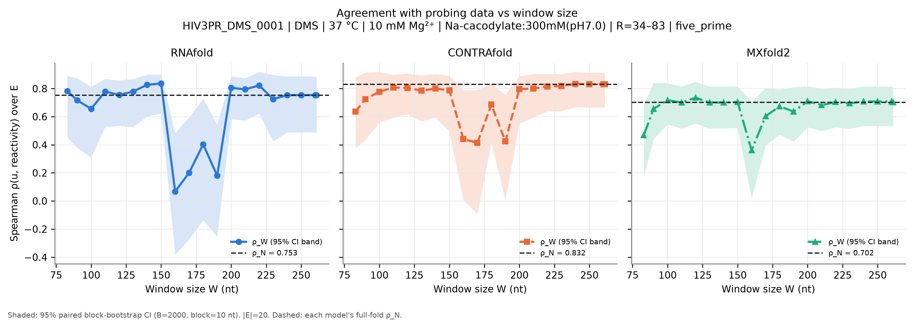

**Figure 2.** $\Delta\rho(W)$ with 95 % CI; dashed line: ε.

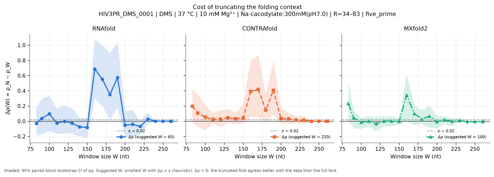

**Figure 3.** Model-internal convergence: Spearman of $u^{(W)}$ to $u^{(N)}$ over $E$ (left) and max $|\Delta u|$ over $E$ (right).

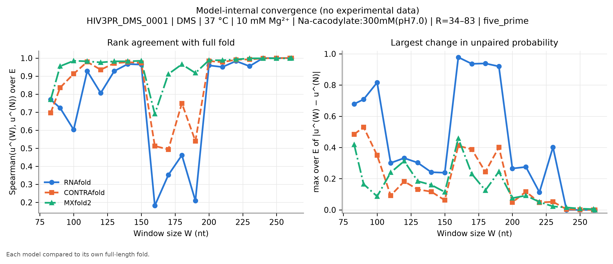

**Figure 4.** Reactivity (evaluation nucleotides dark, others grey, excluded positions ×) and $u$ for the full fold and three representative windows, one panel per model; yellow = $R$.

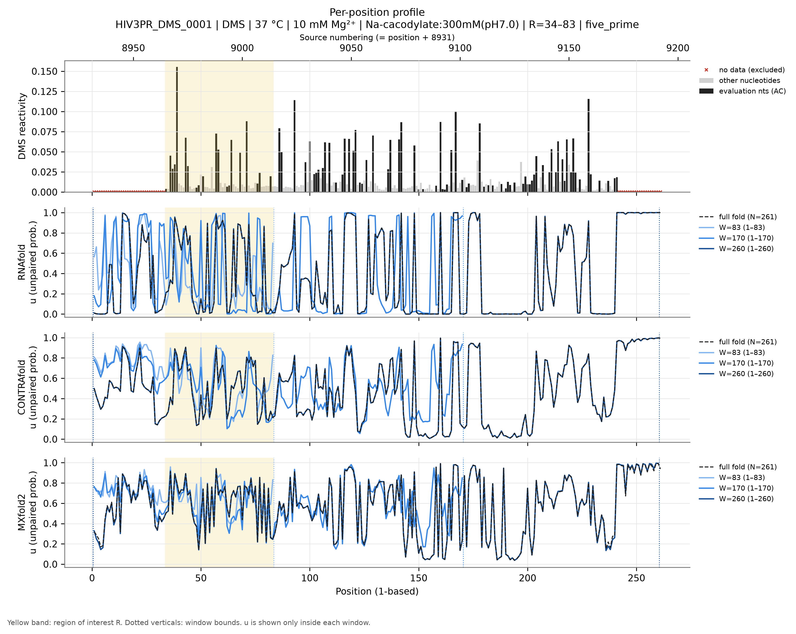

**Figure 5.** $|u_i^{(W)}-u_i^{(N)}|$; position on x, $W$ on y; grey = outside window.

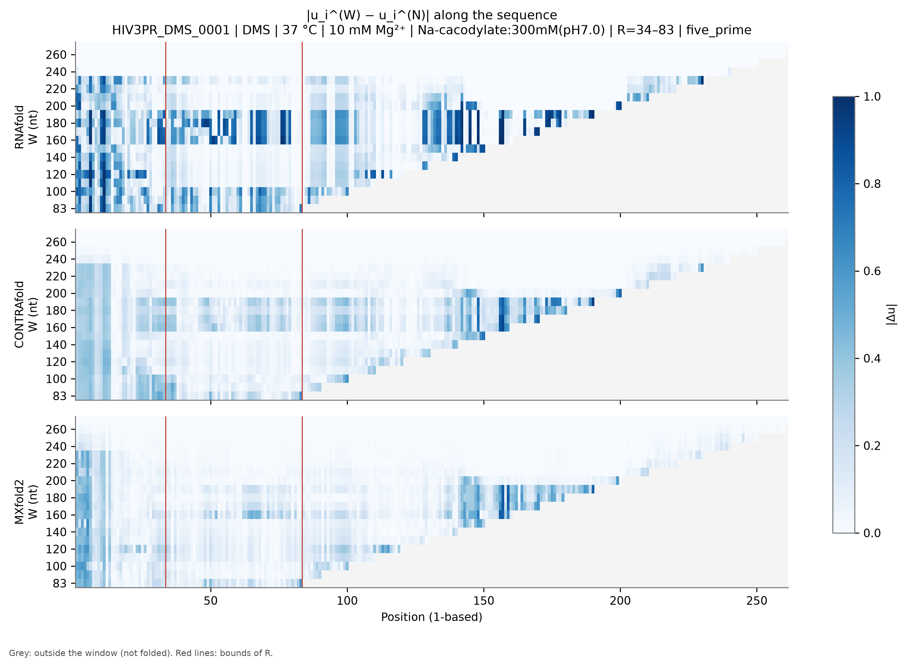

**Figure 6.** $u$ (full fold) vs reactivity over $E$, one panel per model.

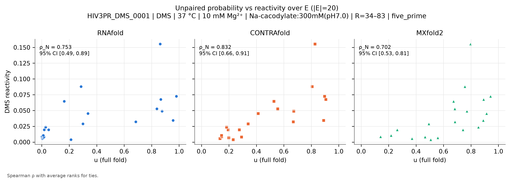

### Comparison of the three models

* **Absolute agreement (full fold):** CONTRAfold ρ_N = 0.832 [0.66, 0.91], RNAfold ρ_N = 0.753 [0.49, 0.89], MXfold2 ρ_N = 0.702 [0.53, 0.81]. Overlapping CIs mean the ranking is not resolved by these data.
* **Smallest window (W = 83):** RNAfold Δρ = -0.029 [-0.19, 0.18], CONTRAfold Δρ = 0.195 [-0.02, 0.41], MXfold2 Δρ = 0.235 [0.00, 0.52].
* **Largest Δρ over the grid:** RNAfold 0.686 at W = 160, CONTRAfold 0.418 at W = 170, MXfold2 0.341 at W = 160.
* **Internal convergence** (smallest W from which max |Δu| over E stays ≤ 0.1): RNAfold W = 240, CONTRAfold W = 220, MXfold2 W = 200.
* **RNAfold: Δρ CI excludes 0** above 0 (truncation costs agreement) at W = [160, 170, 180, 190].
* **CONTRAfold: Δρ CI excludes 0** above 0 (truncation costs agreement) at W = [160, 170, 190].
* **MXfold2: Δρ CI excludes 0** above 0 (truncation costs agreement) at W = [83].
* **Suggested W (ε = 0.02):** RNAfold W* = 83 (stable 240, CI-based 220), CONTRAfold W* = 220 (stable 220, CI-based 240), MXfold2 W* = 100 (stable 200, CI-based 240).

**Interpretation (generated from the numbers above).**
Truncation measurably reduces agreement with the data for some windows (Δρ CI above 0); W*, W*_stable and W*_CI should be read together with the convergence figures.

# Dataset RNASEP_DMS_0000

## 3. Data

* **Source:** https://rmdb.stanford.edu/detail/RNASEP_DMS_0000/ — file `RNASEP_DMS_0000.rdat` downloaded from https://github.com/DasLab/rmdb.github.io/releases/download/data-rna-structures/RNASEP_DMS_0000.rdat on 2026-11-04T17:30:19+00:00 (SHA-256 `4d90c0b47e7e5dc17cf2ded210c04dd922d315ae34a6187bfb3e83fd581c4d3c`).
* **Construct:** RNase P catalytic domain, B. stearothermophilus (265 nt), DMS mutate-and-map (data of Homan et al., PNAS 2014, reanalysed with MaP2D), WT row of the 37 °C entry.
* **Sequence:** N = 265 nt, RDAT/source numbering 1–265 (1-based position = source − 0).
* **Row used:** 1 of 266 data rows, selected by annotation match `{'annotation': {'mutation': 'WT'}}` (row annotations: `{'mutation': ['WT']}`). The selection fails loudly if it matches zero or several rows.
* **Reagent:** DMS. **Conditions (from file annotations):** 37.0 °C, Mg²⁺ 10.0 mM, buffer Na-cacodylate:300mM(pH7.0); all annotations: `Na-cacodylate:300mM(pH7.0), MgCl2:10mM`.
* **Evaluation nucleotides:** AC (reagent mapping (DMS)).
* **Excluded positions (set to NaN):** source 1-3 (1-based 1-3). Reason: Leading run of 3 exact zeros at the 5' end (no data at the read end). NaN already present in the source: none.
* **Region of interest:** source 4–53 (1-based 4–53), anchoring `five_prime`. R = 4-53: the first 50 nt with data. It contains the 5' strand of P1, whose partner is at the 3' end, so small windows cut it. The region of interest is the 5'-most stretch with data (uniform rule across datasets: first 50 nt, 100 nt for the 1266-nt HOXA9 UTR), with 5'-anchored windows mimicking the mRNA use case.
* **Evaluation set:** |E| = 22; source positions 4-5, 7-8, 11, 13, 18-19, 21, 23, 26, 29-30, 36, 39-40, 43, 45, 48-50, 53.
* **Window grid:** 53, 60, 70, 80, 90, 100, 110, 120, 130, 140, 150, 160, 170, 180, 190, 200, 210, 220, 230, 240, 250, 260, 265.

## 4. Models and parameters

| Model | Version | Parameters | Temperature | Salt | Mg²⁺ / tertiary |
|---|---|---|---|---|---|
| RNAfold | 2.7.2 | turner2004, dangles=2, partition function (`fc.pf()`, `fc.bpp()`) | 37 °C | standard 1.021 M monovalent (correction off) | not representable |
| CONTRAfold | CONTRAFold version 2.01 - RNA secondary structure prediction (bioconda package 2.02) | `contrafold predict --posteriors 1e-05`, built-in default parameters | not representable | not representable | not representable |
| MXfold2 | 0.1.2 | `mxfold2 predict --bpp`, bundled default (TrainSetAB.conf, model MixC), seed 0 | not representable | not representable | not representable |

**CONTRAfold threshold bias.** CONTRAfold only writes pairs with posterior ≥ 1e-05. Omitted pairs are counted as 'unpaired', so $u_i$ is biased **upward** by at most (number of omitted partners of $i$) × 1e-05 ≤ $(N-1)$ × 1e-05 = 0.0026 for the full fold (less for windows). **Measured on this dataset** by re-folding with threshold 1e-09: W = 53: max |Δu| = 0, |Δρ| = 0; W = 265: max |Δu| = 0, |Δρ| = 0.

**MXfold2 rounding.** MXfold2 writes $p_{ij}$ with 5 decimals; the resulting error on $u_i$ is ≤ $N\times5\cdot10^{-6}$ (≈0.001 here). Values of $u$ are clipped to [0, 1]; the maximal clipped amount per call is in `run_metadata.json`.

**Condition mismatches flagged at run time:**

* 10 mM Mg²⁺ in the experiment: no model represents Mg²⁺ or tertiary structure.
* Experiment at 37 °C: RNAfold folds at 37 °C; CONTRAfold and MXfold2 have no temperature parameter.
* Buffer Na-cacodylate:300mM(pH7.0): RNAfold uses standard 1.021 M monovalent salt (correction off); CONTRAfold/MXfold2 have no salt dependence.

## 5. Results

|E| = 22 positions. ε = 0.02. Bootstrap: B = 2000, block = 10 nt, seed = 0.

### Summary table

$\rho_W$ [95 % CI] and $\Delta\rho(W)$ [95 % CI] per model. Full numbers: `RNASEP_DMS_0000_summary.csv` (long) and `RNASEP_DMS_0000_summary_wide.csv`.

| W | window (1-based) | RNAfold ρ_W | RNAfold Δρ | CONTRAfold ρ_W | CONTRAfold Δρ | MXfold2 ρ_W | MXfold2 Δρ |
|---|---|---|---|---|---|---|---|
| 53 | 1–53 | 0.215 [-0.20, 0.73] | 0.440 [0.03, 0.69] | 0.143 [-0.36, 0.73] | 0.533 [0.04, 0.89] | 0.230 [-0.25, 0.70] | 0.320 [-0.11, 0.78] |
| 60 | 1–60 | 0.200 [-0.39, 0.75] | 0.455 [0.01, 0.79] | 0.145 [-0.34, 0.71] | 0.531 [0.06, 0.88] | 0.257 [-0.26, 0.71] | 0.292 [-0.08, 0.58] |
| 70 | 1–70 | 0.305 [-0.14, 0.71] | 0.350 [0.04, 0.56] | 0.193 [-0.34, 0.74] | 0.483 [0.04, 0.85] | 0.430 [-0.02, 0.79] | 0.120 [-0.24, 0.33] |
| 80 | 1–80 | 0.093 [-0.43, 0.71] | 0.562 [0.04, 0.87] | 0.015 [-0.49, 0.71] | 0.661 [0.04, 1.07] | 0.168 [-0.35, 0.74] | 0.382 [-0.01, 0.76] |
| 90 | 1–90 | 0.160 [-0.43, 0.72] | 0.496 [0.05, 0.80] | 0.109 [-0.47, 0.73] | 0.567 [0.03, 1.00] | 0.250 [-0.39, 0.72] | 0.299 [-0.03, 0.60] |
| 100 | 1–100 | 0.112 [-0.45, 0.72] | 0.543 [0.05, 0.85] | 0.088 [-0.50, 0.73] | 0.588 [0.03, 1.03] | 0.125 [-0.52, 0.74] | 0.425 [-0.07, 0.85] |
| 110 | 1–110 | 0.256 [-0.34, 0.82] | 0.400 [-0.03, 0.77] | 0.128 [-0.41, 0.76] | 0.548 [0.00, 0.96] | 0.120 [-0.39, 0.76] | 0.429 [-0.08, 0.88] |
| 120 | 1–120 | 0.354 [-0.16, 0.75] | 0.302 [0.01, 0.50] | 0.165 [-0.35, 0.74] | 0.510 [0.01, 0.87] | 0.311 [-0.16, 0.71] | 0.238 [-0.09, 0.47] |
| 130 | 1–130 | 0.326 [-0.25, 0.78] | 0.330 [0.01, 0.59] | 0.171 [-0.35, 0.76] | 0.505 [0.00, 0.88] | 0.283 [-0.17, 0.72] | 0.267 [-0.06, 0.54] |
| 140 | 1–140 | 0.296 [-0.24, 0.74] | 0.359 [0.02, 0.59] | 0.149 [-0.39, 0.76] | 0.527 [0.00, 0.91] | 0.167 [-0.27, 0.70] | 0.383 [0.00, 0.72] |
| 150 | 1–150 | 0.278 [-0.28, 0.76] | 0.377 [0.01, 0.63] | 0.149 [-0.39, 0.76] | 0.527 [0.00, 0.91] | 0.127 [-0.37, 0.72] | 0.422 [-0.01, 0.81] |
| 160 | 1–160 | 0.342 [-0.22, 0.80] | 0.314 [-0.02, 0.56] | 0.164 [-0.36, 0.76] | 0.512 [0.00, 0.89] | 0.259 [-0.18, 0.73] | 0.290 [-0.07, 0.59] |
| 170 | 1–170 | 0.285 [-0.27, 0.77] | 0.370 [0.02, 0.62] | 0.173 [-0.35, 0.76] | 0.503 [0.00, 0.88] | 0.228 [-0.20, 0.75] | 0.322 [-0.11, 0.68] |
| 180 | 1–180 | 0.342 [-0.22, 0.80] | 0.314 [-0.02, 0.56] | 0.164 [-0.36, 0.76] | 0.512 [0.00, 0.89] | 0.284 [-0.17, 0.72] | 0.265 [-0.06, 0.53] |
| 190 | 1–190 | 0.398 [-0.12, 0.78] | 0.257 [0.00, 0.47] | 0.211 [-0.33, 0.76] | 0.465 [0.00, 0.84] | 0.399 [-0.06, 0.75] | 0.150 [-0.17, 0.36] |
| 200 | 1–200 | 0.206 [-0.30, 0.74] | 0.449 [0.03, 0.82] | 0.232 [-0.43, 0.76] | 0.444 [-0.02, 0.98] | 0.357 [-0.10, 0.72] | 0.192 [-0.19, 0.39] |
| 210 | 1–210 | 0.250 [-0.20, 0.78] | 0.405 [-0.01, 0.64] | 0.269 [-0.35, 0.78] | 0.407 [-0.02, 0.88] | 0.248 [-0.21, 0.68] | 0.302 [-0.02, 0.56] |
| 220 | 1–220 | 0.213 [-0.29, 0.81] | 0.443 [-0.03, 0.77] | 0.264 [-0.35, 0.76] | 0.412 [0.00, 0.88] | 0.298 [-0.18, 0.70] | 0.252 [-0.04, 0.49] |
| 230 | 1–230 | 0.242 [-0.33, 0.78] | 0.413 [0.02, 0.71] | 0.252 [-0.35, 0.76] | 0.423 [0.00, 0.87] | 0.311 [-0.17, 0.71] | 0.238 [-0.05, 0.47] |
| 240 | 1–240 | 0.307 [-0.28, 0.78] | 0.349 [0.01, 0.63] | 0.269 [-0.35, 0.76] | 0.407 [0.00, 0.87] | 0.347 [-0.12, 0.71] | 0.202 [-0.10, 0.42] |
| 250 | 1–250 | 0.264 [-0.33, 0.80] | 0.392 [-0.02, 0.73] | 0.300 [-0.30, 0.76] | 0.376 [0.00, 0.82] | 0.298 [-0.28, 0.77] | 0.252 [0.00, 0.51] |
| 260 | 1–260 | 0.247 [-0.41, 0.84] | 0.409 [0.00, 0.82] | 0.170 [-0.45, 0.80] | 0.506 [0.00, 0.98] | 0.142 [-0.44, 0.80] | 0.408 [-0.02, 0.87] |
| 265 (N) | 1–265 | 0.656 [0.24, 0.85] | 0.000 [0.00, 0.00] | 0.676 [0.44, 0.85] | 0.000 [0.00, 0.00] | 0.549 [0.13, 0.87] | 0.000 [0.00, 0.00] |

### Suggested window per model (heuristic)

| Model | ρ_N [95 % CI] | W* (first Δρ ≤ ε) | W*_stable | W*_CI (upper CI ≤ ε) |
|---|---|---|---|---|
| RNAfold | 0.656 [0.24, 0.85] | 265 | 265 | 265 |
| CONTRAfold | 0.676 [0.44, 0.85] | 265 | 265 | 265 |
| MXfold2 | 0.549 [0.13, 0.87] | 265 | 265 | 265 |

### Figures

**Figure 1.** $\rho_W$ vs $W$ (lines), each model's $\rho_N$ (dotted), 95 % bootstrap CI (band).

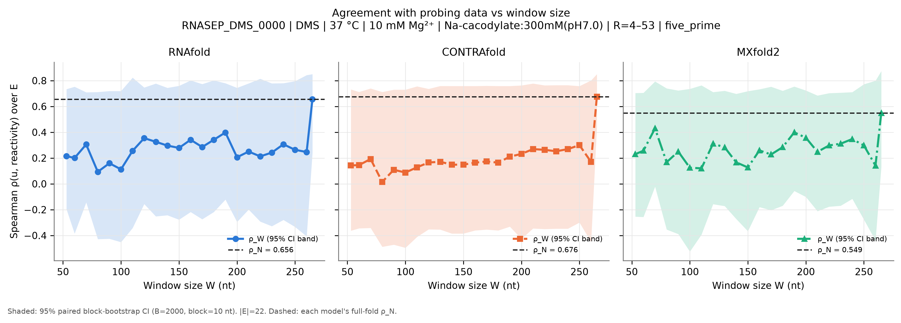

**Figure 2.** $\Delta\rho(W)$ with 95 % CI; dashed line: ε.

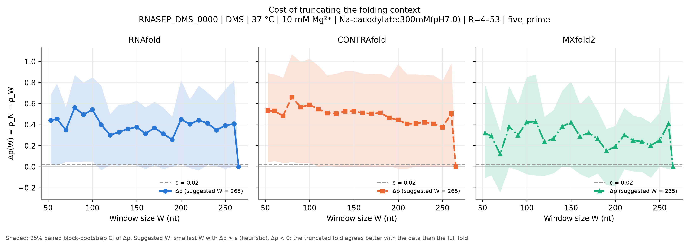

**Figure 3.** Model-internal convergence: Spearman of $u^{(W)}$ to $u^{(N)}$ over $E$ (left) and max $|\Delta u|$ over $E$ (right).

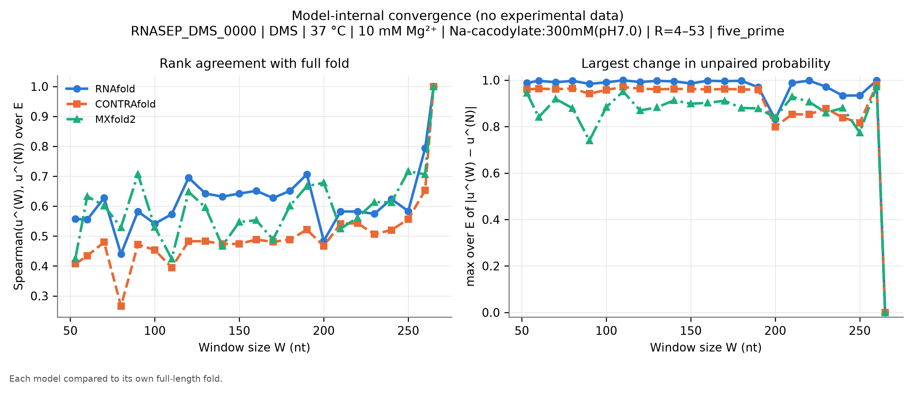

**Figure 4.** Reactivity (evaluation nucleotides dark, others grey, excluded positions ×) and $u$ for the full fold and three representative windows, one panel per model; yellow = $R$.

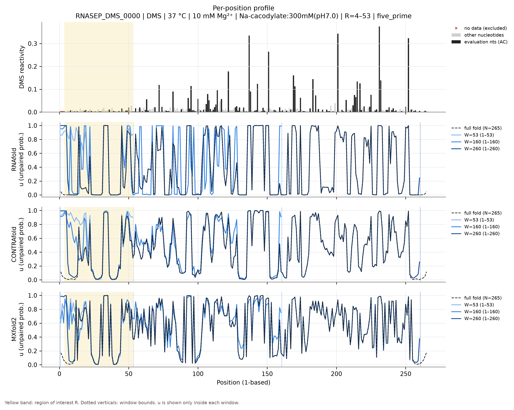

**Figure 5.** $|u_i^{(W)}-u_i^{(N)}|$; position on x, $W$ on y; grey = outside window.

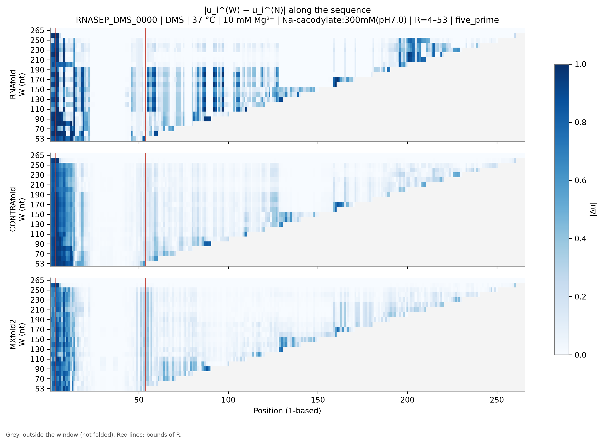

**Figure 6.** $u$ (full fold) vs reactivity over $E$, one panel per model.

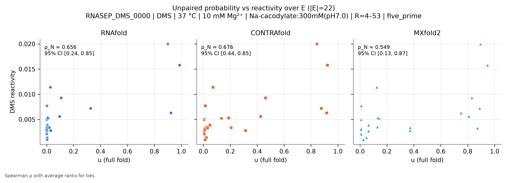

### Comparison of the three models

* **Absolute agreement (full fold):** CONTRAfold ρ_N = 0.676 [0.44, 0.85], RNAfold ρ_N = 0.656 [0.24, 0.85], MXfold2 ρ_N = 0.549 [0.13, 0.87]. Overlapping CIs mean the ranking is not resolved by these data.
* **Smallest window (W = 53):** RNAfold Δρ = 0.440 [0.03, 0.69], CONTRAfold Δρ = 0.533 [0.04, 0.89], MXfold2 Δρ = 0.320 [-0.11, 0.78].
* **Largest Δρ over the grid:** RNAfold 0.562 at W = 80, CONTRAfold 0.661 at W = 80, MXfold2 0.429 at W = 110.
* **Internal convergence** (smallest W from which max |Δu| over E stays ≤ 0.1): RNAfold W = 265, CONTRAfold W = 265, MXfold2 W = 265.
* **RNAfold: Δρ CI excludes 0** above 0 (truncation costs agreement) at W = [53, 60, 70, 80, 90, 100, 120, 130, 140, 150, 170, 190, 200, 230, 240].
* **CONTRAfold: Δρ CI excludes 0** above 0 (truncation costs agreement) at W = [53, 60, 70, 80, 90, 100, 110, 120, 130, 140, 150, 160, 170, 180, 190, 220, 230, 240, 250].
* **MXfold2:** the 95 % CI of Δρ includes 0 at every W.
* **Suggested W (ε = 0.02):** RNAfold W* = 265 (stable 265, CI-based 265), CONTRAfold W* = 265 (stable 265, CI-based 265), MXfold2 W* = 265 (stable 265, CI-based 265).

**Interpretation (generated from the numbers above).**
Truncation measurably reduces agreement with the data for some windows (Δρ CI above 0); W*, W*_stable and W*_CI should be read together with the convergence figures.

### Across datasets (Wilcoxon signed-rank on Δρ)

| Model | W | n | median Δρ | p |
|---|---|---|---|---|
| CONTRAfold | 100 | 6 | 0.036 | 0.6875 |
| CONTRAfold | 150 | 6 | -0.007 | 0.8438 |
| MXfold2 | 100 | 6 | 0.008 | 0.6875 |
| MXfold2 | 150 | 6 | 0.006 | 1.0000 |
| RNAfold | 100 | 6 | 0.001 | 0.8438 |
| RNAfold | 150 | 6 | -0.077 | 1.0000 |

## 6. Limitations

* **Reagent coverage.** DMS mainly reports on the Watson–Crick face of A and C (N1-A, N3-C); G and U carry little signal under standard conditions, so they are excluded from $E$. Conclusions hold for A/C only.
* **Physical conditions.** RNAfold's Turner parameters assume standard salt (1 M NaCl); salt correction (if enabled) is monovalent only. None of the three models represents Mg²⁺ or Mg²⁺-dependent tertiary structure, which limits the absolute $\rho$ any model can reach. Conclusions therefore rest on $\Delta\rho$ (each model vs its own full fold), not on absolute $\rho$.
* **Trained models.** CONTRAfold and MXfold2 are trained on databases of known structures, have no explicit temperature or salt dependence, and may have seen this RNA or close homologues during training, which can inflate their absolute agreement.
* **Statistics.** $|E|$ is small, so CIs are wide; neighbouring positions are correlated, which the block bootstrap only partly accounts for (block length is a choice). The ε rule is a heuristic; the grid step sets the resolution of $W^*$. Spearman ρ uses only ranks, so it is insensitive to monotone rescaling of reactivity but also ignores the magnitude of $u$.
* **Single construct.** One RNA gives one estimate of $\Delta\rho(W)$; generalisation needs several RNAs (the across-RNA Wilcoxon test becomes available when several datasets are run).
* [TRP4P6_DMS_0007] P4-P6 is not an mRNA: the test validates the method, but choosing a window for mRNAs requires mRNA probing data.
* [TRP4P6_DMS_0007] P4-P6 forms an extensive Mg2+-dependent tertiary structure (A-rich bulge, tetraloop/receptor), which none of the models capture.
* [HOXA9_STD_0000] HOXA9 data are normalised SHAPE reactivities with some negative values; Spearman ρ is unaffected by the normalisation but the noise floor is not modelled.
* [HIV3PR_DMS_0001] The HIV-1 3' UTR is a viral mRNA region, not a cellular 5' UTR.
* [RNASEP_DMS_0000] RNase P is a structured ribozyme with Mg2+-dependent tertiary structure, not an mRNA.

## 7. Reproduction

From this folder:

```bash
/home/ldibari/RNAIdea/EncoderDna/EncoderDna_env/bin/python run_test.py config_TRP4P6_DMS_0007.json config_HOXA9_STD_0000.json config_HOXA5_STD_0000.json config_CSDE1_DMS_0000.json config_HIV3PR_DMS_0001.json config_RNASEP_DMS_0000.json --out .
```

Tests and static checks:

```bash
/home/ldibari/RNAIdea/EncoderDna/EncoderDna_env/bin/python -m pytest -q tests
/home/ldibari/RNAIdea/EncoderDna/EncoderDna_env/bin/python -m ruff check . && /home/ldibari/RNAIdea/EncoderDna/EncoderDna_env/bin/python -m mypy .
```

* Environment: Python 3.12.8, NumPy 2.5.1, SciPy 1.18.1, Matplotlib 3.11.1, ViennaRNA 2.7.2, PyTorch 2.13.0+cu130 (MXfold2 backend, CPU). Full `pip freeze`, model versions, binary paths and every parameter: `run_metadata.json`.
* Bootstrap seed: 0 (`numpy.random.default_rng`). MXfold2 runs with `--seed 0` on CPU.
* Run: 2026-11-04T18:24:13+00:00 → 2026-11-04T18:46:36+00:00 (UTC).

### Files

| File | Content |
|---|---|
| `run_test.py` | CLI entry point |
| `dmswin_data.py` | Dataset dataclass, sequence/reagent handling, RDAT and CSV/TSV loaders |
| `dmswin_models.py` | RNAfold, CONTRAfold, MXfold2 wrappers (sequence → u, metadata) |
| `dmswin_analysis.py` | windows, evaluation set, Spearman, block bootstrap, suggested W |
| `dmswin_plots.py` | figures |
| `dmswin_report.py` | this README |
| `config_*.json` | dataset configs (all dataset-specific choices) |
| `*.rdat, *.provenance.json` | downloaded data + URL/date/SHA-256 |
| `summary.csv` | one row per (model, W): window, ρ_W, ρ_N, Δρ with CIs, convergence metrics |
| `summary_wide.csv` | rows = W, columns per model |
| `per_position.csv` | one row per (model, W, position): reactivity, u_W, u_N, |Δu|, flags in_R / in_E / masked |
| `run_metadata.json` | versions, parameters, windows, E, provenance, condition flags |
| `fig_*.png` | figures (300 dpi) |
| `tests/` | pytest suite |
