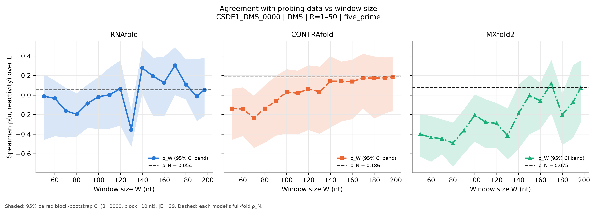
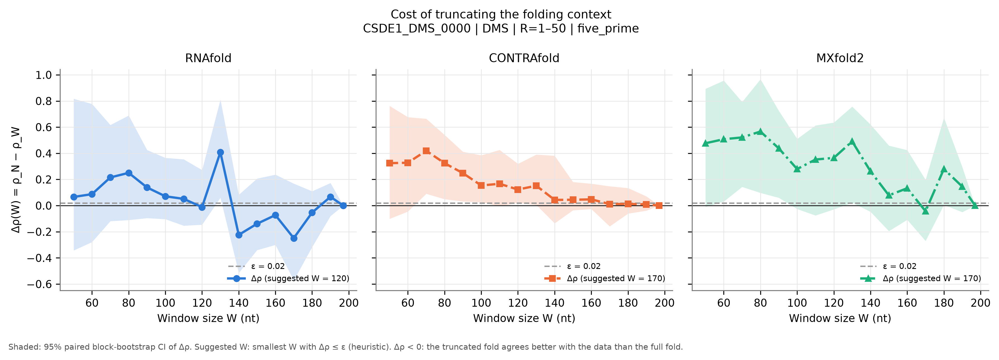
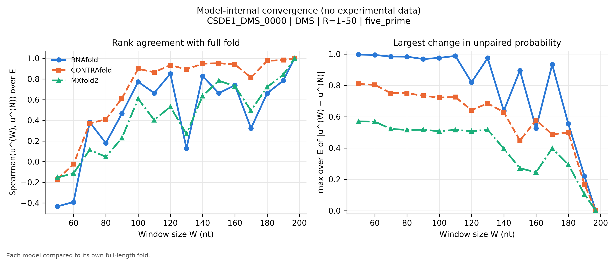
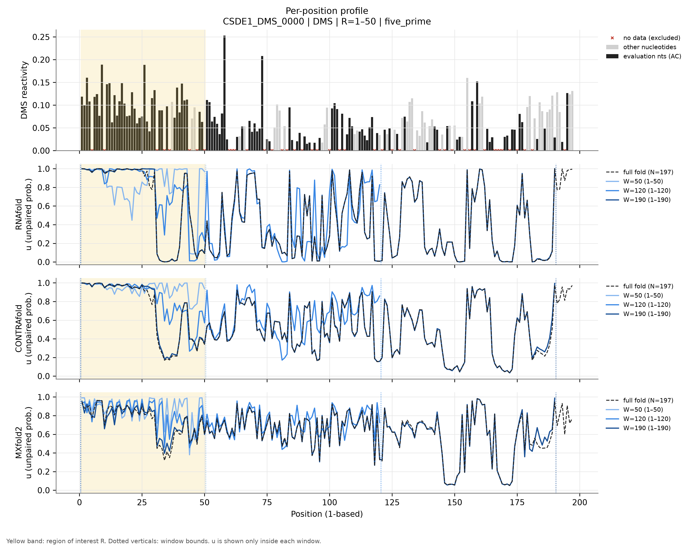
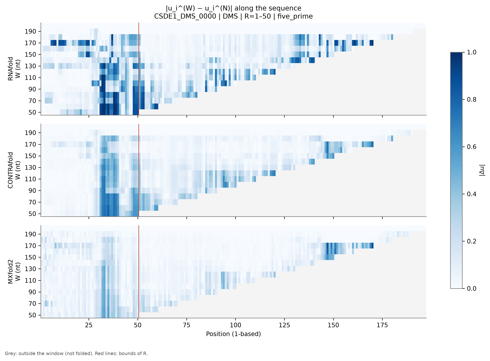
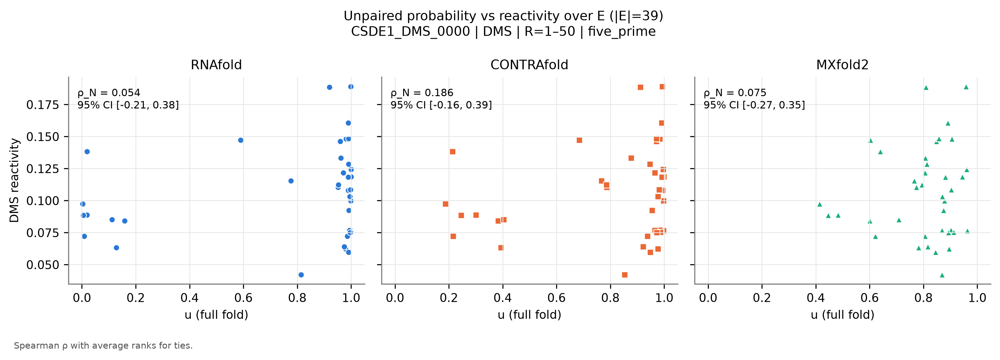

# CSDE1_DMS_0000: Csde1_190_386

*Generated by `run_test.py`. [Overview of all 8 datasets](../overview.md) · [Method](../method.md) · [README](../../README.md). Config: [`configs/config_CSDE1_DMS_0000.json`](../../configs/config_CSDE1_DMS_0000.json); outputs: [`results/CSDE1_DMS_0000/`](../../results/CSDE1_DMS_0000/).*

**In short:** N = 197 nt; RNAfold ρ_N = 0.05, W_conv = 197; CONTRAfold ρ_N = 0.19, W_conv = 197; MXfold2 ρ_N = 0.08, W_conv = 197 (W_conv: smallest window whose prediction in R matches the full fold, see [method](../method.md)).

## 1. Data

* **Source:** https://rmdb.stanford.edu/detail/CSDE1_DMS_0000/ — file [`data/CSDE1_DMS_0000.rdat`](../../data/CSDE1_DMS_0000.rdat) downloaded from https://github.com/DasLab/rmdb.github.io/releases/download/data-rna-structures/CSDE1_DMS_0000.rdat on 2026-11-04T17:28:31+00:00 (SHA-256 `fef0d9f44954e9678910bb25d66d1007deb237f2476a54e6233a6c2da2a074ab`).
* **Construct:** Csde1 mRNA fragment, nucleotides 190-386 (RMDB name 'Csde1_190_386'), DMS mutate-and-map; only the WT row is used (CSDE1_DMS_0001 is a second entry of the same design with fewer data points).
* **Sequence:** N = 197 nt, source numbering (RDAT SEQPOS) 1–197 (1-based position = source − 0).
* **Row used:** 1 of 198 data rows, selected by annotation match `{'annotation': {'mutation': 'WT'}}` (row annotations: `{'mutation': ['WT']}`). The selection fails loudly if it matches zero or several rows.
* **Reagent:** DMS. **Conditions (file annotations):** temperature not given, Mg²⁺ not given, buffer not given.
* **Evaluation nucleotides:** AC (reagent mapping (DMS)).
* **Excluded positions (set to NaN):** source none (1-based none). Reason: No extra masking: positions without data are already NaN in the RDAT. NaN already present in the source: 5, 10, 31, 34, 36, 44, 47, 50, 60-62, 67, 74, 77, 81, 83, 86, 89, 93, 95, 100, 104, 106, 118, 121, 125, 128, 134, 144, 146, 149, 154, 156, 158, 162, 166-169, 172, 175, 178, 181, 194.
* **Region of interest:** source 1–50 (1-based 1–50), anchoring `five_prime`. R = 1-50: the 5' end of the fragment. The region of interest is the 5'-most stretch with data (uniform rule across datasets: first 50 nt, 100 nt for the 1266-nt HOXA9 UTR), with 5'-anchored windows mimicking the mRNA use case.
* **Evaluation set:** |E| = 39; source positions 1-4, 6-9, 11-30, 32-33, 35, 38-43, 48-49.
* **Window grid:** 50, 60, 70, 80, 90, 100, 110, 120, 130, 140, 150, 160, 170, 180, 190, 197.
* The RDAT annotations give no temperature, buffer or Mg2+; RNAfold uses 37 °C (default) and this is flagged.
* This is an internal fragment of the mRNA, so the 'full fold' is itself a truncation of the natural transcript.

## 2. Models and parameters

| Model | Version | Parameters | Temperature | Salt | Mg²⁺ / tertiary |
|---|---|---|---|---|---|
| RNAfold | 2.7.2 | turner2004, dangles=2, partition function (`fc.pf()`, `fc.bpp()`) | 37 °C | standard 1.021 M monovalent (correction off) | not representable |
| CONTRAfold | CONTRAFold version 2.01 - RNA secondary structure prediction (bioconda package 2.02) | `contrafold predict --posteriors 1e-05`, built-in default parameters | not representable | not representable | not representable |
| MXfold2 | 0.1.2 | `mxfold2 predict --bpp`, bundled default (TrainSetAB.conf, model MixC), seed 0 | not representable | not representable | not representable |

**CONTRAfold threshold bias.** CONTRAfold only writes pairs with posterior ≥ 1e-05. Omitted pairs are counted as 'unpaired', so $u_i$ is biased **upward** by at most (number of omitted partners of $i$) × 1e-05 ≤ $(N-1)$ × 1e-05 = 0.0020 for the full fold (less for windows). **Measured on this dataset** by re-folding with threshold 1e-09: W = 50: max |Δu| = 0, |Δρ| = 0; W = 197: max |Δu| = 0, |Δρ| = 0.

**MXfold2 rounding.** MXfold2 writes $p_{ij}$ with 5 decimals; the resulting error on $u_i$ is ≤ $N\times5\cdot10^{-6}$ (≈0.001 here). Values of $u$ are clipped to [0, 1]; the maximal clipped amount per call is in `run_metadata.json`.

**Condition mismatches flagged at run time:**

* No temperature in the data annotations; RNAfold uses 37 °C (default).

## 3. Results

|E| = 39 positions. ε = 0.02. Bootstrap: B = 2000, block = 10 nt, seed = 0.

### Summary table

$\rho_W$ [95 % CI] and $\Delta\rho(W)$ [95 % CI] per model. Full numbers: [`summary.csv`](../../results/CSDE1_DMS_0000/summary.csv) (long), [`summary_wide.csv`](../../results/CSDE1_DMS_0000/summary_wide.csv) and [`per_position.csv`](../../results/CSDE1_DMS_0000/per_position.csv).

| W | window (1-based) | RNAfold ρ_W | RNAfold Δρ | CONTRAfold ρ_W | CONTRAfold Δρ | MXfold2 ρ_W | MXfold2 Δρ |
|---|---|---|---|---|---|---|---|
| 50 | 1–50 | -0.012 [-0.46, 0.21] | 0.066 [-0.34, 0.82] | -0.139 [-0.46, 0.06] | 0.324 [-0.10, 0.76] | -0.402 [-0.63, -0.19] | 0.477 [-0.01, 0.89] |
| 60 | 1–60 | -0.033 [-0.42, 0.15] | 0.087 [-0.28, 0.78] | -0.142 [-0.42, 0.08] | 0.328 [-0.05, 0.68] | -0.433 [-0.68, -0.21] | 0.508 [0.03, 0.96] |
| 70 | 1–70 | -0.161 [-0.43, 0.07] | 0.215 [-0.12, 0.62] | -0.234 [-0.54, -0.01] | 0.419 [0.09, 0.66] | -0.446 [-0.60, -0.25] | 0.521 [0.14, 0.79] |
| 80 | 1–80 | -0.196 [-0.42, 0.02] | 0.250 [-0.11, 0.69] | -0.139 [-0.49, 0.10] | 0.324 [0.05, 0.54] | -0.491 [-0.73, -0.28] | 0.566 [0.10, 0.97] |
| 90 | 1–90 | -0.085 [-0.33, 0.11] | 0.139 [-0.10, 0.43] | -0.062 [-0.41, 0.20] | 0.248 [0.03, 0.41] | -0.363 [-0.60, -0.15] | 0.438 [0.06, 0.72] |
| 100 | 1–100 | -0.017 [-0.35, 0.18] | 0.071 [-0.10, 0.37] | 0.032 [-0.39, 0.26] | 0.154 [0.03, 0.39] | -0.204 [-0.48, 0.01] | 0.280 [-0.03, 0.51] |
| 110 | 1–110 | 0.003 [-0.34, 0.28] | 0.051 [-0.15, 0.35] | 0.019 [-0.40, 0.25] | 0.167 [-0.00, 0.43] | -0.277 [-0.54, -0.04] | 0.352 [-0.08, 0.61] |
| 120 | 1–120 | 0.066 [-0.31, 0.36] | -0.012 [-0.15, 0.27] | 0.063 [-0.36, 0.30] | 0.123 [0.02, 0.32] | -0.290 [-0.54, -0.08] | 0.365 [-0.03, 0.64] |
| 130 | 1–130 | -0.354 [-0.53, -0.15] | 0.408 [0.06, 0.81] | 0.034 [-0.40, 0.29] | 0.152 [0.01, 0.39] | -0.416 [-0.66, -0.14] | 0.491 [0.02, 0.76] |
| 140 | 1–140 | 0.278 [0.01, 0.49] | -0.224 [-0.51, 0.08] | 0.142 [-0.33, 0.40] | 0.044 [-0.14, 0.38] | -0.187 [-0.55, 0.10] | 0.262 [-0.05, 0.62] |
| 150 | 1–150 | 0.193 [-0.22, 0.38] | -0.139 [-0.34, 0.21] | 0.141 [-0.27, 0.34] | 0.045 [-0.04, 0.18] | -0.003 [-0.40, 0.21] | 0.079 [-0.19, 0.46] |
| 160 | 1–160 | 0.127 [-0.22, 0.39] | -0.073 [-0.30, 0.24] | 0.138 [-0.25, 0.36] | 0.048 [-0.03, 0.17] | -0.057 [-0.35, 0.13] | 0.133 [-0.11, 0.42] |
| 170 | 1–170 | 0.303 [0.00, 0.49] | -0.249 [-0.57, 0.17] | 0.174 [-0.14, 0.42] | 0.012 [-0.16, 0.15] | 0.118 [-0.19, 0.36] | -0.043 [-0.27, 0.20] |
| 180 | 1–180 | 0.107 [-0.04, 0.37] | -0.053 [-0.32, 0.11] | 0.173 [-0.24, 0.40] | 0.013 [-0.06, 0.13] | -0.205 [-0.51, 0.01] | 0.280 [0.01, 0.67] |
| 190 | 1–190 | -0.013 [-0.27, 0.37] | 0.067 [-0.08, 0.17] | 0.176 [-0.19, 0.39] | 0.010 [-0.04, 0.07] | -0.071 [-0.44, 0.31] | 0.146 [-0.05, 0.30] |
| 197 (N) | 1–197 | 0.054 [-0.21, 0.38] | 0.000 [0.00, 0.00] | 0.186 [-0.16, 0.39] | 0.000 [0.00, 0.00] | 0.075 [-0.27, 0.35] | 0.000 [0.00, 0.00] |

### Suggested window per model (heuristic)

| Model | ρ_N [95 % CI] | W* (first Δρ ≤ ε) | W*_stable | W*_CI (upper CI ≤ ε) |
|---|---|---|---|---|
| RNAfold | 0.054 [-0.21, 0.38] | 120 | 197 | 197 |
| CONTRAfold | 0.186 [-0.16, 0.39] | 170 | 170 | 197 |
| MXfold2 | 0.075 [-0.27, 0.35] | 170 | 197 | 197 |

### Figures

**Figure 1.** $\rho_W$ vs $W$ (lines), each model's $\rho_N$ (dotted), 95 % bootstrap CI (band).

**Figure 2.** $\Delta\rho(W)$ with 95 % CI; dashed line: ε.

**Figure 3.** Model-internal convergence: Spearman of $u^{(W)}$ to $u^{(N)}$ over $E$ (left) and max $|\Delta u|$ over $E$ (right).

**Figure 4.** Reactivity (evaluation nucleotides dark, others grey, excluded positions ×) and $u$ for the full fold and three representative windows, one panel per model; yellow = $R$.

**Figure 5.** $|u_i^{(W)}-u_i^{(N)}|$; position on x, $W$ on y; grey = outside window.

**Figure 6.** $u$ (full fold) vs reactivity over $E$, one panel per model.

### Comparison of the three models

* **Absolute agreement (full fold):** CONTRAfold ρ_N = 0.186 [-0.16, 0.39], MXfold2 ρ_N = 0.075 [-0.27, 0.35], RNAfold ρ_N = 0.054 [-0.21, 0.38]. Overlapping CIs mean the ranking is not resolved by these data.
* **Smallest window (W = 50):** RNAfold Δρ = 0.066 [-0.34, 0.82], CONTRAfold Δρ = 0.324 [-0.10, 0.76], MXfold2 Δρ = 0.477 [-0.01, 0.89].
* **Largest Δρ over the grid:** RNAfold 0.408 at W = 130, CONTRAfold 0.419 at W = 70, MXfold2 0.566 at W = 80.
* **Internal convergence** (smallest W from which max |Δu| over E stays ≤ 0.1): RNAfold W = 197, CONTRAfold W = 197, MXfold2 W = 197.
* **RNAfold: Δρ CI excludes 0** above 0 (truncation costs agreement) at W = [130].
* **CONTRAfold: Δρ CI excludes 0** above 0 (truncation costs agreement) at W = [70, 80, 90, 100, 120, 130].
* **MXfold2: Δρ CI excludes 0** above 0 (truncation costs agreement) at W = [60, 70, 80, 90, 130, 180].
* **Suggested W (ε = 0.02):** RNAfold W* = 120 (stable 197, CI-based 197), CONTRAfold W* = 170 (stable 170, CI-based 197), MXfold2 W* = 170 (stable 197, CI-based 197).

**Interpretation (generated from the numbers above).**
Truncation measurably reduces agreement with the data for some windows (Δρ CI above 0); W*, W*_stable and W*_CI should be read together with the convergence figures.

## 4. Limitations

General limitations (reagent coverage, physical conditions, trained models, statistics) are in the [overview](../overview.md#limitations).
