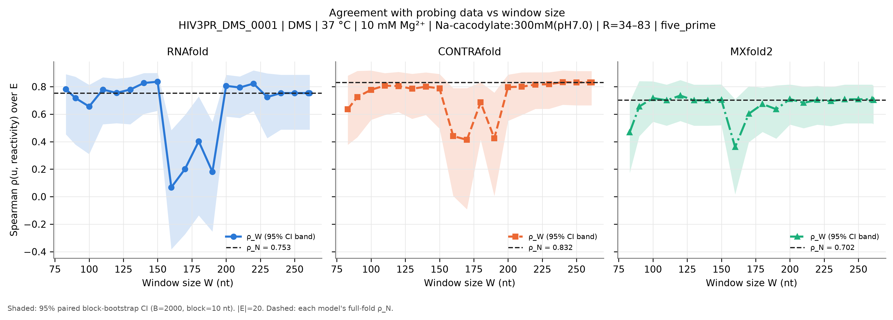
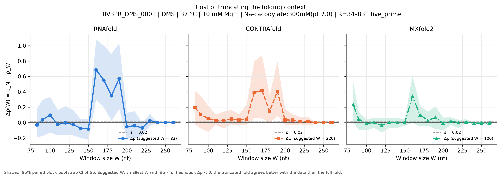
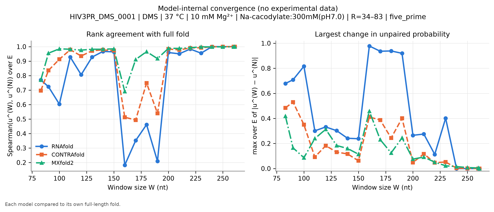
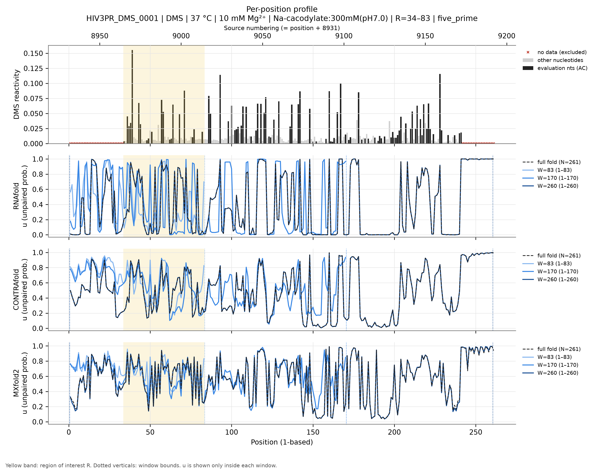
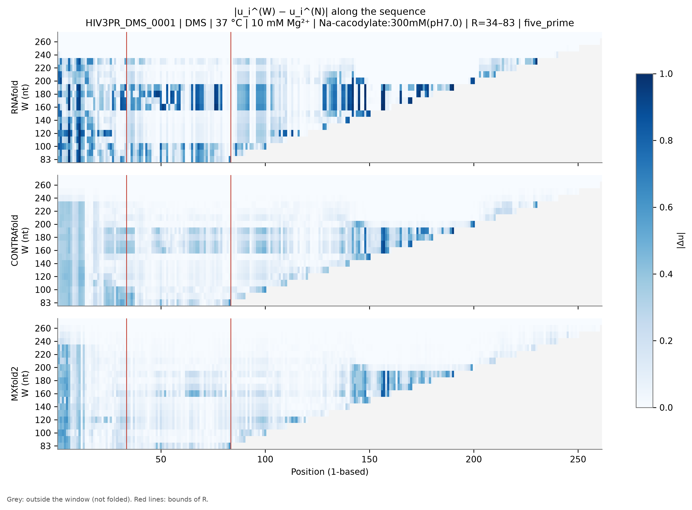
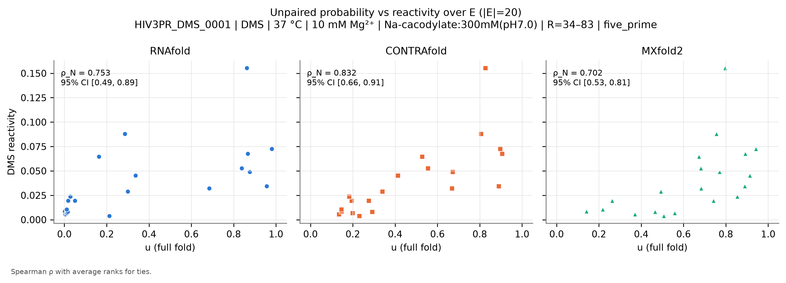

# HIV3PR_DMS_0001: HIV-1 3prime UTR (NL4-3)

*Generated by `run_test.py`. [Overview of all 8 datasets](../overview.md) · [Method](../method.md) · [README](../../README.md). Config: [`configs/config_HIV3PR_DMS_0001.json`](../../configs/config_HIV3PR_DMS_0001.json); outputs: [`results/HIV3PR_DMS_0001/`](../../results/HIV3PR_DMS_0001/).*

**In short:** N = 261 nt; RNAfold ρ_N = 0.75, W_conv = 240; CONTRAfold ρ_N = 0.83, W_conv = 220; MXfold2 ρ_N = 0.70, W_conv = 200 (W_conv: smallest window whose prediction in R matches the full fold, see [method](../method.md)).

## 1. Data

* **Source:** https://rmdb.stanford.edu/detail/HIV3PR_DMS_0001/ — file [`data/HIV3PR_DMS_0001.rdat`](../../data/HIV3PR_DMS_0001.rdat) downloaded from https://github.com/DasLab/rmdb.github.io/releases/download/data-rna-structures/HIV3PR_DMS_0001.rdat on 2026-11-04T17:29:14+00:00 (SHA-256 `a9b0dcb7adae1d1fef70efc6c1d851f264a42eca995f704532a67b8f7e066d04`).
* **Construct:** HIV-1 NL4-3 3' UTR (RDAT numbering = NL4-3 genome), DMS mutate-and-map, WT row; the version without the A20 tail (HIV3PR_DMS_0003/0004 add one).
* **Sequence:** N = 261 nt, source numbering (RDAT SEQPOS) 8932–9192 (1-based position = source − 8931).
* **Row used:** 1 of 262 data rows, selected by annotation match `{'annotation': {'mutation': 'WT'}}` (row annotations: `{'reads': ['398349'], 'mutation': ['WT']}`). The selection fails loudly if it matches zero or several rows.
* **Reagent:** DMS. **Conditions (file annotations):** temperature 37.0 °C, Mg²⁺ 10.0 mM, buffer Na-cacodylate:300mM(pH7.0); all annotations: `MgCl2:10mM, Na-cacodylate:300mM(pH7.0)`.
* **Evaluation nucleotides:** AC (reagent mapping (DMS)).
* **Excluded positions (set to NaN):** source 8932-8964, 9173-9192 (1-based 1-33, 242-261). Reason: 8932-8964: suppressed reactivity, used for priming (RDAT comment says 8931-8964; 8932 is the first position in the file). 9173-9192: the appended 20-nt Tail2 primer-binding sequence. NaN already present in the source: none.
* **Region of interest:** source 8965–9014 (1-based 34–83), anchoring `five_prime`. R = 8965-9014: the first 50 nt with data. The region of interest is the 5'-most stretch with data (uniform rule across datasets: first 50 nt, 100 nt for the 1266-nt HOXA9 UTR), with 5'-anchored windows mimicking the mRNA use case.
* **Evaluation set:** |E| = 20; source positions 8965, 8967-8970, 8974-8975, 8979-8980, 8982, 8988-8989, 8993-8995, 8999, 9002, 9007-9008, 9013.
* **Window grid:** 83, 90, 100, 110, 120, 130, 140, 150, 160, 170, 180, 190, 200, 210, 220, 230, 240, 250, 260, 261.
* Same buffer and temperature as TRP4P6_DMS_0007 (300 mM Na-cacodylate pH 7.0, 10 mM MgCl2, 37 °C).

## 2. Models and parameters

| Model | Version | Parameters | Temperature | Salt | Mg²⁺ / tertiary |
|---|---|---|---|---|---|
| RNAfold | 2.7.2 | turner2004, dangles=2, partition function (`fc.pf()`, `fc.bpp()`) | 37 °C | standard 1.021 M monovalent (correction off) | not representable |
| CONTRAfold | CONTRAFold version 2.01 - RNA secondary structure prediction (bioconda package 2.02) | `contrafold predict --posteriors 1e-05`, built-in default parameters | not representable | not representable | not representable |
| MXfold2 | 0.1.2 | `mxfold2 predict --bpp`, bundled default (TrainSetAB.conf, model MixC), seed 0 | not representable | not representable | not representable |

**CONTRAfold threshold bias.** CONTRAfold only writes pairs with posterior ≥ 1e-05. Omitted pairs are counted as 'unpaired', so $u_i$ is biased **upward** by at most (number of omitted partners of $i$) × 1e-05 ≤ $(N-1)$ × 1e-05 = 0.0026 for the full fold (less for windows). **Measured on this dataset** by re-folding with threshold 1e-09: W = 83: max |Δu| = 0, |Δρ| = 0; W = 261: max |Δu| = 0, |Δρ| = 0.

**MXfold2 rounding.** MXfold2 writes $p_{ij}$ with 5 decimals; the resulting error on $u_i$ is ≤ $N\times5\cdot10^{-6}$ (≈0.001 here). Values of $u$ are clipped to [0, 1]; the maximal clipped amount per call is in `run_metadata.json`.

**Condition mismatches flagged at run time:**

* 10 mM Mg²⁺ in the experiment: no model represents Mg²⁺ or tertiary structure.
* Experiment at 37 °C: RNAfold folds at 37 °C; CONTRAfold and MXfold2 have no temperature parameter.
* Buffer Na-cacodylate:300mM(pH7.0): RNAfold uses standard 1.021 M monovalent salt (correction off); CONTRAfold/MXfold2 have no salt dependence.

## 3. Results

|E| = 20 positions. ε = 0.02. Bootstrap: B = 2000, block = 10 nt, seed = 0.

### Summary table

$\rho_W$ [95 % CI] and $\Delta\rho(W)$ [95 % CI] per model. Full numbers: [`summary.csv`](../../results/HIV3PR_DMS_0001/summary.csv) (long), [`summary_wide.csv`](../../results/HIV3PR_DMS_0001/summary_wide.csv) and [`per_position.csv`](../../results/HIV3PR_DMS_0001/per_position.csv).

| W | window (1-based) | RNAfold ρ_W | RNAfold Δρ | CONTRAfold ρ_W | CONTRAfold Δρ | MXfold2 ρ_W | MXfold2 Δρ |
|---|---|---|---|---|---|---|---|
| 83 | 1–83 | 0.782 [0.45, 0.89] | -0.029 [-0.19, 0.18] | 0.636 [0.38, 0.88] | 0.195 [-0.02, 0.41] | 0.468 [0.17, 0.69] | 0.235 [0.00, 0.52] |
| 90 | 1–90 | 0.717 [0.38, 0.87] | 0.036 [-0.18, 0.29] | 0.725 [0.43, 0.91] | 0.107 [-0.07, 0.35] | 0.656 [0.44, 0.84] | 0.047 [-0.09, 0.14] |
| 100 | 1–100 | 0.656 [0.31, 0.81] | 0.098 [-0.13, 0.33] | 0.777 [0.56, 0.92] | 0.054 [-0.12, 0.22] | 0.717 [0.54, 0.84] | -0.015 [-0.10, 0.04] |
| 110 | 1–110 | 0.779 [0.53, 0.87] | -0.026 [-0.17, 0.17] | 0.808 [0.59, 0.90] | 0.024 [-0.03, 0.11] | 0.701 [0.52, 0.81] | 0.002 [-0.07, 0.06] |
| 120 | 1–120 | 0.755 [0.53, 0.86] | -0.002 [-0.16, 0.21] | 0.805 [0.62, 0.91] | 0.027 [-0.08, 0.14] | 0.735 [0.55, 0.85] | -0.033 [-0.13, 0.06] |
| 130 | 1–130 | 0.779 [0.53, 0.87] | -0.026 [-0.17, 0.17] | 0.785 [0.57, 0.89] | 0.047 [-0.02, 0.17] | 0.701 [0.52, 0.81] | 0.002 [-0.07, 0.06] |
| 140 | 1–140 | 0.827 [0.60, 0.90] | -0.074 [-0.20, 0.04] | 0.800 [0.59, 0.90] | 0.032 [-0.04, 0.11] | 0.701 [0.52, 0.81] | 0.002 [-0.07, 0.06] |
| 150 | 1–150 | 0.836 [0.62, 0.90] | -0.083 [-0.22, 0.04] | 0.788 [0.49, 0.89] | 0.044 [-0.03, 0.23] | 0.704 [0.52, 0.82] | -0.002 [-0.04, 0.04] |
| 160 | 1–160 | 0.068 [-0.38, 0.48] | 0.686 [0.30, 1.08] | 0.441 [0.00, 0.79] | 0.391 [0.06, 0.80] | 0.361 [0.02, 0.71] | 0.341 [-0.00, 0.62] |
| 170 | 1–170 | 0.202 [-0.27, 0.59] | 0.552 [0.20, 1.00] | 0.414 [-0.09, 0.79] | 0.418 [0.05, 0.88] | 0.603 [0.40, 0.80] | 0.099 [-0.05, 0.21] |
| 180 | 1–180 | 0.403 [-0.14, 0.73] | 0.350 [0.02, 0.90] | 0.686 [0.41, 0.83] | 0.146 [-0.00, 0.36] | 0.674 [0.47, 0.79] | 0.029 [-0.04, 0.14] |
| 190 | 1–190 | 0.180 [-0.25, 0.54] | 0.573 [0.18, 1.03] | 0.426 [0.00, 0.76] | 0.406 [0.09, 0.79] | 0.636 [0.42, 0.81] | 0.066 [-0.08, 0.21] |
| 200 | 1–200 | 0.806 [0.58, 0.89] | -0.053 [-0.21, 0.13] | 0.797 [0.55, 0.89] | 0.035 [-0.03, 0.18] | 0.710 [0.52, 0.82] | -0.008 [-0.10, 0.07] |
| 210 | 1–210 | 0.794 [0.57, 0.87] | -0.041 [-0.20, 0.15] | 0.800 [0.59, 0.90] | 0.032 [-0.04, 0.11] | 0.683 [0.50, 0.80] | 0.020 [-0.03, 0.07] |
| 220 | 1–220 | 0.823 [0.62, 0.92] | -0.069 [-0.17, 0.00] | 0.815 [0.64, 0.90] | 0.017 [-0.02, 0.07] | 0.704 [0.52, 0.81] | -0.002 [-0.07, 0.04] |
| 230 | 1–230 | 0.725 [0.43, 0.90] | 0.029 [-0.04, 0.11] | 0.818 [0.64, 0.90] | 0.014 [-0.04, 0.07] | 0.695 [0.51, 0.80] | 0.008 [0.00, 0.04] |
| 240 | 1–240 | 0.753 [0.49, 0.89] | 0.000 [0.00, 0.00] | 0.833 [0.67, 0.92] | -0.002 [-0.02, 0.00] | 0.708 [0.53, 0.82] | -0.006 [-0.02, 0.00] |
| 250 | 1–250 | 0.753 [0.49, 0.89] | 0.000 [0.00, 0.00] | 0.832 [0.66, 0.91] | 0.000 [0.00, 0.00] | 0.708 [0.53, 0.82] | -0.006 [-0.02, 0.00] |
| 260 | 1–260 | 0.753 [0.49, 0.89] | 0.000 [0.00, 0.00] | 0.832 [0.66, 0.91] | 0.000 [0.00, 0.00] | 0.708 [0.53, 0.82] | -0.006 [-0.02, 0.00] |
| 261 (N) | 1–261 | 0.753 [0.49, 0.89] | 0.000 [0.00, 0.00] | 0.832 [0.66, 0.91] | 0.000 [0.00, 0.00] | 0.702 [0.53, 0.81] | 0.000 [0.00, 0.00] |

### Suggested window per model (heuristic)

| Model | ρ_N [95 % CI] | W* (first Δρ ≤ ε) | W*_stable | W*_CI (upper CI ≤ ε) |
|---|---|---|---|---|
| RNAfold | 0.753 [0.49, 0.89] | 83 | 240 | 220 |
| CONTRAfold | 0.832 [0.66, 0.91] | 220 | 220 | 240 |
| MXfold2 | 0.702 [0.53, 0.81] | 100 | 200 | 240 |

### Figures

**Figure 1.** $\rho_W$ vs $W$ (lines), each model's $\rho_N$ (dotted), 95 % bootstrap CI (band).

**Figure 2.** $\Delta\rho(W)$ with 95 % CI; dashed line: ε.

**Figure 3.** Model-internal convergence: Spearman of $u^{(W)}$ to $u^{(N)}$ over $E$ (left) and max $|\Delta u|$ over $E$ (right).

**Figure 4.** Reactivity (evaluation nucleotides dark, others grey, excluded positions ×) and $u$ for the full fold and three representative windows, one panel per model; yellow = $R$.

**Figure 5.** $|u_i^{(W)}-u_i^{(N)}|$; position on x, $W$ on y; grey = outside window.

**Figure 6.** $u$ (full fold) vs reactivity over $E$, one panel per model.

### Comparison of the three models

* **Absolute agreement (full fold):** CONTRAfold ρ_N = 0.832 [0.66, 0.91], RNAfold ρ_N = 0.753 [0.49, 0.89], MXfold2 ρ_N = 0.702 [0.53, 0.81]. Overlapping CIs mean the ranking is not resolved by these data.
* **Smallest window (W = 83):** RNAfold Δρ = -0.029 [-0.19, 0.18], CONTRAfold Δρ = 0.195 [-0.02, 0.41], MXfold2 Δρ = 0.235 [0.00, 0.52].
* **Largest Δρ over the grid:** RNAfold 0.686 at W = 160, CONTRAfold 0.418 at W = 170, MXfold2 0.341 at W = 160.
* **Internal convergence** (smallest W from which max |Δu| over E stays ≤ 0.1): RNAfold W = 240, CONTRAfold W = 220, MXfold2 W = 200.
* **RNAfold: Δρ CI excludes 0** above 0 (truncation costs agreement) at W = [160, 170, 180, 190].
* **CONTRAfold: Δρ CI excludes 0** above 0 (truncation costs agreement) at W = [160, 170, 190].
* **MXfold2: Δρ CI excludes 0** above 0 (truncation costs agreement) at W = [83].
* **Suggested W (ε = 0.02):** RNAfold W* = 83 (stable 240, CI-based 220), CONTRAfold W* = 220 (stable 220, CI-based 240), MXfold2 W* = 100 (stable 200, CI-based 240).

**Interpretation (generated from the numbers above).**
Truncation measurably reduces agreement with the data for some windows (Δρ CI above 0); W*, W*_stable and W*_CI should be read together with the convergence figures.

## 4. Limitations

General limitations (reagent coverage, physical conditions, trained models, statistics) are in the [overview](../overview.md#limitations).
 Specific to this dataset:

* The HIV-1 3' UTR is a viral mRNA region, not a cellular 5' UTR.
