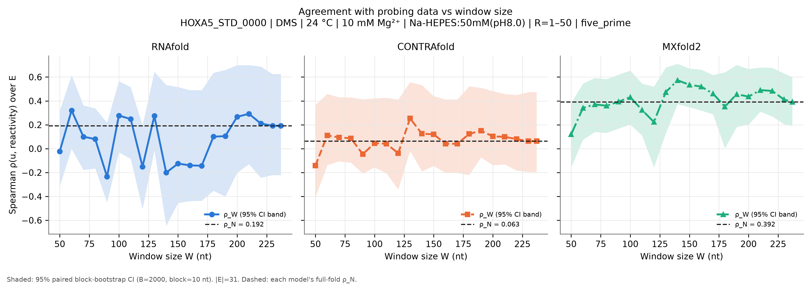
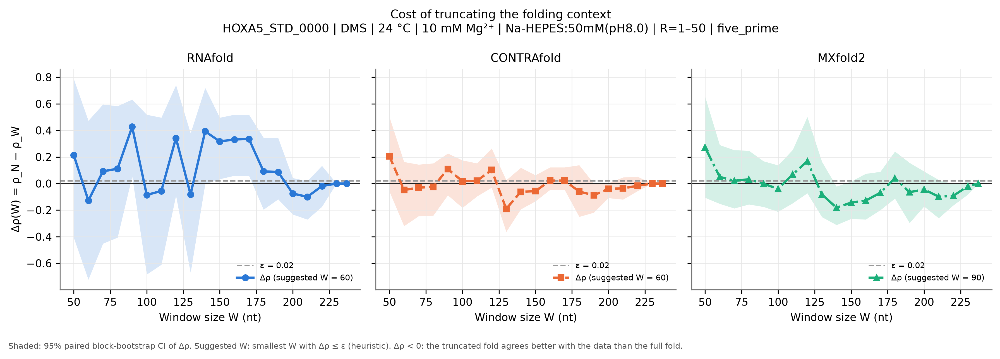
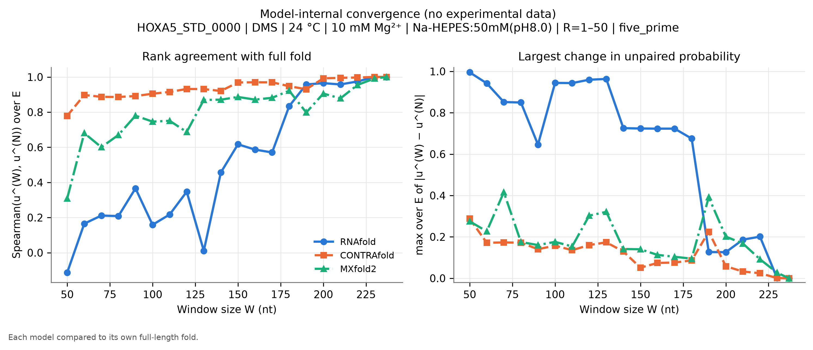
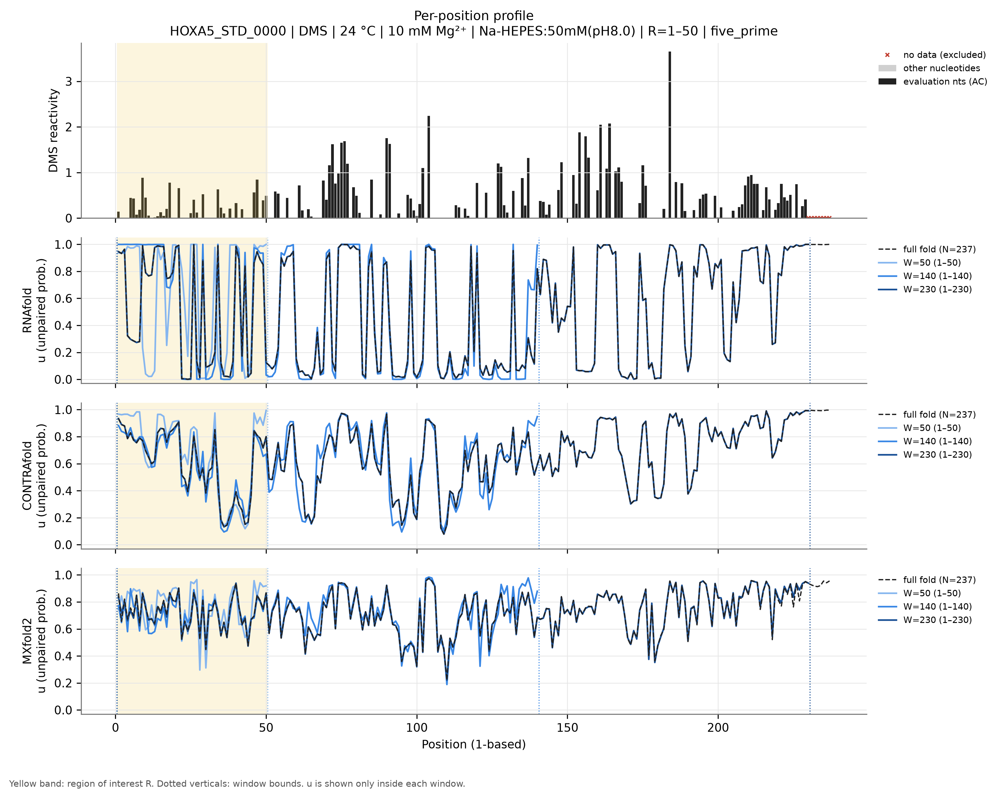
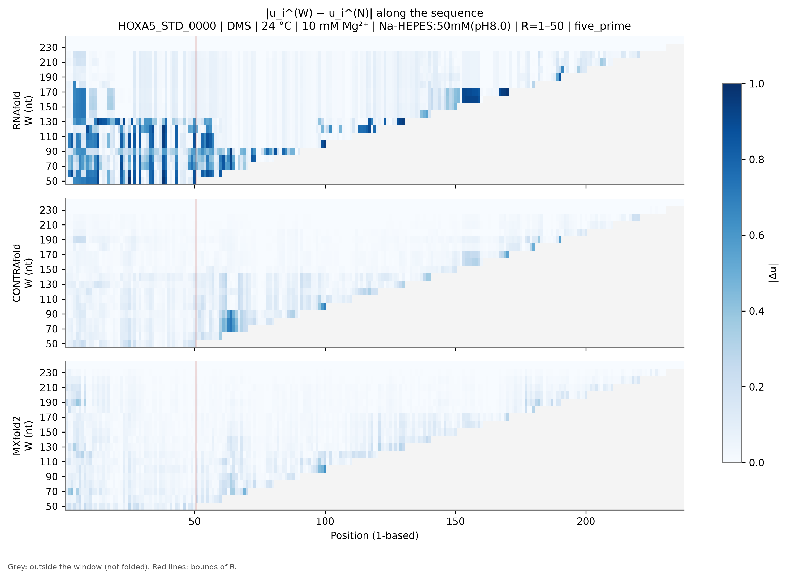
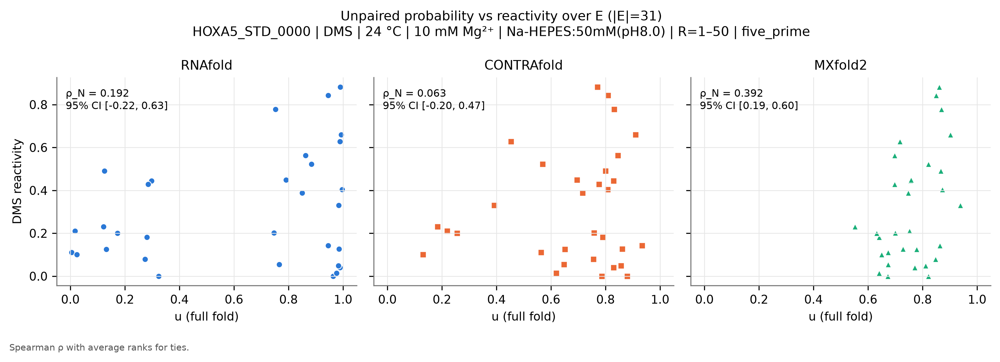

# HOXA5_STD_0000: Hox A5 mRNA 5' UTR

*Generated by `run_test.py`. [Overview of all 8 datasets](../overview.md) · [Method](../method.md) · [README](../../README.md). Config: [`configs/config_HOXA5_STD_0000.json`](../../configs/config_HOXA5_STD_0000.json); outputs: [`results/HOXA5_STD_0000/`](../../results/HOXA5_STD_0000/).*

**In short:** N = 237 nt; RNAfold ρ_N = 0.19, W_conv = 230; CONTRAfold ρ_N = 0.06, W_conv = 200; MXfold2 ρ_N = 0.39, W_conv = 220 (W_conv: smallest window whose prediction in R matches the full fold, see [method](../method.md)).

## 1. Data

* **Source:** https://rmdb.stanford.edu/detail/HOXA5_STD_0000/ — file [`data/HOXA5_STD_0000.rdat`](../../data/HOXA5_STD_0000.rdat) downloaded from https://github.com/DasLab/rmdb.github.io/releases/download/data-rna-structures/HOXA5_STD_0000.rdat on 2026-11-04T17:27:35+00:00 (SHA-256 `c6ce4224152eac930e9ca6d597c4e9eee22319e8dd344b0374755b39e6a8f5f0`).
* **Construct:** Hox A5 mRNA 5' UTR (237 nt); the DMS, PAGE-purified row (row 4 of 4: rows 1/3 are 1M7, row 2 DMS non-PAGE).
* **Sequence:** N = 237 nt, source numbering (RDAT SEQPOS) 1–237 (1-based position = source − 0).
* **Row used:** 4 of 4 data rows, selected by annotation match `{'annotation': {'modifier': 'DMS', 'sequenceSource': 'PAGE'}}` (row annotations: `{'modifier': ['DMS'], 'sequenceSource': ['PAGE'], 'MAPseq': ['ligSHAPE']}`). The selection fails loudly if it matches zero or several rows.
* **Reagent:** DMS. **Conditions (file annotations):** temperature 24.0 °C, Mg²⁺ 10.0 mM, buffer Na-HEPES:50mM(pH8.0); all annotations: `Na-HEPES:50mM(pH8.0), MgCl2:10mM`.
* **Evaluation nucleotides:** AC (reagent mapping (DMS)).
* **Excluded positions (set to NaN):** source 230-237 (1-based 230-237). Reason: Trailing run of 8 exact zeros at the 3' end (no data at the read end). NaN already present in the source: none.
* **Region of interest:** source 1–50 (1-based 1–50), anchoring `five_prime`. R = 1-50: the 5' end of the UTR. The region of interest is the 5'-most stretch with data (uniform rule across datasets: first 50 nt, 100 nt for the 1266-nt HOXA9 UTR), with 5'-anchored windows mimicking the mRNA use case.
* **Evaluation set:** |E| = 31; source positions 1, 3-11, 13-18, 21, 25-27, 29, 34-36, 38, 40, 42, 46-47, 49-50.
* **Window grid:** 50, 60, 70, 80, 90, 100, 110, 120, 130, 140, 150, 160, 170, 180, 190, 200, 210, 220, 230, 237.
* RNA was heat-denatured, then folded at 37 °C for 20 min with 10 mM MgCl2; annotated probing temperature 24 °C.
* DMS data are normalised so that G/U are 0; G/U are outside E anyway.

## 2. Models and parameters

| Model | Version | Parameters | Temperature | Salt | Mg²⁺ / tertiary |
|---|---|---|---|---|---|
| RNAfold | 2.7.2 | turner2004, dangles=2, partition function (`fc.pf()`, `fc.bpp()`) | 24 °C | standard 1.021 M monovalent (correction off) | not representable |
| CONTRAfold | CONTRAFold version 2.01 - RNA secondary structure prediction (bioconda package 2.02) | `contrafold predict --posteriors 1e-05`, built-in default parameters | not representable | not representable | not representable |
| MXfold2 | 0.1.2 | `mxfold2 predict --bpp`, bundled default (TrainSetAB.conf, model MixC), seed 0 | not representable | not representable | not representable |

**CONTRAfold threshold bias.** CONTRAfold only writes pairs with posterior ≥ 1e-05. Omitted pairs are counted as 'unpaired', so $u_i$ is biased **upward** by at most (number of omitted partners of $i$) × 1e-05 ≤ $(N-1)$ × 1e-05 = 0.0024 for the full fold (less for windows). **Measured on this dataset** by re-folding with threshold 1e-09: W = 50: max |Δu| = 0, |Δρ| = 0; W = 237: max |Δu| = 0, |Δρ| = 0.

**MXfold2 rounding.** MXfold2 writes $p_{ij}$ with 5 decimals; the resulting error on $u_i$ is ≤ $N\times5\cdot10^{-6}$ (≈0.001 here). Values of $u$ are clipped to [0, 1]; the maximal clipped amount per call is in `run_metadata.json`.

**Condition mismatches flagged at run time:**

* 10 mM Mg²⁺ in the experiment: no model represents Mg²⁺ or tertiary structure.
* Experiment at 24 °C: RNAfold folds at 24 °C; CONTRAfold and MXfold2 have no temperature parameter.
* Buffer Na-HEPES:50mM(pH8.0): RNAfold uses standard 1.021 M monovalent salt (correction off); CONTRAfold/MXfold2 have no salt dependence.

## 3. Results

|E| = 31 positions. ε = 0.02. Bootstrap: B = 2000, block = 10 nt, seed = 0.

### Summary table

$\rho_W$ [95 % CI] and $\Delta\rho(W)$ [95 % CI] per model. Full numbers: [`summary.csv`](../../results/HOXA5_STD_0000/summary.csv) (long), [`summary_wide.csv`](../../results/HOXA5_STD_0000/summary_wide.csv) and [`per_position.csv`](../../results/HOXA5_STD_0000/per_position.csv).

| W | window (1-based) | RNAfold ρ_W | RNAfold Δρ | CONTRAfold ρ_W | CONTRAfold Δρ | MXfold2 ρ_W | MXfold2 Δρ |
|---|---|---|---|---|---|---|---|
| 50 | 1–50 | -0.023 [-0.31, 0.32] | 0.215 [-0.41, 0.79] | -0.142 [-0.41, 0.37] | 0.205 [-0.06, 0.50] | 0.120 [-0.16, 0.38] | 0.272 [-0.11, 0.65] |
| 60 | 1–60 | 0.320 [-0.00, 0.62] | -0.128 [-0.72, 0.47] | 0.112 [-0.14, 0.46] | -0.048 [-0.32, 0.16] | 0.341 [0.07, 0.55] | 0.050 [-0.15, 0.29] |
| 70 | 1–70 | 0.100 [-0.18, 0.36] | 0.092 [-0.45, 0.60] | 0.094 [-0.11, 0.43] | -0.031 [-0.25, 0.14] | 0.371 [0.14, 0.59] | 0.020 [-0.19, 0.25] |
| 80 | 1–80 | 0.081 [-0.17, 0.34] | 0.111 [-0.41, 0.58] | 0.087 [-0.12, 0.43] | -0.024 [-0.24, 0.15] | 0.360 [0.13, 0.58] | 0.032 [-0.16, 0.25] |
| 90 | 1–90 | -0.235 [-0.45, 0.22] | 0.427 [0.05, 0.63] | -0.046 [-0.21, 0.41] | 0.109 [-0.09, 0.23] | 0.393 [0.17, 0.62] | -0.002 [-0.18, 0.17] |
| 100 | 1–100 | 0.278 [-0.03, 0.57] | -0.086 [-0.68, 0.52] | 0.046 [-0.16, 0.42] | 0.017 [-0.18, 0.17] | 0.431 [0.20, 0.65] | -0.040 [-0.21, 0.14] |
| 110 | 1–110 | 0.248 [-0.09, 0.52] | -0.056 [-0.61, 0.50] | 0.042 [-0.21, 0.43] | 0.021 [-0.10, 0.15] | 0.323 [0.11, 0.54] | 0.068 [-0.15, 0.25] |
| 120 | 1–120 | -0.151 [-0.50, 0.19] | 0.343 [-0.09, 0.74] | -0.039 [-0.34, 0.41] | 0.102 [-0.03, 0.26] | 0.223 [-0.16, 0.52] | 0.168 [-0.07, 0.50] |
| 130 | 1–130 | 0.274 [-0.01, 0.64] | -0.082 [-0.67, 0.38] | 0.254 [-0.02, 0.56] | -0.191 [-0.36, 0.03] | 0.473 [0.13, 0.68] | -0.082 [-0.25, 0.16] |
| 140 | 1–140 | -0.201 [-0.65, 0.53] | 0.393 [-0.00, 0.72] | 0.125 [-0.19, 0.53] | -0.062 [-0.19, 0.12] | 0.573 [0.37, 0.71] | -0.182 [-0.31, -0.02] |
| 150 | 1–150 | -0.125 [-0.45, 0.52] | 0.317 [0.03, 0.50] | 0.121 [-0.14, 0.44] | -0.057 [-0.13, 0.06] | 0.535 [0.35, 0.67] | -0.144 [-0.27, 0.02] |
| 160 | 1–160 | -0.140 [-0.44, 0.49] | 0.332 [0.06, 0.52] | 0.041 [-0.20, 0.41] | 0.022 [-0.05, 0.12] | 0.520 [0.32, 0.66] | -0.128 [-0.27, 0.07] |
| 170 | 1–170 | -0.143 [-0.44, 0.49] | 0.335 [0.06, 0.52] | 0.041 [-0.20, 0.41] | 0.022 [-0.05, 0.12] | 0.461 [0.29, 0.62] | -0.069 [-0.20, 0.09] |
| 180 | 1–180 | 0.101 [-0.35, 0.64] | 0.091 [-0.20, 0.34] | 0.123 [-0.22, 0.52] | -0.060 [-0.25, 0.14] | 0.352 [0.00, 0.64] | 0.040 [-0.11, 0.24] |
| 190 | 1–190 | 0.105 [-0.40, 0.66] | 0.087 [-0.12, 0.34] | 0.151 [-0.07, 0.51] | -0.088 [-0.22, 0.00] | 0.456 [0.18, 0.70] | -0.065 [-0.30, 0.16] |
| 200 | 1–200 | 0.267 [-0.20, 0.70] | -0.075 [-0.23, 0.04] | 0.103 [-0.14, 0.48] | -0.040 [-0.11, 0.00] | 0.436 [0.20, 0.67] | -0.045 [-0.17, 0.09] |
| 210 | 1–210 | 0.292 [-0.13, 0.70] | -0.100 [-0.27, 0.02] | 0.099 [-0.13, 0.46] | -0.036 [-0.12, 0.05] | 0.491 [0.31, 0.68] | -0.099 [-0.26, 0.03] |
| 220 | 1–220 | 0.211 [-0.24, 0.69] | -0.019 [-0.17, 0.13] | 0.080 [-0.18, 0.45] | -0.017 [-0.06, 0.05] | 0.484 [0.27, 0.68] | -0.092 [-0.16, -0.00] |
| 230 | 1–230 | 0.192 [-0.22, 0.63] | 0.000 [0.00, 0.00] | 0.063 [-0.20, 0.47] | 0.000 [0.00, 0.00] | 0.412 [0.21, 0.63] | -0.020 [-0.08, 0.01] |
| 237 (N) | 1–237 | 0.192 [-0.22, 0.63] | 0.000 [0.00, 0.00] | 0.063 [-0.20, 0.47] | 0.000 [0.00, 0.00] | 0.392 [0.19, 0.60] | 0.000 [0.00, 0.00] |

### Suggested window per model (heuristic)

| Model | ρ_N [95 % CI] | W* (first Δρ ≤ ε) | W*_stable | W*_CI (upper CI ≤ ε) |
|---|---|---|---|---|
| RNAfold | 0.192 [-0.22, 0.63] | 60 | 200 | 210 |
| CONTRAfold | 0.063 [-0.20, 0.47] | 60 | 180 | 190 |
| MXfold2 | 0.392 [0.19, 0.60] | 90 | 190 | 140 |

### Figures

**Figure 1.** $\rho_W$ vs $W$ (lines), each model's $\rho_N$ (dotted), 95 % bootstrap CI (band).

**Figure 2.** $\Delta\rho(W)$ with 95 % CI; dashed line: ε.

**Figure 3.** Model-internal convergence: Spearman of $u^{(W)}$ to $u^{(N)}$ over $E$ (left) and max $|\Delta u|$ over $E$ (right).

**Figure 4.** Reactivity (evaluation nucleotides dark, others grey, excluded positions ×) and $u$ for the full fold and three representative windows, one panel per model; yellow = $R$.

**Figure 5.** $|u_i^{(W)}-u_i^{(N)}|$; position on x, $W$ on y; grey = outside window.

**Figure 6.** $u$ (full fold) vs reactivity over $E$, one panel per model.

### Comparison of the three models

* **Absolute agreement (full fold):** MXfold2 ρ_N = 0.392 [0.19, 0.60], RNAfold ρ_N = 0.192 [-0.22, 0.63], CONTRAfold ρ_N = 0.063 [-0.20, 0.47]. Overlapping CIs mean the ranking is not resolved by these data.
* **Smallest window (W = 50):** RNAfold Δρ = 0.215 [-0.41, 0.79], CONTRAfold Δρ = 0.205 [-0.06, 0.50], MXfold2 Δρ = 0.272 [-0.11, 0.65].
* **Largest Δρ over the grid:** RNAfold 0.427 at W = 90, CONTRAfold 0.205 at W = 50, MXfold2 0.272 at W = 50.
* **Internal convergence** (smallest W from which max |Δu| over E stays ≤ 0.1): RNAfold W = 230, CONTRAfold W = 200, MXfold2 W = 220.
* **RNAfold: Δρ CI excludes 0** above 0 (truncation costs agreement) at W = [90, 150, 160, 170].
* **CONTRAfold:** the 95 % CI of Δρ includes 0 at every W.
* **MXfold2: Δρ CI excludes 0** below 0 (truncated fold agrees *better* with data) at W = [140, 220].
* **Suggested W (ε = 0.02):** RNAfold W* = 60 (stable 200, CI-based 210), CONTRAfold W* = 60 (stable 180, CI-based 190), MXfold2 W* = 90 (stable 190, CI-based 140).

**Interpretation (generated from the numbers above).**
Truncation measurably reduces agreement with the data for some windows (Δρ CI above 0); W*, W*_stable and W*_CI should be read together with the convergence figures.

## 4. Limitations

General limitations (reagent coverage, physical conditions, trained models, statistics) are in the [overview](../overview.md#limitations).
