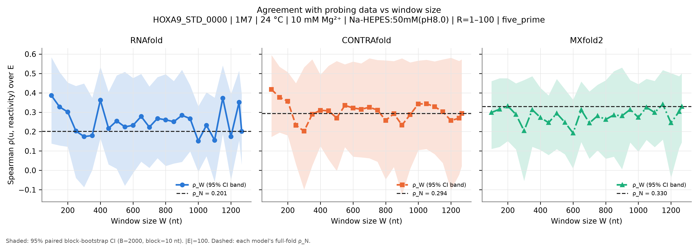
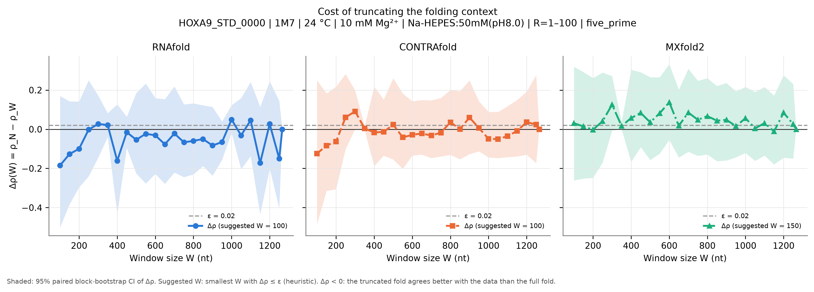
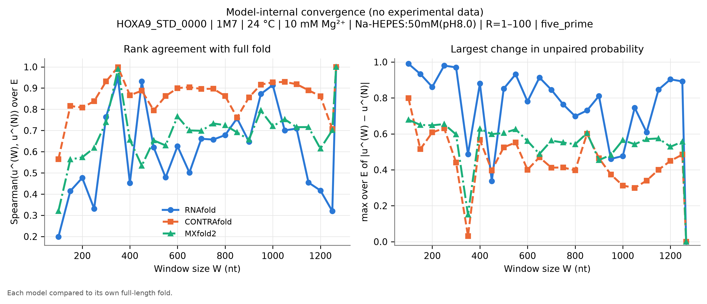
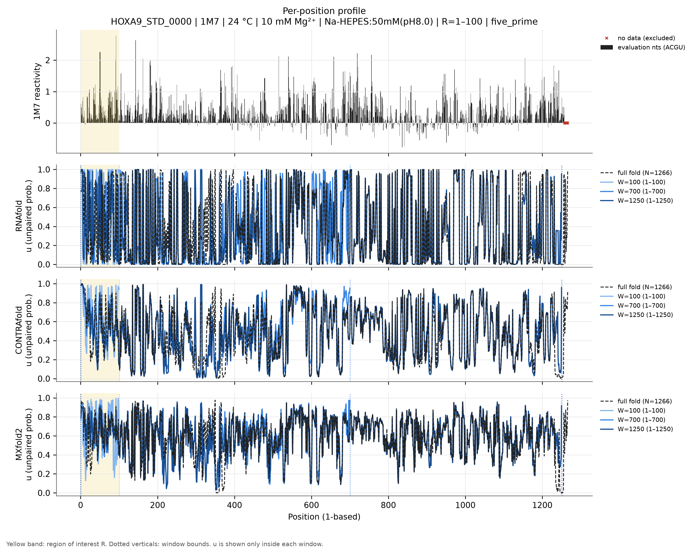
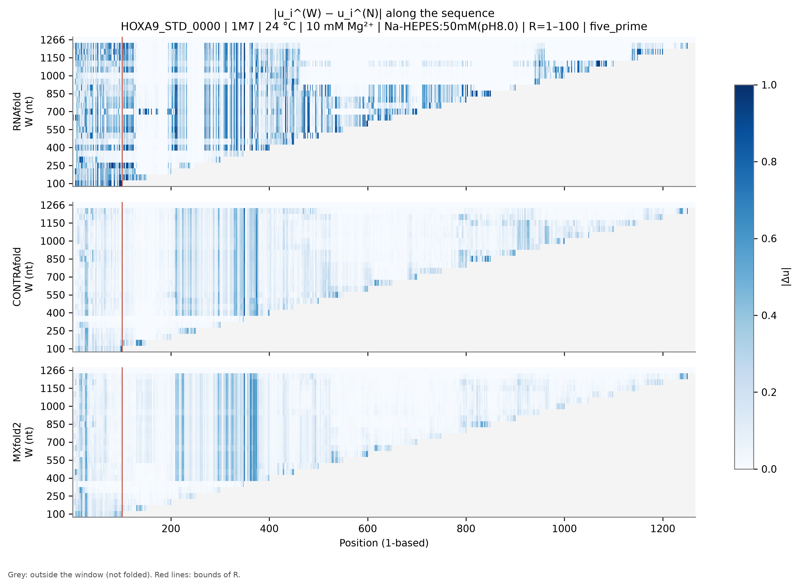
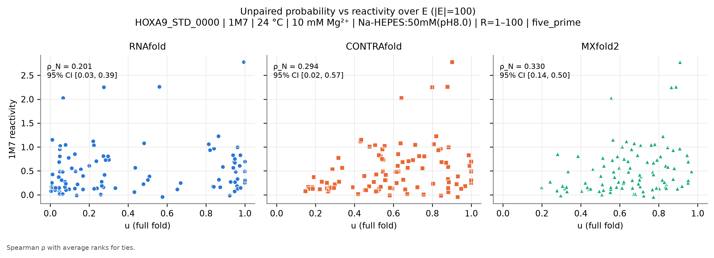

# HOXA9_STD_0000: Hox A9 mRNA 5' UTR

*Generated by `run_test.py`. [Overview of all 8 datasets](../overview.md) · [Method](../method.md) · [README](../../README.md). Config: [`configs/config_HOXA9_STD_0000.json`](../../configs/config_HOXA9_STD_0000.json); outputs: [`results/HOXA9_STD_0000/`](../../results/HOXA9_STD_0000/).*

**In short:** N = 1266 nt; RNAfold ρ_N = 0.20, W_conv = 1266; CONTRAfold ρ_N = 0.29, W_conv = 1266; MXfold2 ρ_N = 0.33, W_conv = 1266 (W_conv: smallest window whose prediction in R matches the full fold, see [method](../method.md)).

## 1. Data

* **Source:** https://rmdb.stanford.edu/detail/HOXA9_STD_0000/ — file [`data/HOXA9_STD_0000.rdat`](../../data/HOXA9_STD_0000.rdat) downloaded from https://github.com/DasLab/rmdb.github.io/releases/download/data-rna-structures/HOXA9_STD_0000.rdat on 2026-11-04T17:32:31+00:00 (SHA-256 `1ee9008cd773b2b76a789cb0bddbb59bc677823360ece4404facfdffe1cad7ee`).
* **Construct:** Hox A9 mRNA 5' UTR (1266 nt), 1M7 SHAPE, ligation-based readout (ligSHAPE), PAGE-purified RNA (row 1 of 2; row 2 is non-PAGE). Data were normalised over a 350-nt window (file comment).
* **Sequence:** N = 1266 nt, source numbering (RDAT SEQPOS) 1–1266 (1-based position = source − 0).
* **Row used:** 1 of 2 data rows, selected by annotation match `{'annotation': {'sequenceSource': 'PAGE'}}` (row annotations: `{'modifier': ['1M7'], 'sequenceSource': ['PAGE'], 'MAPseq': ['ligSHAPE']}`). The selection fails loudly if it matches zero or several rows.
* **Reagent:** 1M7. **Conditions (file annotations):** temperature 24.0 °C, Mg²⁺ 10.0 mM, buffer Na-HEPES:50mM(pH8.0); all annotations: `Na-HEPES:50mM(pH8.0), MgCl2:10mM`.
* **Evaluation nucleotides:** ACGU (reagent mapping (1M7)).
* **Excluded positions (set to NaN):** source 1258-1266 (1-based 1258-1266). Reason: Trailing run of 9 exact zeros at the 3' end (no data at the read end). NaN already present in the source: none.
* **Region of interest:** source 1–100 (1-based 1–100), anchoring `five_prime`. R = 1-100: the 5' end of the UTR. The region of interest is the 5'-most stretch with data (uniform rule across datasets: first 50 nt, 100 nt for the 1266-nt HOXA9 UTR), with 5'-anchored windows mimicking the mRNA use case.
* **Evaluation set:** |E| = 100; source positions 1-100.
* **Window grid:** 100, 150, 200, 250, 300, 350, 400, 450, 500, 550, 600, 650, 700, 750, 800, 850, 900, 950, 1000, 1050, 1100, 1150, 1200, 1250, 1266.
* RNA was heat-denatured, then folded at 37 °C for 20 min with 10 mM MgCl2; the annotated probing temperature is 24 °C. RNAfold folds at the annotated 24 °C.
* SHAPE reagent: all four nucleotides enter E.
* Window grid step is 50 nt because MXfold2 needs ~100 s per full-length fold.

## 2. Models and parameters

| Model | Version | Parameters | Temperature | Salt | Mg²⁺ / tertiary |
|---|---|---|---|---|---|
| RNAfold | 2.7.2 | turner2004, dangles=2, partition function (`fc.pf()`, `fc.bpp()`) | 24 °C | standard 1.021 M monovalent (correction off) | not representable |
| CONTRAfold | CONTRAFold version 2.01 - RNA secondary structure prediction (bioconda package 2.02) | `contrafold predict --posteriors 1e-05`, built-in default parameters | not representable | not representable | not representable |
| MXfold2 | 0.1.2 | `mxfold2 predict --bpp`, bundled default (TrainSetAB.conf, model MixC), seed 0 | not representable | not representable | not representable |

**CONTRAfold threshold bias.** CONTRAfold only writes pairs with posterior ≥ 1e-05. Omitted pairs are counted as 'unpaired', so $u_i$ is biased **upward** by at most (number of omitted partners of $i$) × 1e-05 ≤ $(N-1)$ × 1e-05 = 0.0127 for the full fold (less for windows). **Measured on this dataset** by re-folding with threshold 1e-09: W = 100: max |Δu| = 0, |Δρ| = 0; W = 1266: max |Δu| = 0, |Δρ| = 0.

**MXfold2 rounding.** MXfold2 writes $p_{ij}$ with 5 decimals; the resulting error on $u_i$ is ≤ $N\times5\cdot10^{-6}$ (≈0.001 here). Values of $u$ are clipped to [0, 1]; the maximal clipped amount per call is in `run_metadata.json`.

**Condition mismatches flagged at run time:**

* 10 mM Mg²⁺ in the experiment: no model represents Mg²⁺ or tertiary structure.
* Experiment at 24 °C: RNAfold folds at 24 °C; CONTRAfold and MXfold2 have no temperature parameter.
* Buffer Na-HEPES:50mM(pH8.0): RNAfold uses standard 1.021 M monovalent salt (correction off); CONTRAfold/MXfold2 have no salt dependence.

## 3. Results

|E| = 100 positions. ε = 0.02. Bootstrap: B = 2000, block = 10 nt, seed = 0.

### Summary table

$\rho_W$ [95 % CI] and $\Delta\rho(W)$ [95 % CI] per model. Full numbers: [`summary.csv`](../../results/HOXA9_STD_0000/summary.csv) (long), [`summary_wide.csv`](../../results/HOXA9_STD_0000/summary_wide.csv) and [`per_position.csv`](../../results/HOXA9_STD_0000/per_position.csv).

| W | window (1-based) | RNAfold ρ_W | RNAfold Δρ | CONTRAfold ρ_W | CONTRAfold Δρ | MXfold2 ρ_W | MXfold2 Δρ |
|---|---|---|---|---|---|---|---|
| 100 | 1–100 | 0.386 [0.14, 0.58] | -0.185 [-0.50, 0.17] | 0.418 [0.17, 0.60] | -0.124 [-0.49, 0.25] | 0.299 [0.11, 0.46] | 0.031 [-0.26, 0.32] |
| 150 | 1–150 | 0.327 [0.13, 0.51] | -0.126 [-0.38, 0.14] | 0.377 [0.19, 0.53] | -0.083 [-0.31, 0.18] | 0.315 [0.12, 0.48] | 0.014 [-0.25, 0.29] |
| 200 | 1–200 | 0.301 [0.12, 0.45] | -0.100 [-0.30, 0.14] | 0.357 [0.18, 0.51] | -0.063 [-0.31, 0.22] | 0.332 [0.15, 0.48] | -0.002 [-0.25, 0.26] |
| 250 | 1–250 | 0.203 [-0.04, 0.44] | -0.002 [-0.24, 0.25] | 0.233 [0.03, 0.45] | 0.061 [-0.10, 0.28] | 0.288 [0.11, 0.45] | 0.041 [-0.17, 0.29] |
| 300 | 1–300 | 0.174 [-0.09, 0.45] | 0.027 [-0.15, 0.17] | 0.202 [-0.10, 0.53] | 0.091 [0.00, 0.20] | 0.204 [-0.06, 0.47] | 0.126 [-0.01, 0.27] |
| 350 | 1–350 | 0.180 [0.00, 0.37] | 0.022 [-0.04, 0.08] | 0.290 [0.02, 0.57] | 0.004 [-0.01, 0.02] | 0.313 [0.12, 0.49] | 0.017 [0.00, 0.04] |
| 400 | 1–400 | 0.362 [0.17, 0.53] | -0.161 [-0.43, 0.13] | 0.310 [0.12, 0.49] | -0.016 [-0.19, 0.22] | 0.273 [0.11, 0.43] | 0.057 [-0.17, 0.30] |
| 450 | 1–450 | 0.217 [0.03, 0.41] | -0.015 [-0.10, 0.06] | 0.307 [0.06, 0.54] | -0.014 [-0.13, 0.15] | 0.246 [0.08, 0.39] | 0.084 [-0.09, 0.29] |
| 500 | 1–500 | 0.255 [0.01, 0.49] | -0.054 [-0.23, 0.19] | 0.270 [-0.00, 0.56] | 0.024 [-0.15, 0.26] | 0.294 [0.11, 0.47] | 0.035 [-0.16, 0.27] |
| 550 | 1–550 | 0.224 [-0.08, 0.51] | -0.023 [-0.28, 0.23] | 0.335 [0.12, 0.55] | -0.042 [-0.20, 0.18] | 0.248 [0.08, 0.42] | 0.082 [-0.12, 0.27] |
| 600 | 1–600 | 0.232 [-0.01, 0.48] | -0.031 [-0.23, 0.16] | 0.322 [0.07, 0.56] | -0.028 [-0.13, 0.14] | 0.192 [0.01, 0.36] | 0.137 [-0.05, 0.33] |
| 650 | 1–650 | 0.278 [0.04, 0.50] | -0.077 [-0.28, 0.15] | 0.315 [0.07, 0.55] | -0.022 [-0.13, 0.15] | 0.312 [0.15, 0.46] | 0.018 [-0.14, 0.20] |
| 700 | 1–700 | 0.223 [0.01, 0.43] | -0.022 [-0.22, 0.22] | 0.326 [0.06, 0.58] | -0.032 [-0.15, 0.15] | 0.244 [0.06, 0.41] | 0.085 [-0.11, 0.31] |
| 750 | 1–750 | 0.268 [0.06, 0.48] | -0.067 [-0.24, 0.13] | 0.311 [0.04, 0.57] | -0.017 [-0.14, 0.16] | 0.281 [0.10, 0.44] | 0.048 [-0.14, 0.25] |
| 800 | 1–800 | 0.261 [0.02, 0.50] | -0.059 [-0.23, 0.13] | 0.258 [-0.05, 0.57] | 0.036 [-0.13, 0.20] | 0.263 [0.06, 0.46] | 0.067 [-0.13, 0.26] |
| 850 | 1–850 | 0.251 [0.04, 0.46] | -0.050 [-0.19, 0.12] | 0.292 [0.02, 0.56] | 0.001 [-0.15, 0.19] | 0.286 [0.07, 0.51] | 0.044 [-0.16, 0.22] |
| 900 | 1–900 | 0.284 [0.04, 0.52] | -0.083 [-0.24, 0.11] | 0.234 [-0.13, 0.58] | 0.060 [-0.13, 0.25] | 0.281 [0.01, 0.53] | 0.048 [-0.16, 0.24] |
| 950 | 1–950 | 0.267 [0.10, 0.44] | -0.066 [-0.16, 0.04] | 0.287 [0.01, 0.56] | 0.006 [-0.11, 0.14] | 0.314 [0.14, 0.47] | 0.016 [-0.14, 0.19] |
| 1000 | 1–1000 | 0.152 [-0.01, 0.33] | 0.050 [-0.02, 0.12] | 0.342 [0.10, 0.57] | -0.049 [-0.14, 0.09] | 0.273 [0.10, 0.44] | 0.056 [-0.12, 0.22] |
| 1050 | 1–1050 | 0.233 [0.07, 0.40] | -0.031 [-0.20, 0.16] | 0.344 [0.11, 0.57] | -0.050 [-0.15, 0.09] | 0.325 [0.16, 0.47] | 0.005 [-0.16, 0.19] |
| 1100 | 1–1100 | 0.156 [-0.06, 0.38] | 0.045 [-0.14, 0.24] | 0.328 [0.08, 0.56] | -0.035 [-0.14, 0.12] | 0.298 [0.12, 0.46] | 0.031 [-0.13, 0.22] |
| 1150 | 1–1150 | 0.373 [0.19, 0.54] | -0.172 [-0.43, 0.11] | 0.302 [0.04, 0.57] | -0.009 [-0.14, 0.15] | 0.341 [0.16, 0.52] | -0.011 [-0.18, 0.17] |
| 1200 | 1–1200 | 0.174 [-0.05, 0.39] | 0.027 [-0.20, 0.24] | 0.257 [-0.10, 0.58] | 0.036 [-0.13, 0.19] | 0.245 [-0.04, 0.50] | 0.085 [-0.15, 0.28] |
| 1250 | 1–1250 | 0.351 [0.15, 0.51] | -0.150 [-0.40, 0.14] | 0.269 [-0.02, 0.56] | 0.024 [-0.17, 0.28] | 0.304 [0.11, 0.49] | 0.026 [-0.15, 0.23] |
| 1266 (N) | 1–1266 | 0.201 [0.03, 0.39] | 0.000 [0.00, 0.00] | 0.294 [0.02, 0.57] | 0.000 [0.00, 0.00] | 0.330 [0.14, 0.50] | 0.000 [0.00, 0.00] |

### Suggested window per model (heuristic)

| Model | ρ_N [95 % CI] | W* (first Δρ ≤ ε) | W*_stable | W*_CI (upper CI ≤ ε) |
|---|---|---|---|---|
| RNAfold | 0.201 [0.03, 0.39] | 100 | 1250 | 1266 |
| CONTRAfold | 0.294 [0.02, 0.57] | 100 | 1266 | 350 |
| MXfold2 | 0.330 [0.14, 0.50] | 150 | 1266 | 1266 |

### Figures

**Figure 1.** $\rho_W$ vs $W$ (lines), each model's $\rho_N$ (dotted), 95 % bootstrap CI (band).

**Figure 2.** $\Delta\rho(W)$ with 95 % CI; dashed line: ε.

**Figure 3.** Model-internal convergence: Spearman of $u^{(W)}$ to $u^{(N)}$ over $E$ (left) and max $|\Delta u|$ over $E$ (right).

**Figure 4.** Reactivity (evaluation nucleotides dark, others grey, excluded positions ×) and $u$ for the full fold and three representative windows, one panel per model; yellow = $R$.

**Figure 5.** $|u_i^{(W)}-u_i^{(N)}|$; position on x, $W$ on y; grey = outside window.

**Figure 6.** $u$ (full fold) vs reactivity over $E$, one panel per model.

### Comparison of the three models

* **Absolute agreement (full fold):** MXfold2 ρ_N = 0.330 [0.14, 0.50], CONTRAfold ρ_N = 0.294 [0.02, 0.57], RNAfold ρ_N = 0.201 [0.03, 0.39]. Overlapping CIs mean the ranking is not resolved by these data.
* **Smallest window (W = 100):** RNAfold Δρ = -0.185 [-0.50, 0.17], CONTRAfold Δρ = -0.124 [-0.49, 0.25], MXfold2 Δρ = 0.031 [-0.26, 0.32].
* **Largest Δρ over the grid:** RNAfold 0.050 at W = 1000, CONTRAfold 0.091 at W = 300, MXfold2 0.137 at W = 600.
* **Internal convergence** (smallest W from which max |Δu| over E stays ≤ 0.1): RNAfold W = 1266, CONTRAfold W = 1266, MXfold2 W = 1266.
* **RNAfold:** the 95 % CI of Δρ includes 0 at every W.
* **CONTRAfold: Δρ CI excludes 0** above 0 (truncation costs agreement) at W = [300].
* **MXfold2: Δρ CI excludes 0** above 0 (truncation costs agreement) at W = [350].
* **Suggested W (ε = 0.02):** RNAfold W* = 100 (stable 1250, CI-based 1266), CONTRAfold W* = 100 (stable 1266, CI-based 350), MXfold2 W* = 150 (stable 1266, CI-based 1266).

**Interpretation (generated from the numbers above).**
Truncation measurably reduces agreement with the data for some windows (Δρ CI above 0); W*, W*_stable and W*_CI should be read together with the convergence figures.

## 4. Limitations

General limitations (reagent coverage, physical conditions, trained models, statistics) are in the [overview](../overview.md#limitations).
 Specific to this dataset:

* HOXA9 data are normalised SHAPE reactivities with some negative values; Spearman ρ is unaffected by the normalisation but the noise floor is not modelled.
