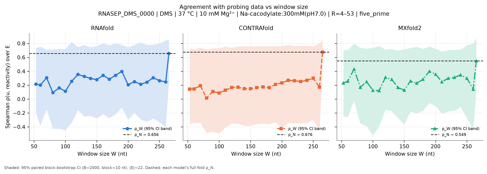
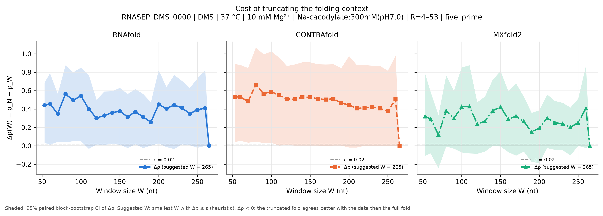
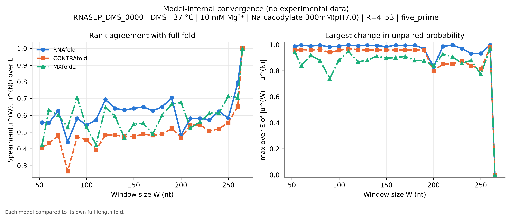
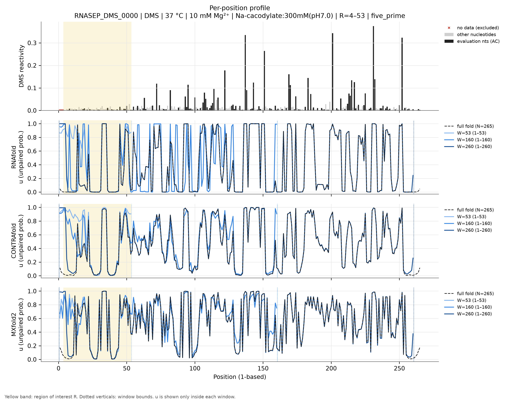
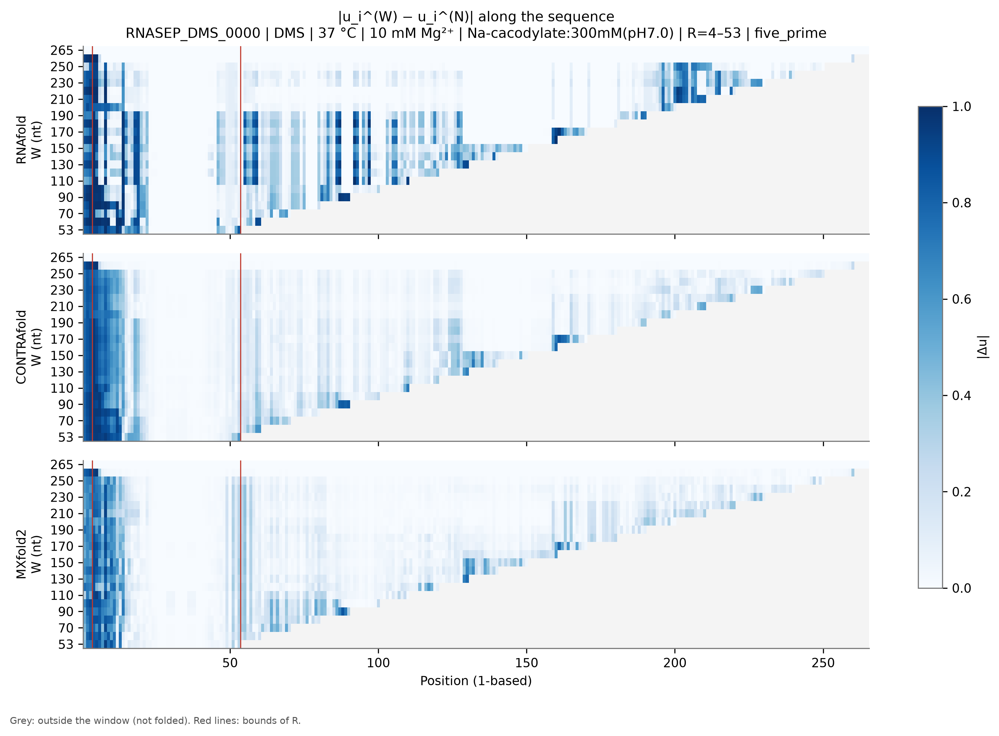
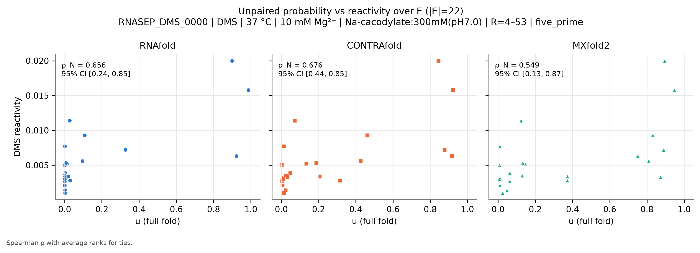

# RNASEP_DMS_0000: Ribonuclease P catalytic domain, B. stearothermophilus

*Generated by `run_test.py`. [Overview of all 8 datasets](../overview.md) · [Method](../method.md) · [README](../../README.md). Config: [`configs/config_RNASEP_DMS_0000.json`](../../configs/config_RNASEP_DMS_0000.json); outputs: [`results/RNASEP_DMS_0000/`](../../results/RNASEP_DMS_0000/).*

**In short:** N = 265 nt; RNAfold ρ_N = 0.66, W_conv = 265; CONTRAfold ρ_N = 0.68, W_conv = 265; MXfold2 ρ_N = 0.55, W_conv = 265 (W_conv: smallest window whose prediction in R matches the full fold, see [method](../method.md)).

## 1. Data

* **Source:** https://rmdb.stanford.edu/detail/RNASEP_DMS_0000/ — file [`data/RNASEP_DMS_0000.rdat`](../../data/RNASEP_DMS_0000.rdat) downloaded from https://github.com/DasLab/rmdb.github.io/releases/download/data-rna-structures/RNASEP_DMS_0000.rdat on 2026-11-04T17:30:19+00:00 (SHA-256 `4d90c0b47e7e5dc17cf2ded210c04dd922d315ae34a6187bfb3e83fd581c4d3c`).
* **Construct:** RNase P catalytic domain, B. stearothermophilus (265 nt), DMS mutate-and-map (data of Homan et al., PNAS 2014, reanalysed with MaP2D), WT row of the 37 °C entry.
* **Sequence:** N = 265 nt, source numbering (RDAT SEQPOS) 1–265 (1-based position = source − 0).
* **Row used:** 1 of 266 data rows, selected by annotation match `{'annotation': {'mutation': 'WT'}}` (row annotations: `{'mutation': ['WT']}`). The selection fails loudly if it matches zero or several rows.
* **Reagent:** DMS. **Conditions (file annotations):** temperature 37.0 °C, Mg²⁺ 10.0 mM, buffer Na-cacodylate:300mM(pH7.0); all annotations: `Na-cacodylate:300mM(pH7.0), MgCl2:10mM`.
* **Evaluation nucleotides:** AC (reagent mapping (DMS)).
* **Excluded positions (set to NaN):** source 1-3 (1-based 1-3). Reason: Leading run of 3 exact zeros at the 5' end (no data at the read end). NaN already present in the source: none.
* **Region of interest:** source 4–53 (1-based 4–53), anchoring `five_prime`. R = 4-53: the first 50 nt with data. It contains the 5' strand of P1, whose partner is at the 3' end, so small windows cut it. The region of interest is the 5'-most stretch with data (uniform rule across datasets: first 50 nt, 100 nt for the 1266-nt HOXA9 UTR), with 5'-anchored windows mimicking the mRNA use case.
* **Evaluation set:** |E| = 22; source positions 4-5, 7-8, 11, 13, 18-19, 21, 23, 26, 29-30, 36, 39-40, 43, 45, 48-50, 53.
* **Window grid:** 53, 60, 70, 80, 90, 100, 110, 120, 130, 140, 150, 160, 170, 180, 190, 200, 210, 220, 230, 240, 250, 260, 265.

## 2. Models and parameters

| Model | Version | Parameters | Temperature | Salt | Mg²⁺ / tertiary |
|---|---|---|---|---|---|
| RNAfold | 2.7.2 | turner2004, dangles=2, partition function (`fc.pf()`, `fc.bpp()`) | 37 °C | standard 1.021 M monovalent (correction off) | not representable |
| CONTRAfold | CONTRAFold version 2.01 - RNA secondary structure prediction (bioconda package 2.02) | `contrafold predict --posteriors 1e-05`, built-in default parameters | not representable | not representable | not representable |
| MXfold2 | 0.1.2 | `mxfold2 predict --bpp`, bundled default (TrainSetAB.conf, model MixC), seed 0 | not representable | not representable | not representable |

**CONTRAfold threshold bias.** CONTRAfold only writes pairs with posterior ≥ 1e-05. Omitted pairs are counted as 'unpaired', so $u_i$ is biased **upward** by at most (number of omitted partners of $i$) × 1e-05 ≤ $(N-1)$ × 1e-05 = 0.0026 for the full fold (less for windows). **Measured on this dataset** by re-folding with threshold 1e-09: W = 53: max |Δu| = 0, |Δρ| = 0; W = 265: max |Δu| = 0, |Δρ| = 0.

**MXfold2 rounding.** MXfold2 writes $p_{ij}$ with 5 decimals; the resulting error on $u_i$ is ≤ $N\times5\cdot10^{-6}$ (≈0.001 here). Values of $u$ are clipped to [0, 1]; the maximal clipped amount per call is in `run_metadata.json`.

**Condition mismatches flagged at run time:**

* 10 mM Mg²⁺ in the experiment: no model represents Mg²⁺ or tertiary structure.
* Experiment at 37 °C: RNAfold folds at 37 °C; CONTRAfold and MXfold2 have no temperature parameter.
* Buffer Na-cacodylate:300mM(pH7.0): RNAfold uses standard 1.021 M monovalent salt (correction off); CONTRAfold/MXfold2 have no salt dependence.

## 3. Results

|E| = 22 positions. ε = 0.02. Bootstrap: B = 2000, block = 10 nt, seed = 0.

### Summary table

$\rho_W$ [95 % CI] and $\Delta\rho(W)$ [95 % CI] per model. Full numbers: [`summary.csv`](../../results/RNASEP_DMS_0000/summary.csv) (long), [`summary_wide.csv`](../../results/RNASEP_DMS_0000/summary_wide.csv) and [`per_position.csv`](../../results/RNASEP_DMS_0000/per_position.csv).

| W | window (1-based) | RNAfold ρ_W | RNAfold Δρ | CONTRAfold ρ_W | CONTRAfold Δρ | MXfold2 ρ_W | MXfold2 Δρ |
|---|---|---|---|---|---|---|---|
| 53 | 1–53 | 0.215 [-0.20, 0.73] | 0.440 [0.03, 0.69] | 0.143 [-0.36, 0.73] | 0.533 [0.04, 0.89] | 0.230 [-0.25, 0.70] | 0.320 [-0.11, 0.78] |
| 60 | 1–60 | 0.200 [-0.39, 0.75] | 0.455 [0.01, 0.79] | 0.145 [-0.34, 0.71] | 0.531 [0.06, 0.88] | 0.257 [-0.26, 0.71] | 0.292 [-0.08, 0.58] |
| 70 | 1–70 | 0.305 [-0.14, 0.71] | 0.350 [0.04, 0.56] | 0.193 [-0.34, 0.74] | 0.483 [0.04, 0.85] | 0.430 [-0.02, 0.79] | 0.120 [-0.24, 0.33] |
| 80 | 1–80 | 0.093 [-0.43, 0.71] | 0.562 [0.04, 0.87] | 0.015 [-0.49, 0.71] | 0.661 [0.04, 1.07] | 0.168 [-0.35, 0.74] | 0.382 [-0.01, 0.76] |
| 90 | 1–90 | 0.160 [-0.43, 0.72] | 0.496 [0.05, 0.80] | 0.109 [-0.47, 0.73] | 0.567 [0.03, 1.00] | 0.250 [-0.39, 0.72] | 0.299 [-0.03, 0.60] |
| 100 | 1–100 | 0.112 [-0.45, 0.72] | 0.543 [0.05, 0.85] | 0.088 [-0.50, 0.73] | 0.588 [0.03, 1.03] | 0.125 [-0.52, 0.74] | 0.425 [-0.07, 0.85] |
| 110 | 1–110 | 0.256 [-0.34, 0.82] | 0.400 [-0.03, 0.77] | 0.128 [-0.41, 0.76] | 0.548 [0.00, 0.96] | 0.120 [-0.39, 0.76] | 0.429 [-0.08, 0.88] |
| 120 | 1–120 | 0.354 [-0.16, 0.75] | 0.302 [0.01, 0.50] | 0.165 [-0.35, 0.74] | 0.510 [0.01, 0.87] | 0.311 [-0.16, 0.71] | 0.238 [-0.09, 0.47] |
| 130 | 1–130 | 0.326 [-0.25, 0.78] | 0.330 [0.01, 0.59] | 0.171 [-0.35, 0.76] | 0.505 [0.00, 0.88] | 0.283 [-0.17, 0.72] | 0.267 [-0.06, 0.54] |
| 140 | 1–140 | 0.296 [-0.24, 0.74] | 0.359 [0.02, 0.59] | 0.149 [-0.39, 0.76] | 0.527 [0.00, 0.91] | 0.167 [-0.27, 0.70] | 0.383 [0.00, 0.72] |
| 150 | 1–150 | 0.278 [-0.28, 0.76] | 0.377 [0.01, 0.63] | 0.149 [-0.39, 0.76] | 0.527 [0.00, 0.91] | 0.127 [-0.37, 0.72] | 0.422 [-0.01, 0.81] |
| 160 | 1–160 | 0.342 [-0.22, 0.80] | 0.314 [-0.02, 0.56] | 0.164 [-0.36, 0.76] | 0.512 [0.00, 0.89] | 0.259 [-0.18, 0.73] | 0.290 [-0.07, 0.59] |
| 170 | 1–170 | 0.285 [-0.27, 0.77] | 0.370 [0.02, 0.62] | 0.173 [-0.35, 0.76] | 0.503 [0.00, 0.88] | 0.228 [-0.20, 0.75] | 0.322 [-0.11, 0.68] |
| 180 | 1–180 | 0.342 [-0.22, 0.80] | 0.314 [-0.02, 0.56] | 0.164 [-0.36, 0.76] | 0.512 [0.00, 0.89] | 0.284 [-0.17, 0.72] | 0.265 [-0.06, 0.53] |
| 190 | 1–190 | 0.398 [-0.12, 0.78] | 0.257 [0.00, 0.47] | 0.211 [-0.33, 0.76] | 0.465 [0.00, 0.84] | 0.399 [-0.06, 0.75] | 0.150 [-0.17, 0.36] |
| 200 | 1–200 | 0.206 [-0.30, 0.74] | 0.449 [0.03, 0.82] | 0.232 [-0.43, 0.76] | 0.444 [-0.02, 0.98] | 0.357 [-0.10, 0.72] | 0.192 [-0.19, 0.39] |
| 210 | 1–210 | 0.250 [-0.20, 0.78] | 0.405 [-0.01, 0.64] | 0.269 [-0.35, 0.78] | 0.407 [-0.02, 0.88] | 0.248 [-0.21, 0.68] | 0.302 [-0.02, 0.56] |
| 220 | 1–220 | 0.213 [-0.29, 0.81] | 0.443 [-0.03, 0.77] | 0.264 [-0.35, 0.76] | 0.412 [0.00, 0.88] | 0.298 [-0.18, 0.70] | 0.252 [-0.04, 0.49] |
| 230 | 1–230 | 0.242 [-0.33, 0.78] | 0.413 [0.02, 0.71] | 0.252 [-0.35, 0.76] | 0.423 [0.00, 0.87] | 0.311 [-0.17, 0.71] | 0.238 [-0.05, 0.47] |
| 240 | 1–240 | 0.307 [-0.28, 0.78] | 0.349 [0.01, 0.63] | 0.269 [-0.35, 0.76] | 0.407 [0.00, 0.87] | 0.347 [-0.12, 0.71] | 0.202 [-0.10, 0.42] |
| 250 | 1–250 | 0.264 [-0.33, 0.80] | 0.392 [-0.02, 0.73] | 0.300 [-0.30, 0.76] | 0.376 [0.00, 0.82] | 0.298 [-0.28, 0.77] | 0.252 [0.00, 0.51] |
| 260 | 1–260 | 0.247 [-0.41, 0.84] | 0.409 [0.00, 0.82] | 0.170 [-0.45, 0.80] | 0.506 [0.00, 0.98] | 0.142 [-0.44, 0.80] | 0.408 [-0.02, 0.87] |
| 265 (N) | 1–265 | 0.656 [0.24, 0.85] | 0.000 [0.00, 0.00] | 0.676 [0.44, 0.85] | 0.000 [0.00, 0.00] | 0.549 [0.13, 0.87] | 0.000 [0.00, 0.00] |

### Suggested window per model (heuristic)

| Model | ρ_N [95 % CI] | W* (first Δρ ≤ ε) | W*_stable | W*_CI (upper CI ≤ ε) |
|---|---|---|---|---|
| RNAfold | 0.656 [0.24, 0.85] | 265 | 265 | 265 |
| CONTRAfold | 0.676 [0.44, 0.85] | 265 | 265 | 265 |
| MXfold2 | 0.549 [0.13, 0.87] | 265 | 265 | 265 |

### Figures

**Figure 1.** $\rho_W$ vs $W$ (lines), each model's $\rho_N$ (dotted), 95 % bootstrap CI (band).

**Figure 2.** $\Delta\rho(W)$ with 95 % CI; dashed line: ε.

**Figure 3.** Model-internal convergence: Spearman of $u^{(W)}$ to $u^{(N)}$ over $E$ (left) and max $|\Delta u|$ over $E$ (right).

**Figure 4.** Reactivity (evaluation nucleotides dark, others grey, excluded positions ×) and $u$ for the full fold and three representative windows, one panel per model; yellow = $R$.

**Figure 5.** $|u_i^{(W)}-u_i^{(N)}|$; position on x, $W$ on y; grey = outside window.

**Figure 6.** $u$ (full fold) vs reactivity over $E$, one panel per model.

### Comparison of the three models

* **Absolute agreement (full fold):** CONTRAfold ρ_N = 0.676 [0.44, 0.85], RNAfold ρ_N = 0.656 [0.24, 0.85], MXfold2 ρ_N = 0.549 [0.13, 0.87]. Overlapping CIs mean the ranking is not resolved by these data.
* **Smallest window (W = 53):** RNAfold Δρ = 0.440 [0.03, 0.69], CONTRAfold Δρ = 0.533 [0.04, 0.89], MXfold2 Δρ = 0.320 [-0.11, 0.78].
* **Largest Δρ over the grid:** RNAfold 0.562 at W = 80, CONTRAfold 0.661 at W = 80, MXfold2 0.429 at W = 110.
* **Internal convergence** (smallest W from which max |Δu| over E stays ≤ 0.1): RNAfold W = 265, CONTRAfold W = 265, MXfold2 W = 265.
* **RNAfold: Δρ CI excludes 0** above 0 (truncation costs agreement) at W = [53, 60, 70, 80, 90, 100, 120, 130, 140, 150, 170, 190, 200, 230, 240].
* **CONTRAfold: Δρ CI excludes 0** above 0 (truncation costs agreement) at W = [53, 60, 70, 80, 90, 100, 110, 120, 130, 140, 150, 160, 170, 180, 190, 220, 230, 240, 250].
* **MXfold2:** the 95 % CI of Δρ includes 0 at every W.
* **Suggested W (ε = 0.02):** RNAfold W* = 265 (stable 265, CI-based 265), CONTRAfold W* = 265 (stable 265, CI-based 265), MXfold2 W* = 265 (stable 265, CI-based 265).

**Interpretation (generated from the numbers above).**
Truncation measurably reduces agreement with the data for some windows (Δρ CI above 0); W*, W*_stable and W*_CI should be read together with the convergence figures.

## 4. Limitations

General limitations (reagent coverage, physical conditions, trained models, statistics) are in the [overview](../overview.md#limitations).
 Specific to this dataset:

* RNase P is a structured ribozyme with Mg2+-dependent tertiary structure, not an mRNA.
