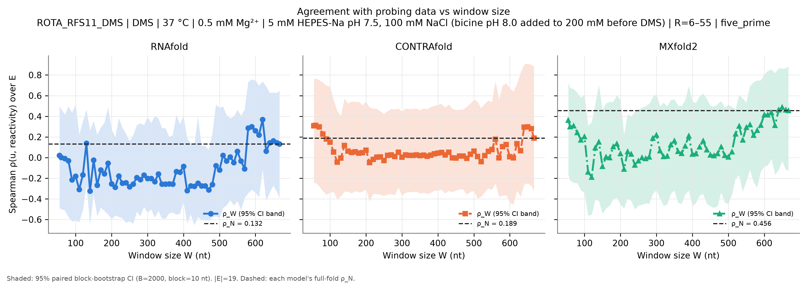
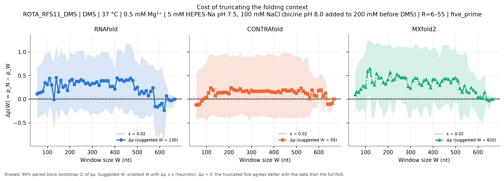
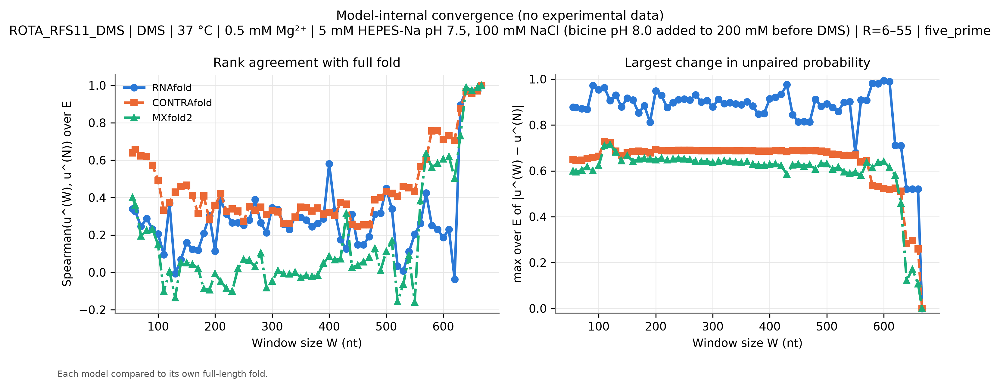
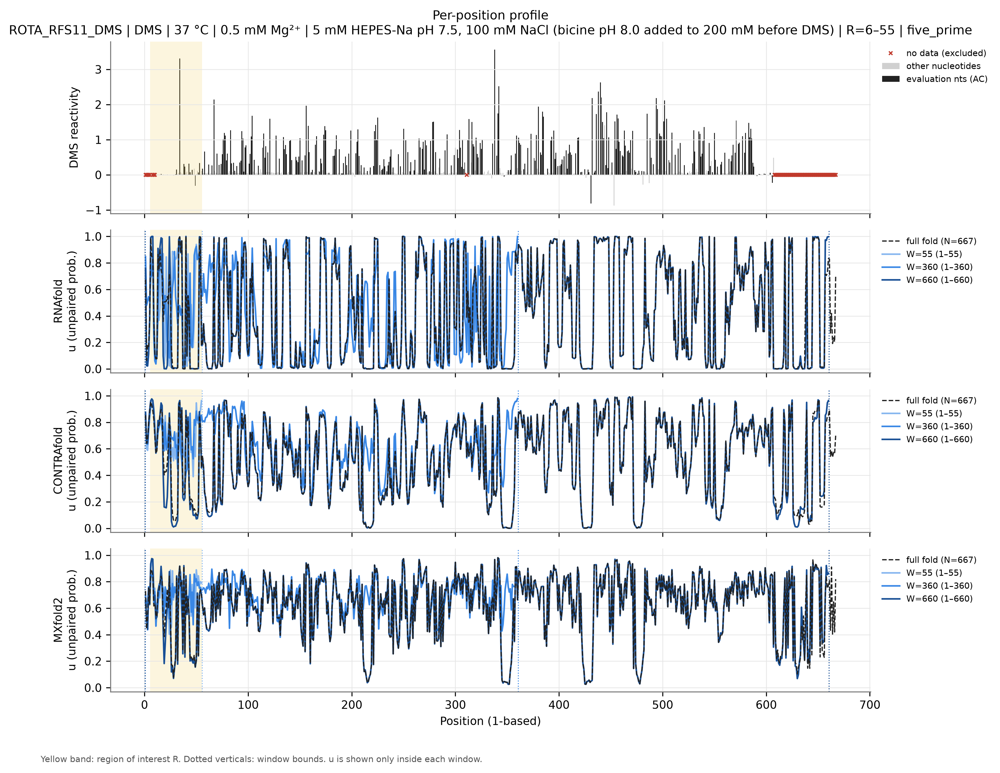
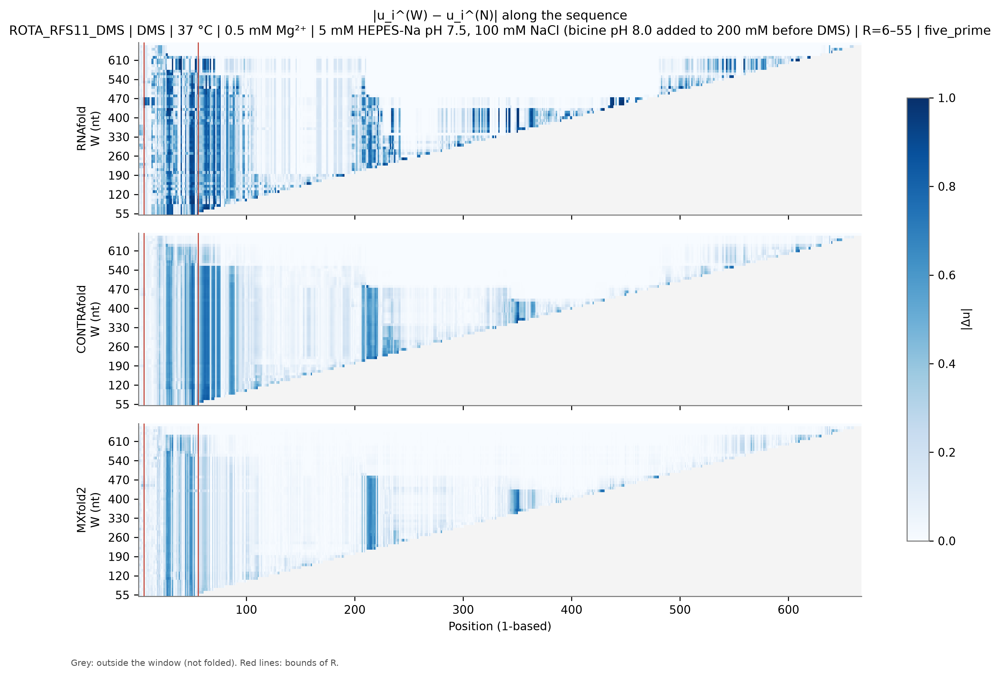
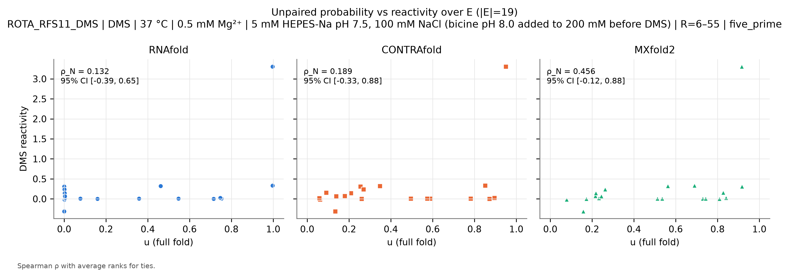

# ROTA_RFS11_DMS: Rotavirus A RF segment 11 (NSP5)

*Generated by `run_test.py`. [Overview of all 8 datasets](../overview.md) · [Method](../method.md) · [README](../../README.md). Config: [`configs/config_ROTA_RFS11_DMS.json`](../../configs/config_ROTA_RFS11_DMS.json); outputs: [`results/ROTA_RFS11_DMS/`](../../results/ROTA_RFS11_DMS/).*

**In short:** N = 667 nt; RNAfold ρ_N = 0.13, W_conv = 667; CONTRAfold ρ_N = 0.19, W_conv = 667; MXfold2 ρ_N = 0.46, W_conv = 667 (W_conv: smallest window whose prediction in R matches the full fold, see [method](../method.md)).

## 1. Data

* **Source:** https://rasp2.zhanglab.net/download/ (RASP v2; track rotavirus/SHAPE-MaP_NAR_2022_Coria/RFS11_50mM_DMS.bw; Coria et al. 2022 NAR, doi:10.1093/nar/gkac738) — file [`data/ROTA_RFS11_DMS.bw`](../../data/ROTA_RFS11_DMS.bw) downloaded from https://rasp2.zhanglab.net/api/downloadfile/?filetype=bw&filelist=rotavirus/SHAPE-MaP_NAR_2022_Coria/RFS11_50mM_DMS.bw on 2026-11-05T09:04:27+00:00 (SHA-256 `a0fb70bc1b1dbeaf48ef4b0569fb746fe0d416bb3aa7e5ee8b2211b2b7432b47`).
* **Auxiliary file (fasta):** `data/rotavirus.fa.gz` downloaded from https://rasp2.zhanglab.net/api/downloadfile/?filetype=fasta&filelist=rotavirus.fa.gz on 2026-11-05T09:04:28+00:00 (SHA-256 `ce6517c951aff2131fe1628fdbd567ef3e6ea52164936e658dfb52c957d6d2f8`).
* **Genome region extracted:** RFS11:1-667(+) (1-based, inclusive); positions without a track value are NaN.
* **Construct:** Bovine rotavirus A strain RF, genome segment 11 (NSP5/NSP6 mRNA), full-length in vitro T7 transcript (667 nt in the RASP reference). In vitro DMS-MaPseq, 0.5% (v/v) DMS ('50mM' in the RASP track name), no NSP2. Coria et al. 2022 NAR 50:10078.
* **Sequence:** N = 667 nt, source numbering (genome coordinate) 1–667 (1-based position = source − 0).
* **Row used:** the file holds a single profile; no selection needed.
* **Reagent:** DMS. **Conditions (from the config; the file has no annotations):** temperature 37 °C, Mg²⁺ 0.5 mM, buffer 5 mM HEPES-Na pH 7.5, 100 mM NaCl (bicine pH 8.0 added to 200 mM before DMS).
* **Evaluation nucleotides:** AC (reagent mapping (DMS)).
* **Excluded positions (set to NaN):** source none (1-based none). Reason: No extra mask. Positions 1-5, 8-10, 311 and 608-667 have no value in the track and are already NaN (608-667 at the 3' end is presumably the RT/PCR primer-binding region; Supplementary Table S1 of the paper was not checked). NaN already present in the source: 1-5, 8-10, 311, 608-667.
* **Region of interest:** source 6–55 (1-based 6–55), anchoring `five_prime`. R = 6-55: the first 50 nt of the RNA that have data (same rule as the other datasets), 5'-anchored windows.
* **Evaluation set:** |E| = 19; source positions 12, 14, 16-18, 22, 26, 28, 30-31, 34, 38-39, 43-44, 46, 49, 52-53.
* **Window grid:** 55, 60, 70, 80, 90, 100, 110, 120, 130, 140, 150, 160, 170, 180, 190, 200, 210, 220, 230, 240, 250, 260, 270, 280, 290, 300, 310, 320, 330, 340, 350, 360, 370, 380, 390, 400, 410, 420, 430, 440, 450, 460, 470, 480, 490, 500, 510, 520, 530, 540, 550, 560, 570, 580, 590, 600, 610, 620, 630, 640, 650, 660, 667.
* Conditions from the paper's Methods (not from the file): refolded 65 °C 5 min then slow cooling; probed at 37 °C for 1 min in 5 mM HEPES-Na pH 7.5, 0.5 mM MgCl2, 100 mM NaCl, ~200 mM bicine pH 8.0.
* Track values are RASP's 'raw' DMS-MaPseq reactivities; normalisation does not matter for Spearman correlation.
* Data come from RASP v2 (genome-coordinate bigWig); the sequence is taken from RASP's reference FASTA for segment RFS11.

## 2. Models and parameters

| Model | Version | Parameters | Temperature | Salt | Mg²⁺ / tertiary |
|---|---|---|---|---|---|
| RNAfold | 2.7.2 | turner2004, dangles=2, partition function (`fc.pf()`, `fc.bpp()`) | 37 °C | standard 1.021 M monovalent (correction off) | not representable |
| CONTRAfold | CONTRAFold version 2.01 - RNA secondary structure prediction (bioconda package 2.02) | `contrafold predict --posteriors 1e-05`, built-in default parameters | not representable | not representable | not representable |
| MXfold2 | 0.1.2 | `mxfold2 predict --bpp`, bundled default (TrainSetAB.conf, model MixC), seed 0 | not representable | not representable | not representable |

**CONTRAfold threshold bias.** CONTRAfold only writes pairs with posterior ≥ 1e-05. Omitted pairs are counted as 'unpaired', so $u_i$ is biased **upward** by at most (number of omitted partners of $i$) × 1e-05 ≤ $(N-1)$ × 1e-05 = 0.0067 for the full fold (less for windows). **Measured on this dataset** by re-folding with threshold 1e-09: W = 55: max |Δu| = 0, |Δρ| = 0; W = 667: max |Δu| = 0, |Δρ| = 0.

**MXfold2 rounding.** MXfold2 writes $p_{ij}$ with 5 decimals; the resulting error on $u_i$ is ≤ $N\times5\cdot10^{-6}$ (≈0.001 here). Values of $u$ are clipped to [0, 1]; the maximal clipped amount per call is in `run_metadata.json`.

**Condition mismatches flagged at run time:**

* 0.5 mM Mg²⁺ in the experiment: no model represents Mg²⁺ or tertiary structure.
* Experiment at 37 °C: RNAfold folds at 37 °C; CONTRAfold and MXfold2 have no temperature parameter.
* Buffer 5 mM HEPES-Na pH 7.5, 100 mM NaCl (bicine pH 8.0 added to 200 mM before DMS): RNAfold uses standard 1.021 M monovalent salt (correction off); CONTRAfold/MXfold2 have no salt dependence.

## 3. Results

|E| = 19 positions. ε = 0.02. Bootstrap: B = 2000, block = 10 nt, seed = 0.

### Summary table

$\rho_W$ [95 % CI] and $\Delta\rho(W)$ [95 % CI] per model. Full numbers: [`summary.csv`](../../results/ROTA_RFS11_DMS/summary.csv) (long), [`summary_wide.csv`](../../results/ROTA_RFS11_DMS/summary_wide.csv) and [`per_position.csv`](../../results/ROTA_RFS11_DMS/per_position.csv).

| W | window (1-based) | RNAfold ρ_W | RNAfold Δρ | CONTRAfold ρ_W | CONTRAfold Δρ | MXfold2 ρ_W | MXfold2 Δρ |
|---|---|---|---|---|---|---|---|
| 55 | 1–55 | 0.021 [-0.49, 0.50] | 0.111 [-0.41, 0.70] | 0.307 [-0.25, 0.76] | -0.118 [-0.45, 0.52] | 0.361 [-0.16, 0.72] | 0.095 [-0.34, 0.58] |
| 60 | 1–60 | 0.002 [-0.50, 0.47] | 0.130 [-0.40, 0.70] | 0.312 [-0.24, 0.77] | -0.123 [-0.43, 0.58] | 0.300 [-0.22, 0.67] | 0.156 [-0.18, 0.66] |
| 70 | 1–70 | -0.009 [-0.51, 0.42] | 0.140 [-0.34, 0.75] | 0.296 [-0.28, 0.75] | -0.107 [-0.41, 0.65] | 0.309 [-0.25, 0.66] | 0.147 [-0.27, 0.80] |
| 80 | 1–80 | -0.032 [-0.58, 0.50] | 0.163 [-0.35, 0.78] | 0.228 [-0.32, 0.73] | -0.039 [-0.39, 0.66] | 0.244 [-0.25, 0.63] | 0.212 [-0.24, 0.86] |
| 90 | 1–90 | -0.216 [-0.62, 0.43] | 0.347 [-0.28, 0.97] | 0.181 [-0.36, 0.70] | 0.009 [-0.39, 0.74] | 0.172 [-0.32, 0.58] | 0.284 [-0.17, 0.90] |
| 100 | 1–100 | -0.181 [-0.61, 0.52] | 0.312 [-0.41, 0.97] | 0.149 [-0.34, 0.69] | 0.040 [-0.47, 0.77] | 0.204 [-0.34, 0.61] | 0.253 [-0.36, 1.01] |
| 110 | 1–110 | -0.309 [-0.62, 0.23] | 0.440 [-0.16, 1.03] | 0.054 [-0.33, 0.56] | 0.135 [-0.40, 0.93] | -0.140 [-0.56, 0.31] | 0.596 [0.07, 1.26] |
| 120 | 1–120 | -0.168 [-0.51, 0.35] | 0.300 [-0.28, 0.85] | -0.044 [-0.40, 0.45] | 0.233 [-0.35, 0.96] | -0.189 [-0.55, 0.34] | 0.646 [0.06, 1.24] |
| 130 | 1–130 | 0.139 [-0.27, 0.47] | -0.007 [-0.64, 0.78] | -0.005 [-0.38, 0.40] | 0.195 [-0.33, 0.93] | 0.095 [-0.41, 0.52] | 0.361 [-0.41, 1.20] |
| 140 | 1–140 | -0.325 [-0.65, 0.26] | 0.456 [-0.23, 1.14] | 0.116 [-0.33, 0.57] | 0.074 [-0.36, 0.91] | 0.151 [-0.42, 0.70] | 0.305 [-0.41, 1.14] |
| 150 | 1–150 | -0.025 [-0.36, 0.35] | 0.156 [-0.43, 0.84] | 0.063 [-0.33, 0.52] | 0.126 [-0.36, 0.91] | -0.084 [-0.54, 0.47] | 0.540 [0.04, 1.18] |
| 160 | 1–160 | -0.267 [-0.57, 0.22] | 0.398 [-0.22, 1.08] | 0.049 [-0.35, 0.54] | 0.140 [-0.38, 0.94] | 0.005 [-0.49, 0.53] | 0.451 [-0.14, 1.18] |
| 170 | 1–170 | -0.121 [-0.48, 0.29] | 0.253 [-0.25, 0.92] | 0.056 [-0.32, 0.54] | 0.133 [-0.37, 0.95] | 0.000 [-0.47, 0.54] | 0.456 [-0.19, 1.14] |
| 180 | 1–180 | -0.156 [-0.52, 0.34] | 0.288 [-0.35, 0.97] | 0.042 [-0.34, 0.54] | 0.147 [-0.41, 0.94] | 0.105 [-0.40, 0.54] | 0.351 [-0.40, 1.14] |
| 190 | 1–190 | -0.054 [-0.55, 0.49] | 0.186 [-0.34, 0.79] | 0.047 [-0.33, 0.51] | 0.142 [-0.37, 0.97] | 0.135 [-0.39, 0.61] | 0.321 [-0.31, 1.14] |
| 200 | 1–200 | -0.254 [-0.60, 0.28] | 0.386 [-0.20, 1.01] | 0.072 [-0.31, 0.54] | 0.118 [-0.40, 0.90] | 0.039 [-0.45, 0.56] | 0.418 [-0.18, 1.15] |
| 210 | 1–210 | -0.288 [-0.56, 0.20] | 0.419 [-0.18, 0.95] | -0.049 [-0.43, 0.49] | 0.239 [-0.38, 0.90] | -0.112 [-0.49, 0.22] | 0.568 [-0.03, 1.16] |
| 220 | 1–220 | -0.179 [-0.57, 0.38] | 0.311 [-0.29, 0.95] | -0.018 [-0.35, 0.47] | 0.207 [-0.38, 0.94] | 0.058 [-0.40, 0.42] | 0.398 [-0.31, 1.07] |
| 230 | 1–230 | -0.247 [-0.59, 0.29] | 0.379 [-0.28, 1.00] | 0.004 [-0.35, 0.47] | 0.186 [-0.36, 0.90] | 0.033 [-0.42, 0.39] | 0.423 [-0.25, 1.09] |
| 240 | 1–240 | -0.244 [-0.63, 0.23] | 0.375 [-0.23, 1.04] | 0.005 [-0.36, 0.45] | 0.184 [-0.34, 0.91] | -0.072 [-0.50, 0.45] | 0.528 [0.05, 1.13] |
| 250 | 1–250 | -0.282 [-0.62, 0.16] | 0.414 [-0.18, 1.03] | -0.028 [-0.37, 0.42] | 0.218 [-0.30, 0.97] | -0.030 [-0.47, 0.46] | 0.486 [0.00, 1.11] |
| 260 | 1–260 | -0.256 [-0.64, 0.22] | 0.388 [-0.22, 1.05] | 0.021 [-0.36, 0.45] | 0.168 [-0.31, 0.90] | 0.000 [-0.46, 0.48] | 0.456 [-0.05, 1.10] |
| 270 | 1–270 | -0.195 [-0.53, 0.31] | 0.326 [-0.25, 0.83] | 0.025 [-0.35, 0.47] | 0.165 [-0.36, 0.90] | -0.009 [-0.44, 0.50] | 0.465 [-0.12, 1.12] |
| 280 | 1–280 | -0.214 [-0.57, 0.33] | 0.346 [-0.23, 0.97] | 0.011 [-0.36, 0.47] | 0.179 [-0.36, 0.90] | 0.007 [-0.45, 0.52] | 0.449 [-0.12, 1.09] |
| 290 | 1–290 | -0.170 [-0.48, 0.32] | 0.302 [-0.36, 0.92] | 0.053 [-0.29, 0.48] | 0.137 [-0.46, 0.90] | 0.188 [-0.35, 0.59] | 0.268 [-0.39, 1.10] |
| 300 | 1–300 | -0.204 [-0.53, 0.39] | 0.335 [-0.30, 0.91] | 0.004 [-0.37, 0.45] | 0.186 [-0.34, 0.90] | 0.219 [-0.32, 0.61] | 0.237 [-0.42, 1.08] |
| 310 | 1–310 | -0.204 [-0.50, 0.34] | 0.335 [-0.29, 0.88] | 0.025 [-0.34, 0.48] | 0.165 [-0.37, 0.90] | 0.067 [-0.40, 0.49] | 0.389 [-0.20, 1.08] |
| 320 | 1–320 | -0.233 [-0.58, 0.40] | 0.365 [-0.32, 0.96] | 0.021 [-0.33, 0.47] | 0.168 [-0.37, 0.95] | 0.011 [-0.47, 0.53] | 0.446 [-0.23, 1.16] |
| 330 | 1–330 | -0.160 [-0.52, 0.38] | 0.291 [-0.31, 0.92] | 0.021 [-0.33, 0.47] | 0.168 [-0.37, 0.95] | 0.016 [-0.45, 0.50] | 0.440 [-0.17, 1.16] |
| 340 | 1–340 | -0.258 [-0.59, 0.29] | 0.389 [-0.26, 1.00] | 0.026 [-0.33, 0.48] | 0.163 [-0.38, 0.95] | 0.126 [-0.35, 0.56] | 0.330 [-0.31, 1.06] |
| 350 | 1–350 | -0.258 [-0.59, 0.29] | 0.389 [-0.26, 1.00] | 0.019 [-0.35, 0.46] | 0.170 [-0.35, 0.90] | 0.163 [-0.32, 0.56] | 0.293 [-0.39, 1.07] |
| 360 | 1–360 | -0.254 [-0.54, 0.20] | 0.386 [-0.20, 1.01] | 0.023 [-0.34, 0.48] | 0.167 [-0.37, 0.90] | 0.060 [-0.44, 0.50] | 0.396 [-0.17, 1.11] |
| 370 | 1–370 | -0.258 [-0.53, 0.22] | 0.389 [-0.25, 1.01] | 0.012 [-0.35, 0.47] | 0.177 [-0.37, 0.95] | 0.040 [-0.45, 0.50] | 0.416 [-0.15, 1.11] |
| 380 | 1–380 | -0.135 [-0.55, 0.41] | 0.267 [-0.31, 0.88] | 0.023 [-0.34, 0.49] | 0.167 [-0.38, 0.95] | 0.112 [-0.36, 0.56] | 0.344 [-0.26, 1.07] |
| 390 | 1–390 | -0.142 [-0.54, 0.32] | 0.274 [-0.30, 0.82] | 0.037 [-0.32, 0.50] | 0.153 [-0.39, 0.95] | 0.211 [-0.32, 0.69] | 0.246 [-0.43, 1.04] |
| 400 | 1–400 | -0.084 [-0.43, 0.40] | 0.216 [-0.16, 0.60] | 0.044 [-0.32, 0.51] | 0.146 [-0.42, 0.95] | 0.033 [-0.47, 0.54] | 0.423 [-0.02, 1.09] |
| 410 | 1–410 | -0.319 [-0.64, 0.19] | 0.451 [-0.15, 1.05] | 0.049 [-0.31, 0.52] | 0.140 [-0.42, 0.90] | 0.039 [-0.44, 0.53] | 0.418 [-0.11, 1.09] |
| 420 | 1–420 | -0.274 [-0.55, 0.14] | 0.405 [-0.24, 1.05] | 0.025 [-0.35, 0.49] | 0.165 [-0.37, 0.90] | 0.104 [-0.37, 0.59] | 0.353 [-0.20, 1.01] |
| 430 | 1–430 | -0.279 [-0.65, 0.12] | 0.411 [-0.18, 1.04] | 0.051 [-0.32, 0.52] | 0.139 [-0.40, 0.94] | 0.161 [-0.35, 0.62] | 0.295 [-0.21, 0.88] |
| 440 | 1–440 | -0.247 [-0.58, 0.40] | 0.379 [-0.30, 0.94] | -0.002 [-0.33, 0.47] | 0.191 [-0.38, 0.99] | 0.075 [-0.45, 0.57] | 0.381 [-0.19, 1.14] |
| 450 | 1–450 | -0.274 [-0.61, 0.11] | 0.405 [-0.31, 1.16] | -0.005 [-0.32, 0.46] | 0.195 [-0.40, 0.99] | 0.026 [-0.47, 0.50] | 0.430 [-0.12, 1.15] |
| 460 | 1–460 | -0.274 [-0.61, 0.11] | 0.405 [-0.31, 1.16] | 0.016 [-0.31, 0.46] | 0.174 [-0.40, 0.99] | 0.019 [-0.49, 0.49] | 0.437 [-0.10, 1.15] |
| 470 | 1–470 | -0.312 [-0.61, 0.08] | 0.444 [-0.22, 1.17] | 0.016 [-0.31, 0.46] | 0.174 [-0.40, 0.99] | 0.039 [-0.47, 0.52] | 0.418 [-0.12, 1.14] |
| 480 | 1–480 | -0.261 [-0.58, 0.23] | 0.393 [-0.25, 1.04] | -0.007 [-0.36, 0.49] | 0.196 [-0.39, 0.95] | 0.104 [-0.34, 0.55] | 0.353 [-0.27, 1.02] |
| 490 | 1–490 | -0.079 [-0.57, 0.51] | 0.211 [-0.35, 0.84] | 0.032 [-0.33, 0.52] | 0.158 [-0.40, 0.90] | 0.021 [-0.43, 0.48] | 0.435 [-0.13, 1.07] |
| 500 | 1–500 | -0.121 [-0.59, 0.48] | 0.253 [-0.33, 0.77] | 0.063 [-0.32, 0.56] | 0.126 [-0.40, 0.90] | 0.005 [-0.45, 0.51] | 0.451 [-0.04, 1.06] |
| 510 | 1–510 | 0.021 [-0.49, 0.50] | 0.111 [-0.41, 0.70] | 0.011 [-0.39, 0.54] | 0.179 [-0.40, 0.90] | 0.056 [-0.36, 0.49] | 0.400 [-0.10, 0.95] |
| 520 | 1–520 | -0.033 [-0.46, 0.41] | 0.165 [-0.41, 0.92] | -0.039 [-0.38, 0.48] | 0.228 [-0.38, 0.89] | 0.230 [-0.20, 0.47] | 0.226 [-0.42, 0.96] |
| 530 | 1–530 | 0.007 [-0.41, 0.38] | 0.125 [-0.42, 0.86] | 0.019 [-0.34, 0.52] | 0.170 [-0.40, 0.77] | 0.305 [-0.17, 0.61] | 0.151 [-0.44, 0.91] |
| 540 | 1–540 | -0.047 [-0.47, 0.40] | 0.179 [-0.34, 0.82] | 0.061 [-0.30, 0.55] | 0.128 [-0.40, 0.88] | 0.172 [-0.33, 0.57] | 0.284 [-0.29, 0.99] |
| 550 | 1–550 | 0.060 [-0.42, 0.46] | 0.072 [-0.36, 0.74] | 0.077 [-0.31, 0.54] | 0.112 [-0.35, 0.88] | 0.293 [-0.23, 0.53] | 0.163 [-0.39, 0.98] |
| 560 | 1–560 | -0.033 [-0.51, 0.41] | 0.165 [-0.37, 0.71] | 0.177 [-0.25, 0.74] | 0.012 [-0.41, 0.60] | 0.319 [-0.12, 0.69] | 0.137 [-0.39, 0.64] |
| 570 | 1–570 | -0.109 [-0.39, 0.47] | 0.240 [-0.29, 0.72] | -0.002 [-0.38, 0.56] | 0.191 [-0.21, 0.56] | 0.216 [-0.24, 0.73] | 0.240 [-0.12, 0.56] |
| 580 | 1–580 | 0.286 [-0.34, 0.73] | -0.154 [-0.79, 0.64] | 0.105 [-0.37, 0.70] | 0.084 [-0.18, 0.44] | 0.265 [-0.29, 0.75] | 0.191 [-0.23, 0.61] |
| 590 | 1–590 | 0.298 [-0.31, 0.76] | -0.167 [-0.80, 0.62] | 0.125 [-0.36, 0.72] | 0.065 [-0.18, 0.43] | 0.314 [-0.14, 0.75] | 0.142 [-0.26, 0.45] |
| 600 | 1–600 | 0.260 [-0.34, 0.75] | -0.128 [-0.74, 0.62] | 0.009 [-0.44, 0.67] | 0.181 [-0.07, 0.50] | 0.414 [-0.09, 0.80] | 0.042 [-0.40, 0.40] |
| 610 | 1–610 | 0.219 [-0.38, 0.70] | -0.088 [-0.70, 0.67] | -0.004 [-0.46, 0.64] | 0.193 [-0.05, 0.54] | 0.414 [-0.07, 0.84] | 0.042 [-0.42, 0.41] |
| 620 | 1–620 | 0.368 [-0.12, 0.74] | -0.237 [-0.88, 0.42] | 0.133 [-0.32, 0.71] | 0.056 [-0.29, 0.47] | 0.437 [-0.01, 0.85] | 0.019 [-0.54, 0.46] |
| 630 | 1–630 | 0.063 [-0.42, 0.69] | 0.068 [-0.19, 0.33] | 0.067 [-0.38, 0.82] | 0.123 [-0.10, 0.38] | 0.312 [-0.17, 0.82] | 0.144 [-0.26, 0.51] |
| 640 | 1–640 | 0.142 [-0.33, 0.63] | -0.011 [-0.16, 0.08] | 0.295 [-0.26, 0.90] | -0.105 [-0.26, 0.00] | 0.461 [-0.12, 0.87] | -0.005 [-0.06, 0.06] |
| 650 | 1–650 | 0.163 [-0.27, 0.63] | -0.032 [-0.20, 0.08] | 0.296 [-0.25, 0.91] | -0.107 [-0.30, 0.03] | 0.488 [-0.03, 0.86] | -0.032 [-0.23, 0.09] |
| 660 | 1–660 | 0.142 [-0.33, 0.63] | -0.011 [-0.16, 0.08] | 0.279 [-0.27, 0.90] | -0.089 [-0.23, 0.00] | 0.461 [-0.12, 0.87] | -0.005 [-0.06, 0.06] |
| 667 (N) | 1–667 | 0.132 [-0.39, 0.65] | 0.000 [0.00, 0.00] | 0.189 [-0.33, 0.88] | 0.000 [0.00, 0.00] | 0.456 [-0.12, 0.88] | 0.000 [0.00, 0.00] |

### Suggested window per model (heuristic)

| Model | ρ_N [95 % CI] | W* (first Δρ ≤ ε) | W*_stable | W*_CI (upper CI ≤ ε) |
|---|---|---|---|---|
| RNAfold | 0.132 [-0.39, 0.65] | 130 | 640 | 667 |
| CONTRAfold | 0.189 [-0.33, 0.88] | 55 | 640 | 640 |
| MXfold2 | 0.456 [-0.12, 0.88] | 620 | 640 | 667 |

### Figures

**Figure 1.** $\rho_W$ vs $W$ (lines), each model's $\rho_N$ (dotted), 95 % bootstrap CI (band).

**Figure 2.** $\Delta\rho(W)$ with 95 % CI; dashed line: ε.

**Figure 3.** Model-internal convergence: Spearman of $u^{(W)}$ to $u^{(N)}$ over $E$ (left) and max $|\Delta u|$ over $E$ (right).

**Figure 4.** Reactivity (evaluation nucleotides dark, others grey, excluded positions ×) and $u$ for the full fold and three representative windows, one panel per model; yellow = $R$.

**Figure 5.** $|u_i^{(W)}-u_i^{(N)}|$; position on x, $W$ on y; grey = outside window.

**Figure 6.** $u$ (full fold) vs reactivity over $E$, one panel per model.

### Comparison of the three models

* **Absolute agreement (full fold):** MXfold2 ρ_N = 0.456 [-0.12, 0.88], CONTRAfold ρ_N = 0.189 [-0.33, 0.88], RNAfold ρ_N = 0.132 [-0.39, 0.65]. Overlapping CIs mean the ranking is not resolved by these data.
* **Smallest window (W = 55):** RNAfold Δρ = 0.111 [-0.41, 0.70], CONTRAfold Δρ = -0.118 [-0.45, 0.52], MXfold2 Δρ = 0.095 [-0.34, 0.58].
* **Largest Δρ over the grid:** RNAfold 0.456 at W = 140, CONTRAfold 0.239 at W = 210, MXfold2 0.646 at W = 120.
* **Internal convergence** (smallest W from which max |Δu| over E stays ≤ 0.1): RNAfold W = 667, CONTRAfold W = 667, MXfold2 W = 667.
* **RNAfold:** the 95 % CI of Δρ includes 0 at every W.
* **CONTRAfold:** the 95 % CI of Δρ includes 0 at every W.
* **MXfold2: Δρ CI excludes 0** above 0 (truncation costs agreement) at W = [110, 120, 150, 240, 250].
* **Suggested W (ε = 0.02):** RNAfold W* = 130 (stable 640, CI-based 667), CONTRAfold W* = 55 (stable 640, CI-based 640), MXfold2 W* = 620 (stable 640, CI-based 667).

**Interpretation (generated from the numbers above).**
Truncation measurably reduces agreement with the data for some windows (Δρ CI above 0); W*, W*_stable and W*_CI should be read together with the convergence figures.

## 4. Limitations

General limitations (reagent coverage, physical conditions, trained models, statistics) are in the [overview](../overview.md#limitations).
 Specific to this dataset:

* Low Mg2+ (0.5 mM) differs from the 10 mM Mg2+ RMDB datasets; none of the models has a Mg2+ term.
* A viral mRNA segment, not a cellular 5' UTR.
