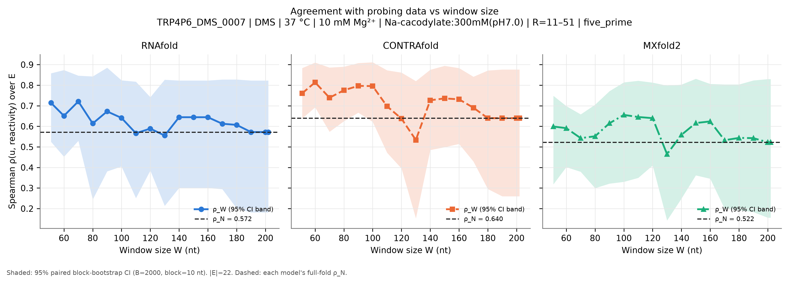
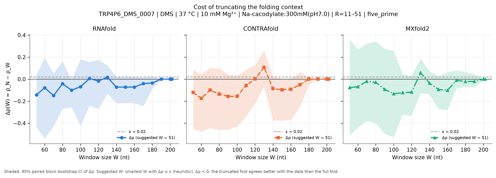
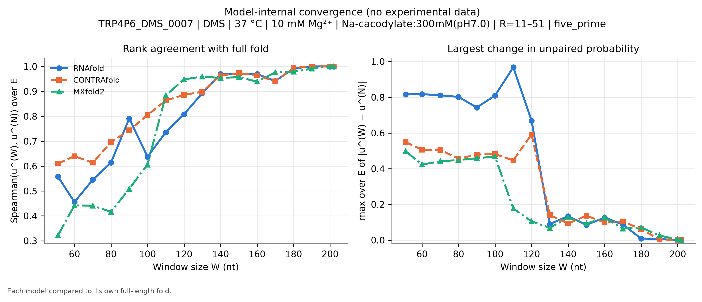
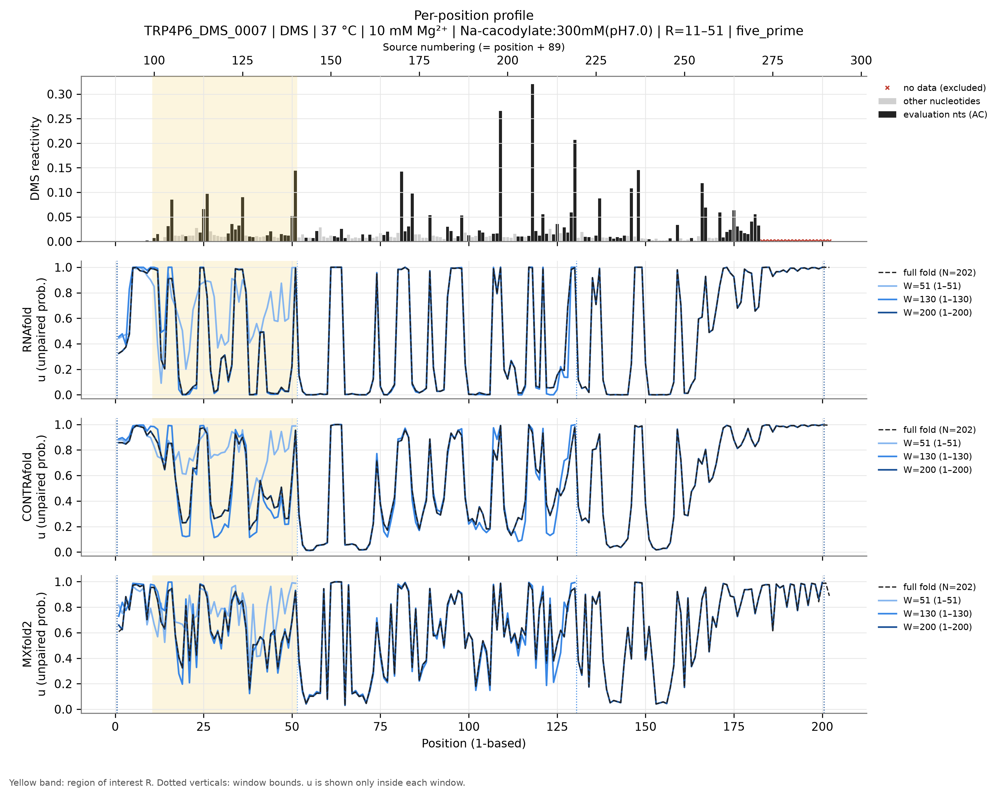
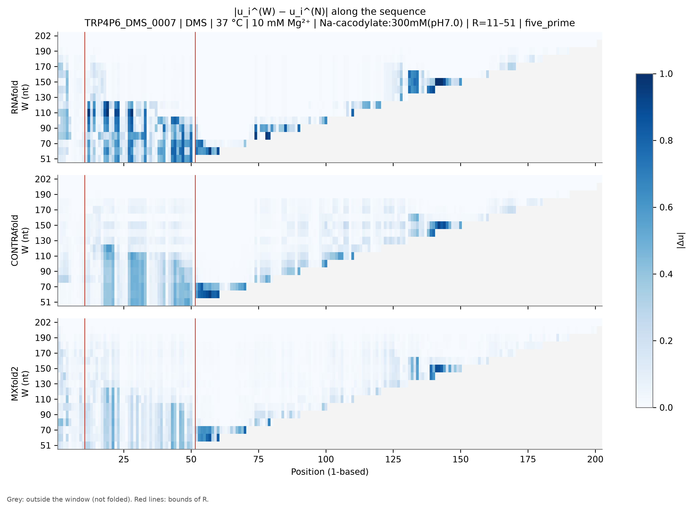
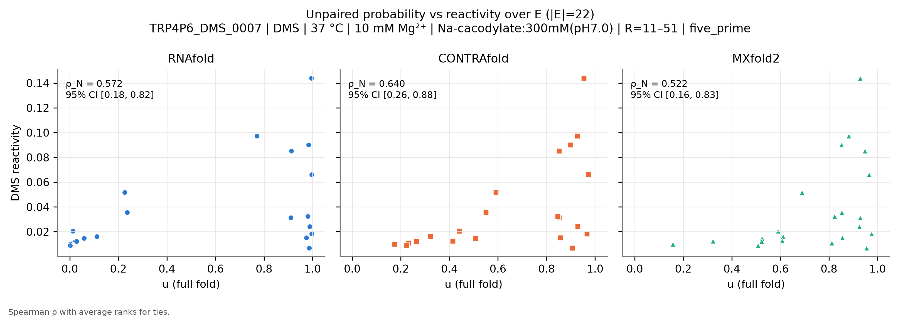

# TRP4P6_DMS_0007: P4-P6 domain, Tetrahymena ribozyme

*Generated by `run_test.py`. [Overview of all 8 datasets](../overview.md) · [Method](../method.md) · [README](../../README.md). Config: [`configs/config_TRP4P6_DMS_0007.json`](../../configs/config_TRP4P6_DMS_0007.json); outputs: [`results/TRP4P6_DMS_0007/`](../../results/TRP4P6_DMS_0007/).*

**In short:** N = 202 nt; RNAfold ρ_N = 0.57, W_conv = 170; CONTRAfold ρ_N = 0.64, W_conv = 180; MXfold2 ρ_N = 0.52, W_conv = 170 (W_conv: smallest window whose prediction in R matches the full fold, see [method](../method.md)).

## 1. Data

* **Source:** https://rmdb.stanford.edu/detail/TRP4P6_DMS_0007/ — file [`data/TRP4P6_DMS_0007.rdat`](../../data/TRP4P6_DMS_0007.rdat) downloaded from https://github.com/DasLab/rmdb.github.io/releases/download/data-rna-structures/TRP4P6_DMS_0007.rdat on 2026-11-04T16:42:08+00:00 (SHA-256 `337ffa4ebf180836de9ad8ad1c845326cdc720be07f3d56a48d41ae3b9adbab4`).
* **Construct:** P4-P6 domain of the Tetrahymena group I intron (RDAT NAME: 'P4-P6 domain, Tetrahymena ribozyme'), mutate-and-map experiment (DMS, MaP readout); only the wild-type row is used.
* **Sequence:** N = 202 nt, source numbering (RDAT SEQPOS) 90–291 (1-based position = source − 89).
* **Row used:** 1 of 203 data rows, selected by annotation match `{'annotation': {'mutation': 'WT'}}` (row annotations: `{'mutation': ['WT']}`). The selection fails loudly if it matches zero or several rows.
* **Reagent:** DMS. **Conditions (file annotations):** temperature 37.0 °C, Mg²⁺ 10.0 mM, buffer Na-cacodylate:300mM(pH7.0); all annotations: `Na-cacodylate:300mM(pH7.0), MgCl2:10mM`.
* **Evaluation nucleotides:** AC (reagent mapping (DMS)).
* **Excluded positions (set to NaN):** source 272-291 (1-based 183-202). Reason: 3' primer-binding tail (AAAGAAACAACAACAACAAC): reactivities ~1e-4, no structural information. Stored as numbers in the RDAT, set to NaN here. NaN already present in the source: none.
* **Region of interest:** source 100–140 (1-based 11–51), anchoring `five_prime`. R = 100-140 (RDAT numbering) contains the 5' arms of P4 (107-112) and P5 (116-121) and the start of P5a (127-138); their partners lie at 200-214 and 180-195, i.e. outside small 5'-anchored windows. This mimics the mRNA use case (5'-anchored window growing toward 3').
* **Evaluation set:** |E| = 22; source positions 100-101, 104-105, 109, 113-115, 121-125, 127-128, 132-133, 136-140.
* **Window grid:** 51, 60, 70, 80, 90, 100, 110, 120, 130, 140, 150, 160, 170, 180, 190, 200, 202.
* Positions 90-92 have reactivity exactly 0 and 93-99 are near 0 (possible low read coverage near the 5' end); they lie outside R and do not enter E.
* Low DMS signal in the first positions of R (100-103) is part of E; it may reflect coverage rather than structure.

## 2. Models and parameters

| Model | Version | Parameters | Temperature | Salt | Mg²⁺ / tertiary |
|---|---|---|---|---|---|
| RNAfold | 2.7.2 | turner2004, dangles=2, partition function (`fc.pf()`, `fc.bpp()`) | 37 °C | standard 1.021 M monovalent (correction off) | not representable |
| CONTRAfold | CONTRAFold version 2.01 - RNA secondary structure prediction (bioconda package 2.02) | `contrafold predict --posteriors 1e-05`, built-in default parameters | not representable | not representable | not representable |
| MXfold2 | 0.1.2 | `mxfold2 predict --bpp`, bundled default (TrainSetAB.conf, model MixC), seed 0 | not representable | not representable | not representable |

**CONTRAfold threshold bias.** CONTRAfold only writes pairs with posterior ≥ 1e-05. Omitted pairs are counted as 'unpaired', so $u_i$ is biased **upward** by at most (number of omitted partners of $i$) × 1e-05 ≤ $(N-1)$ × 1e-05 = 0.0020 for the full fold (less for windows). **Measured on this dataset** by re-folding with threshold 1e-09: W = 51: max |Δu| = 0, |Δρ| = 0; W = 202: max |Δu| = 0, |Δρ| = 0.

**MXfold2 rounding.** MXfold2 writes $p_{ij}$ with 5 decimals; the resulting error on $u_i$ is ≤ $N\times5\cdot10^{-6}$ (≈0.001 here). Values of $u$ are clipped to [0, 1]; the maximal clipped amount per call is in `run_metadata.json`.

**Condition mismatches flagged at run time:**

* 10 mM Mg²⁺ in the experiment: no model represents Mg²⁺ or tertiary structure.
* Experiment at 37 °C: RNAfold folds at 37 °C; CONTRAfold and MXfold2 have no temperature parameter.
* Buffer Na-cacodylate:300mM(pH7.0): RNAfold uses standard 1.021 M monovalent salt (correction off); CONTRAfold/MXfold2 have no salt dependence.

## 3. Results

|E| = 22 positions. ε = 0.02. Bootstrap: B = 2000, block = 10 nt, seed = 0.

### Summary table

$\rho_W$ [95 % CI] and $\Delta\rho(W)$ [95 % CI] per model. Full numbers: [`summary.csv`](../../results/TRP4P6_DMS_0007/summary.csv) (long), [`summary_wide.csv`](../../results/TRP4P6_DMS_0007/summary_wide.csv) and [`per_position.csv`](../../results/TRP4P6_DMS_0007/per_position.csv).

| W | window (1-based) | RNAfold ρ_W | RNAfold Δρ | CONTRAfold ρ_W | CONTRAfold Δρ | MXfold2 ρ_W | MXfold2 Δρ |
|---|---|---|---|---|---|---|---|
| 51 | 1–51 | 0.714 [0.52, 0.86] | -0.142 [-0.44, 0.04] | 0.761 [0.64, 0.88] | -0.121 [-0.45, 0.09] | 0.599 [0.32, 0.75] | -0.077 [-0.51, 0.36] |
| 60 | 1–60 | 0.651 [0.45, 0.87] | -0.079 [-0.54, 0.20] | 0.814 [0.69, 0.91] | -0.174 [-0.48, 0.04] | 0.591 [0.40, 0.70] | -0.069 [-0.44, 0.27] |
| 70 | 1–70 | 0.721 [0.53, 0.85] | -0.149 [-0.43, 0.05] | 0.739 [0.57, 0.89] | -0.099 [-0.45, 0.10] | 0.543 [0.38, 0.66] | -0.020 [-0.38, 0.32] |
| 80 | 1–80 | 0.614 [0.24, 0.84] | -0.042 [-0.27, 0.16] | 0.775 [0.62, 0.89] | -0.136 [-0.46, 0.10] | 0.552 [0.30, 0.71] | -0.029 [-0.40, 0.34] |
| 90 | 1–90 | 0.673 [0.38, 0.89] | -0.101 [-0.25, -0.01] | 0.797 [0.67, 0.91] | -0.157 [-0.46, 0.04] | 0.615 [0.32, 0.77] | -0.093 [-0.50, 0.28] |
| 100 | 1–100 | 0.641 [0.40, 0.82] | -0.069 [-0.43, 0.18] | 0.796 [0.62, 0.91] | -0.156 [-0.43, 0.03] | 0.656 [0.33, 0.81] | -0.133 [-0.53, 0.26] |
| 110 | 1–110 | 0.566 [0.25, 0.82] | 0.006 [-0.24, 0.16] | 0.697 [0.47, 0.87] | -0.058 [-0.34, 0.08] | 0.645 [0.35, 0.82] | -0.123 [-0.32, 0.04] |
| 120 | 1–120 | 0.589 [0.39, 0.74] | -0.017 [-0.27, 0.17] | 0.637 [0.40, 0.86] | 0.002 [-0.22, 0.13] | 0.640 [0.41, 0.81] | -0.117 [-0.33, 0.03] |
| 130 | 1–130 | 0.555 [0.21, 0.83] | 0.017 [-0.13, 0.13] | 0.534 [0.15, 0.82] | 0.106 [-0.07, 0.26] | 0.465 [0.14, 0.80] | 0.058 [-0.13, 0.19] |
| 140 | 1–140 | 0.644 [0.30, 0.82] | -0.072 [-0.22, 0.02] | 0.727 [0.48, 0.88] | -0.087 [-0.38, 0.02] | 0.558 [0.25, 0.80] | -0.036 [-0.14, 0.07] |
| 150 | 1–150 | 0.644 [0.30, 0.82] | -0.072 [-0.22, 0.02] | 0.736 [0.50, 0.89] | -0.096 [-0.38, 0.00] | 0.616 [0.36, 0.83] | -0.094 [-0.27, 0.03] |
| 160 | 1–160 | 0.644 [0.30, 0.82] | -0.072 [-0.22, 0.02] | 0.731 [0.51, 0.88] | -0.091 [-0.37, 0.00] | 0.624 [0.35, 0.81] | -0.102 [-0.28, 0.06] |
| 170 | 1–170 | 0.613 [0.29, 0.83] | -0.041 [-0.24, 0.01] | 0.691 [0.43, 0.84] | -0.051 [-0.25, 0.06] | 0.532 [0.20, 0.80] | -0.010 [-0.08, 0.08] |
| 180 | 1–180 | 0.607 [0.20, 0.83] | -0.035 [-0.09, 0.02] | 0.640 [0.30, 0.87] | 0.000 [-0.05, 0.02] | 0.544 [0.19, 0.80] | -0.021 [-0.07, 0.07] |
| 190 | 1–190 | 0.572 [0.18, 0.82] | 0.000 [0.00, 0.00] | 0.640 [0.26, 0.88] | 0.000 [0.00, 0.00] | 0.543 [0.18, 0.82] | -0.020 [-0.08, 0.04] |
| 200 | 1–200 | 0.572 [0.18, 0.82] | 0.000 [0.00, 0.00] | 0.640 [0.26, 0.88] | 0.000 [0.00, 0.00] | 0.522 [0.16, 0.83] | 0.000 [0.00, 0.00] |
| 202 (N) | 1–202 | 0.572 [0.18, 0.82] | 0.000 [0.00, 0.00] | 0.640 [0.26, 0.88] | 0.000 [0.00, 0.00] | 0.522 [0.16, 0.83] | 0.000 [0.00, 0.00] |

### Suggested window per model (heuristic)

| Model | ρ_N [95 % CI] | W* (first Δρ ≤ ε) | W*_stable | W*_CI (upper CI ≤ ε) |
|---|---|---|---|---|
| RNAfold | 0.572 [0.18, 0.82] | 51 | 51 | 90 |
| CONTRAfold | 0.640 [0.26, 0.88] | 51 | 140 | 150 |
| MXfold2 | 0.522 [0.16, 0.83] | 51 | 140 | 200 |

### Figures

**Figure 1.** $\rho_W$ vs $W$ (lines), each model's $\rho_N$ (dotted), 95 % bootstrap CI (band).

**Figure 2.** $\Delta\rho(W)$ with 95 % CI; dashed line: ε.

**Figure 3.** Model-internal convergence: Spearman of $u^{(W)}$ to $u^{(N)}$ over $E$ (left) and max $|\Delta u|$ over $E$ (right).

**Figure 4.** Reactivity (evaluation nucleotides dark, others grey, excluded positions ×) and $u$ for the full fold and three representative windows, one panel per model; yellow = $R$.

**Figure 5.** $|u_i^{(W)}-u_i^{(N)}|$; position on x, $W$ on y; grey = outside window.

**Figure 6.** $u$ (full fold) vs reactivity over $E$, one panel per model.

### Comparison of the three models

* **Absolute agreement (full fold):** CONTRAfold ρ_N = 0.640 [0.26, 0.88], RNAfold ρ_N = 0.572 [0.18, 0.82], MXfold2 ρ_N = 0.522 [0.16, 0.83]. Overlapping CIs mean the ranking is not resolved by these data.
* **Smallest window (W = 51):** RNAfold Δρ = -0.142 [-0.44, 0.04], CONTRAfold Δρ = -0.121 [-0.45, 0.09], MXfold2 Δρ = -0.077 [-0.51, 0.36].
* **Largest Δρ over the grid:** RNAfold 0.017 at W = 130, CONTRAfold 0.106 at W = 130, MXfold2 0.058 at W = 130.
* **Internal convergence** (smallest W from which max |Δu| over E stays ≤ 0.1): RNAfold W = 170, CONTRAfold W = 180, MXfold2 W = 170.
* **RNAfold: Δρ CI excludes 0** below 0 (truncated fold agrees *better* with data) at W = [90].
* **CONTRAfold:** the 95 % CI of Δρ includes 0 at every W.
* **MXfold2:** the 95 % CI of Δρ includes 0 at every W.
* **Suggested W (ε = 0.02):** RNAfold W* = 51 (stable 51, CI-based 90), CONTRAfold W* = 51 (stable 140, CI-based 150), MXfold2 W* = 51 (stable 140, CI-based 200).

**Interpretation (generated from the numbers above).**
For no model and no window is truncation shown to cost agreement with the data (no Δρ CI lies entirely above 0). W* therefore equals the smallest window tested, which says only that the data do not penalise truncation; it is not evidence that small windows reproduce the full-length structure. The model-internal convergence (Figures 3 and 5) shows where the predicted structure inside R actually stops changing, and W*_CI / W*_stable give more conservative choices.

## 4. Limitations

General limitations (reagent coverage, physical conditions, trained models, statistics) are in the [overview](../overview.md#limitations).
 Specific to this dataset:

* P4-P6 is not an mRNA: the test validates the method, but choosing a window for mRNAs requires mRNA probing data.
* P4-P6 forms an extensive Mg2+-dependent tertiary structure (A-rich bulge, tetraloop/receptor), which none of the models capture.
