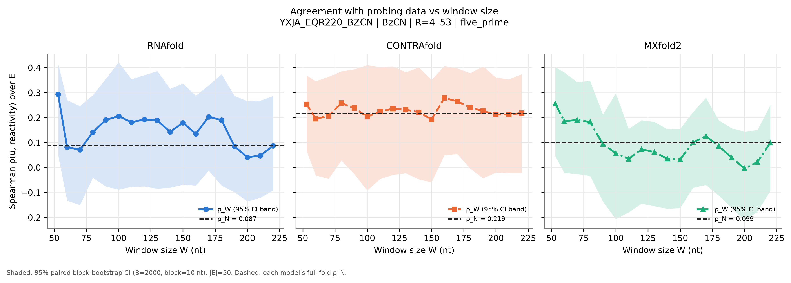
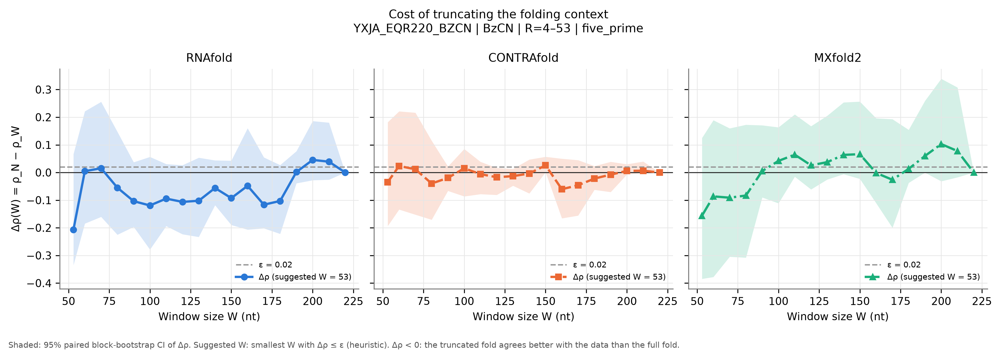
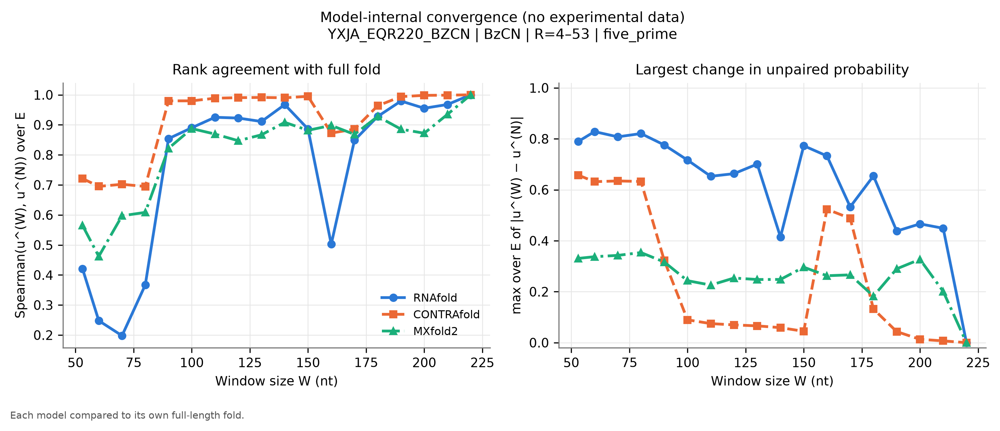
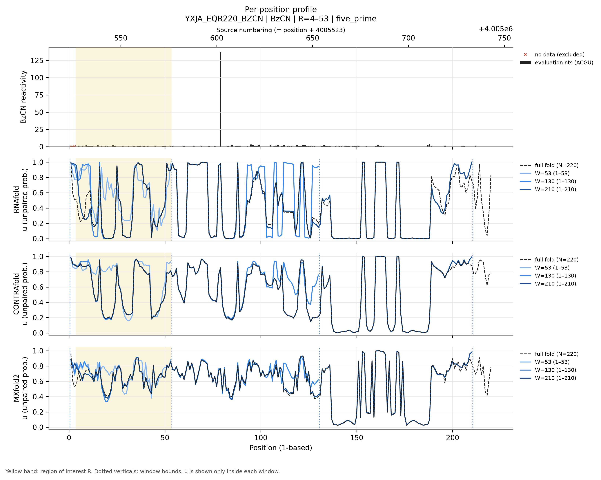
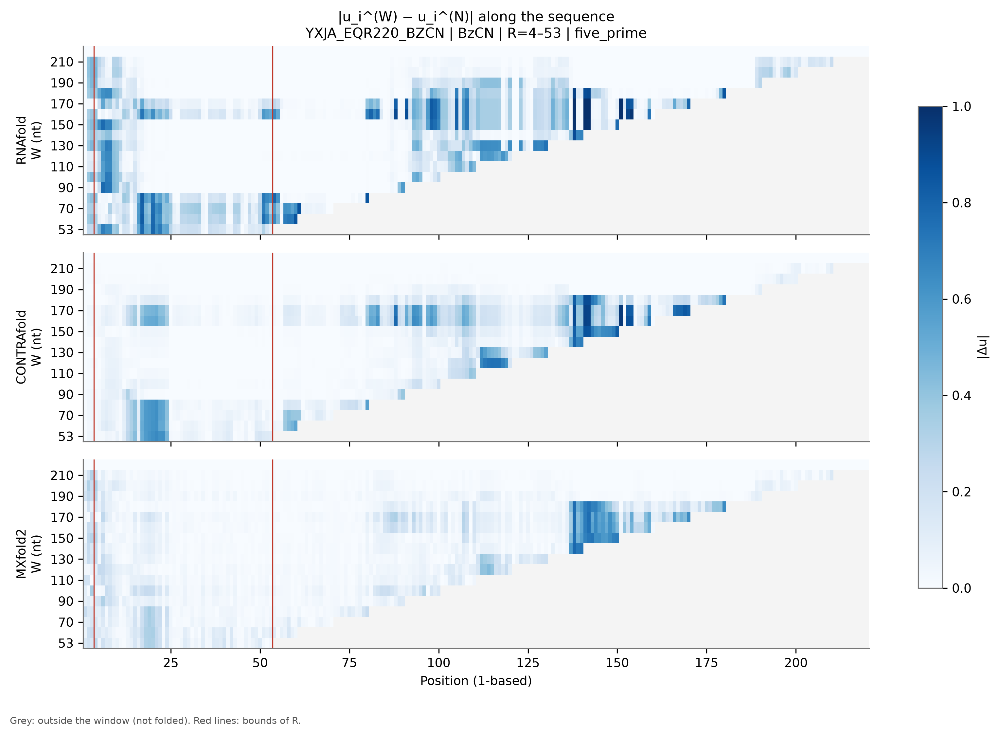
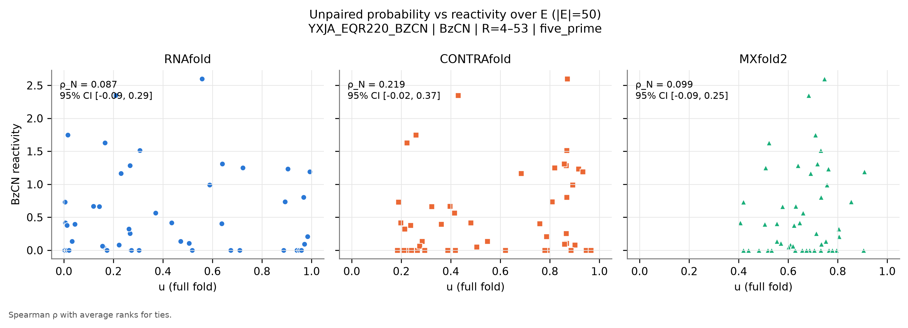

# YXJA_EQR220_BZCN: B. subtilis yxjA riboswitch leader

*Generated by `run_test.py`. [Overview of all 8 datasets](../overview.md) · [Method](../method.md) · [README](../../README.md). Config: [`configs/config_YXJA_EQR220_BZCN.json`](../../configs/config_YXJA_EQR220_BZCN.json); outputs: [`results/YXJA_EQR220_BZCN/`](../../results/YXJA_EQR220_BZCN/).*

**In short:** N = 220 nt; RNAfold ρ_N = 0.09, W_conv = 220; CONTRAfold ρ_N = 0.22, W_conv = 190; MXfold2 ρ_N = 0.10, W_conv = 220 (W_conv: smallest window whose prediction in R matches the full fold, see [method](../method.md)).

## 1. Data

* **Source:** https://rasp2.zhanglab.net/download/ (RASP v2; track Bsubtilis/SHAPE-seq_NAR_2022_Cheng/yxjA_EQR_220_rep1-pos.bw; Cheng et al. 2022 NAR, doi:10.1093/nar/gkac102) — file [`data/YXJA_EQR220_BZCN.bw`](../../data/YXJA_EQR220_BZCN.bw) downloaded from https://rasp2.zhanglab.net/api/downloadfile/?filetype=bw&filelist=Bsubtilis/SHAPE-seq_NAR_2022_Cheng/yxjA_EQR_220_rep1-pos.bw on 2026-11-05T09:04:29+00:00 (SHA-256 `d25afbde4f8292673330ee3b0fb9e3806214427fc1fbdfbe8a839c2a74b01992`).
* **Auxiliary file (fasta):** `data/Bsubtilis.fa.gz` downloaded from https://rasp2.zhanglab.net/api/downloadfile/?filetype=fasta&filelist=Bsubtilis.fa.gz on 2026-11-05T09:04:37+00:00 (SHA-256 `24af8f2c86dc72e6965af345172be1cdafbb10212c06fe38f424a312c266484e`).
* **Genome region extracted:** NC_000964.3:4005524-4005743(+) (1-based, inclusive); positions without a track value are NaN.
* **Construct:** B. subtilis yxjA (nupG) purine riboswitch leader, 220-nt in vitro transcript (genome NC_000964.3:4005524-4005743, + strand, ends 8 nt before the nupG start), equilibrium-refolded ('EQR'), probed with BzCN SHAPE-seq, replicate 1. Cheng et al. 2022 NAR 50:12001. Numbering = genome coordinate.
* **Sequence:** N = 220 nt, source numbering (genome coordinate) 4005524–4005743 (1-based position = source − 4005523).
* **Row used:** the file holds a single profile; no selection needed.
* **Reagent:** BzCN. **Conditions (from the config; the file has no annotations):** temperature not given, Mg²⁺ not given, buffer not given.
* **Evaluation nucleotides:** ACGU (reagent mapping (BzCN)).
* **Excluded positions (set to NaN):** source 4005524-4005526 (1-based 1-3). Reason: Leading run of 3 exact zeros at the 5' end (full-length extension end of SHAPE-seq reads; same rule as RNASEP_DMS_0000). NaN already present in the source: none.
* **Region of interest:** source 4005527–4005576 (1-based 4–53), anchoring `five_prime`. R = 4005527-4005576 (transcript nt 4-53): the first 50 nt with data, 5'-anchored windows.
* **Evaluation set:** |E| = 50; source positions 4005527-4005576.
* **Window grid:** 53, 60, 70, 80, 90, 100, 110, 120, 130, 140, 150, 160, 170, 180, 190, 200, 210, 220.
* Refolding buffer, Mg2+ and temperature are not given in the paper's Methods; RNAfold folds at an assumed 37 °C. Ligand presence in the EQR samples was not verified (Results suggest no 2-aminopurine).
* Track values are RASP's 'raw' SHAPE-seq reactivities; one value (transcript nt 80, rho ~ 137) is an outlier, which does not matter for Spearman correlation but would for a linear one.
* Of the equilibrium transcript lengths in RASP (135, 160, 220 nt) the longest was chosen, so the window test has the most room.

## 2. Models and parameters

| Model | Version | Parameters | Temperature | Salt | Mg²⁺ / tertiary |
|---|---|---|---|---|---|
| RNAfold | 2.7.2 | turner2004, dangles=2, partition function (`fc.pf()`, `fc.bpp()`) | 37 °C | standard 1.021 M monovalent (correction off) | not representable |
| CONTRAfold | CONTRAFold version 2.01 - RNA secondary structure prediction (bioconda package 2.02) | `contrafold predict --posteriors 1e-05`, built-in default parameters | not representable | not representable | not representable |
| MXfold2 | 0.1.2 | `mxfold2 predict --bpp`, bundled default (TrainSetAB.conf, model MixC), seed 0 | not representable | not representable | not representable |

**CONTRAfold threshold bias.** CONTRAfold only writes pairs with posterior ≥ 1e-05. Omitted pairs are counted as 'unpaired', so $u_i$ is biased **upward** by at most (number of omitted partners of $i$) × 1e-05 ≤ $(N-1)$ × 1e-05 = 0.0022 for the full fold (less for windows). **Measured on this dataset** by re-folding with threshold 1e-09: W = 53: max |Δu| = 0, |Δρ| = 0; W = 220: max |Δu| = 0, |Δρ| = 0.

**MXfold2 rounding.** MXfold2 writes $p_{ij}$ with 5 decimals; the resulting error on $u_i$ is ≤ $N\times5\cdot10^{-6}$ (≈0.001 here). Values of $u$ are clipped to [0, 1]; the maximal clipped amount per call is in `run_metadata.json`.

**Condition mismatches flagged at run time:**

## 3. Results

|E| = 50 positions. ε = 0.02. Bootstrap: B = 2000, block = 10 nt, seed = 0.

### Summary table

$\rho_W$ [95 % CI] and $\Delta\rho(W)$ [95 % CI] per model. Full numbers: [`summary.csv`](../../results/YXJA_EQR220_BZCN/summary.csv) (long), [`summary_wide.csv`](../../results/YXJA_EQR220_BZCN/summary_wide.csv) and [`per_position.csv`](../../results/YXJA_EQR220_BZCN/per_position.csv).

| W | window (1-based) | RNAfold ρ_W | RNAfold Δρ | CONTRAfold ρ_W | CONTRAfold Δρ | MXfold2 ρ_W | MXfold2 Δρ |
|---|---|---|---|---|---|---|---|
| 53 | 1–53 | 0.294 [0.05, 0.42] | -0.207 [-0.34, 0.07] | 0.254 [0.07, 0.37] | -0.035 [-0.19, 0.18] | 0.256 [0.05, 0.40] | -0.156 [-0.38, 0.13] |
| 60 | 1–60 | 0.082 [-0.13, 0.27] | 0.005 [-0.18, 0.22] | 0.195 [-0.03, 0.35] | 0.024 [-0.13, 0.22] | 0.186 [-0.02, 0.38] | -0.086 [-0.38, 0.19] |
| 70 | 1–70 | 0.071 [-0.15, 0.25] | 0.015 [-0.16, 0.26] | 0.207 [-0.05, 0.36] | 0.012 [-0.15, 0.22] | 0.190 [-0.03, 0.34] | -0.091 [-0.30, 0.16] |
| 80 | 1–80 | 0.142 [-0.04, 0.29] | -0.055 [-0.23, 0.15] | 0.258 [0.03, 0.39] | -0.040 [-0.17, 0.12] | 0.183 [-0.03, 0.35] | -0.083 [-0.31, 0.17] |
| 90 | 1–90 | 0.191 [-0.08, 0.35] | -0.104 [-0.20, 0.04] | 0.238 [-0.03, 0.39] | -0.019 [-0.07, 0.02] | 0.094 [-0.14, 0.21] | 0.005 [-0.09, 0.17] |
| 100 | 1–100 | 0.206 [-0.09, 0.42] | -0.119 [-0.28, 0.06] | 0.203 [-0.09, 0.41] | 0.015 [-0.09, 0.09] | 0.057 [-0.21, 0.30] | 0.042 [-0.11, 0.16] |
| 110 | 1–110 | 0.181 [-0.08, 0.35] | -0.094 [-0.19, 0.03] | 0.224 [-0.05, 0.40] | -0.006 [-0.08, 0.04] | 0.035 [-0.18, 0.15] | 0.065 [-0.02, 0.21] |
| 120 | 1–120 | 0.193 [-0.08, 0.37] | -0.106 [-0.22, 0.03] | 0.236 [-0.03, 0.41] | -0.017 [-0.08, 0.02] | 0.073 [-0.14, 0.19] | 0.026 [-0.06, 0.17] |
| 130 | 1–130 | 0.189 [-0.09, 0.39] | -0.102 [-0.23, 0.05] | 0.232 [-0.02, 0.38] | -0.013 [-0.05, 0.01] | 0.062 [-0.15, 0.18] | 0.038 [-0.03, 0.21] |
| 140 | 1–140 | 0.143 [-0.08, 0.32] | -0.056 [-0.12, 0.04] | 0.222 [-0.05, 0.40] | -0.004 [-0.08, 0.05] | 0.036 [-0.17, 0.15] | 0.064 [-0.01, 0.25] |
| 150 | 1–150 | 0.179 [-0.07, 0.34] | -0.093 [-0.19, 0.04] | 0.193 [-0.06, 0.35] | 0.026 [0.00, 0.06] | 0.033 [-0.16, 0.16] | 0.066 [-0.02, 0.26] |
| 160 | 1–160 | 0.135 [-0.07, 0.29] | -0.048 [-0.21, 0.16] | 0.279 [0.05, 0.41] | -0.060 [-0.17, 0.05] | 0.101 [-0.08, 0.22] | -0.002 [-0.11, 0.20] |
| 170 | 1–170 | 0.203 [-0.01, 0.33] | -0.116 [-0.20, 0.05] | 0.265 [0.05, 0.40] | -0.046 [-0.16, 0.04] | 0.126 [-0.07, 0.28] | -0.026 [-0.20, 0.19] |
| 180 | 1–180 | 0.190 [-0.07, 0.37] | -0.103 [-0.22, 0.03] | 0.241 [-0.00, 0.38] | -0.022 [-0.06, 0.02] | 0.086 [-0.11, 0.19] | 0.013 [-0.04, 0.15] |
| 190 | 1–190 | 0.085 [-0.10, 0.29] | 0.002 [-0.04, 0.08] | 0.226 [-0.04, 0.41] | -0.008 [-0.07, 0.04] | 0.040 [-0.16, 0.16] | 0.060 [-0.00, 0.26] |
| 200 | 1–200 | 0.041 [-0.14, 0.27] | 0.045 [-0.03, 0.19] | 0.213 [-0.02, 0.36] | 0.006 [-0.01, 0.03] | -0.004 [-0.21, 0.14] | 0.103 [-0.03, 0.34] |
| 210 | 1–210 | 0.048 [-0.12, 0.27] | 0.039 [-0.03, 0.18] | 0.212 [-0.02, 0.35] | 0.006 [-0.00, 0.04] | 0.022 [-0.18, 0.15] | 0.078 [-0.02, 0.31] |
| 220 (N) | 1–220 | 0.087 [-0.09, 0.29] | 0.000 [0.00, 0.00] | 0.219 [-0.02, 0.37] | 0.000 [0.00, 0.00] | 0.099 [-0.09, 0.25] | 0.000 [0.00, 0.00] |

### Suggested window per model (heuristic)

| Model | ρ_N [95 % CI] | W* (first Δρ ≤ ε) | W*_stable | W*_CI (upper CI ≤ ε) |
|---|---|---|---|---|
| RNAfold | 0.087 [-0.09, 0.29] | 53 | 220 | 220 |
| CONTRAfold | 0.219 [-0.02, 0.37] | 53 | 160 | 120 |
| MXfold2 | 0.099 [-0.09, 0.25] | 53 | 220 | 220 |

### Figures

**Figure 1.** $\rho_W$ vs $W$ (lines), each model's $\rho_N$ (dotted), 95 % bootstrap CI (band).

**Figure 2.** $\Delta\rho(W)$ with 95 % CI; dashed line: ε.

**Figure 3.** Model-internal convergence: Spearman of $u^{(W)}$ to $u^{(N)}$ over $E$ (left) and max $|\Delta u|$ over $E$ (right).

**Figure 4.** Reactivity (evaluation nucleotides dark, others grey, excluded positions ×) and $u$ for the full fold and three representative windows, one panel per model; yellow = $R$.

**Figure 5.** $|u_i^{(W)}-u_i^{(N)}|$; position on x, $W$ on y; grey = outside window.

**Figure 6.** $u$ (full fold) vs reactivity over $E$, one panel per model.

### Comparison of the three models

* **Absolute agreement (full fold):** CONTRAfold ρ_N = 0.219 [-0.02, 0.37], MXfold2 ρ_N = 0.099 [-0.09, 0.25], RNAfold ρ_N = 0.087 [-0.09, 0.29]. Overlapping CIs mean the ranking is not resolved by these data.
* **Smallest window (W = 53):** RNAfold Δρ = -0.207 [-0.34, 0.07], CONTRAfold Δρ = -0.035 [-0.19, 0.18], MXfold2 Δρ = -0.156 [-0.38, 0.13].
* **Largest Δρ over the grid:** RNAfold 0.045 at W = 200, CONTRAfold 0.026 at W = 150, MXfold2 0.103 at W = 200.
* **Internal convergence** (smallest W from which max |Δu| over E stays ≤ 0.1): RNAfold W = 220, CONTRAfold W = 190, MXfold2 W = 220.
* **RNAfold:** the 95 % CI of Δρ includes 0 at every W.
* **CONTRAfold: Δρ CI excludes 0** above 0 (truncation costs agreement) at W = [150].
* **MXfold2:** the 95 % CI of Δρ includes 0 at every W.
* **Suggested W (ε = 0.02):** RNAfold W* = 53 (stable 220, CI-based 220), CONTRAfold W* = 53 (stable 160, CI-based 120), MXfold2 W* = 53 (stable 220, CI-based 220).

**Interpretation (generated from the numbers above).**
Truncation measurably reduces agreement with the data for some windows (Δρ CI above 0); W*, W*_stable and W*_CI should be read together with the convergence figures.

## 4. Limitations

General limitations (reagent coverage, physical conditions, trained models, statistics) are in the [overview](../overview.md#limitations).
 Specific to this dataset:

* Experimental conditions are partly unknown (see Data caveats).
* BzCN SHAPE-seq: all four nucleotides are evaluated.
