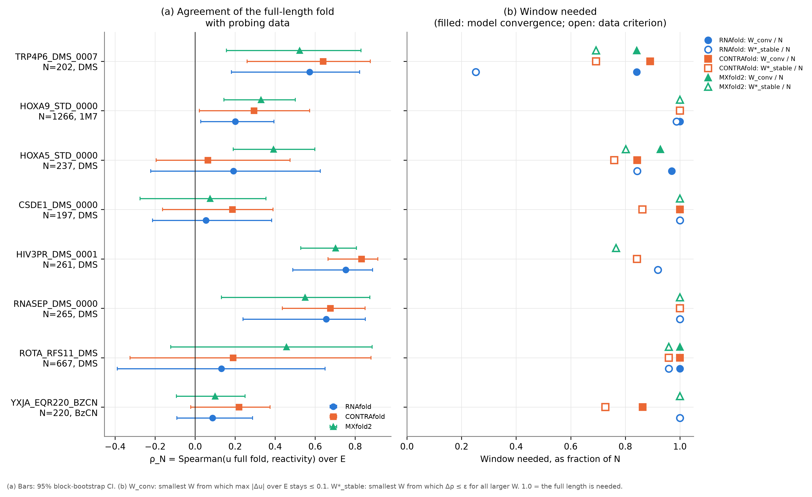
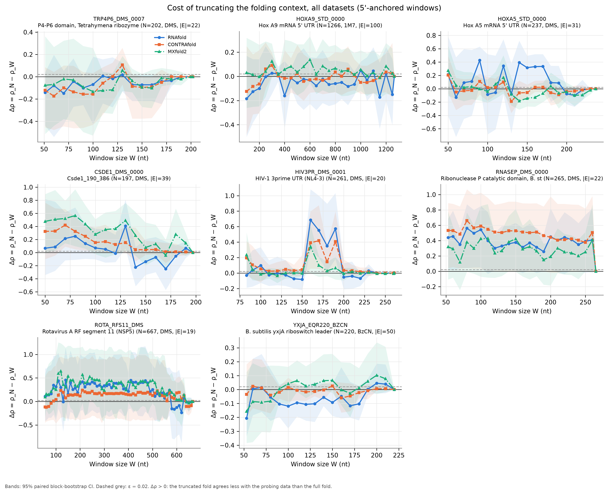
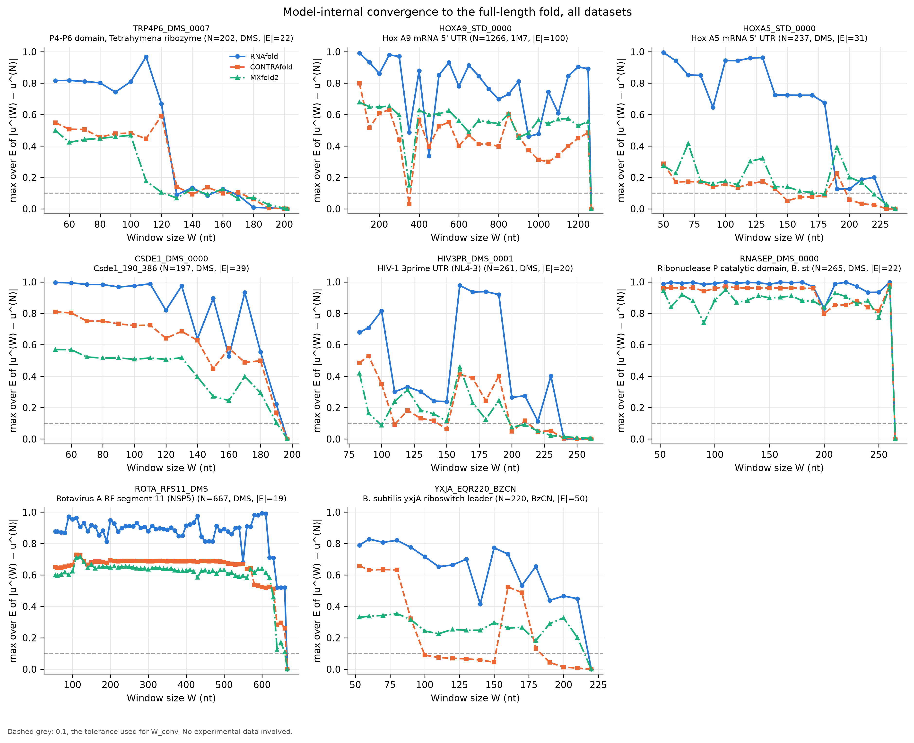
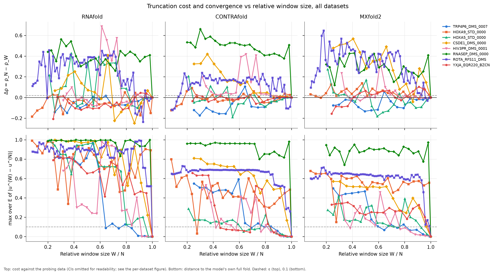

# Overview: folding-window validity test across datasets

*Generated by `run_test.py`; see the [README](../README.md) to regenerate. How each quantity is computed: [method](method.md).*

**Question.** When an RNA is folded in a window instead of at full length, how much does the predicted unpaired probability $u$ in a region of interest $R$ change, and does its agreement with chemical-probing reactivity get worse? Three models: ViennaRNA RNAfold (thermodynamic), CONTRAfold (probabilistic, trained), MXfold2 (deep learning + thermodynamics).

## Datasets

| Dataset | RNA | N | Reagent | R (1-based) | \|E\| |
|---|---|---|---|---|---|
| [TRP4P6_DMS_0007](datasets/TRP4P6_DMS_0007.md) | P4-P6 domain, Tetrahymena ribozyme | 202 | DMS | 11–51 | 22 |
| [HOXA9_STD_0000](datasets/HOXA9_STD_0000.md) | Hox A9 mRNA 5' UTR | 1266 | 1M7 | 1–100 | 100 |
| [HOXA5_STD_0000](datasets/HOXA5_STD_0000.md) | Hox A5 mRNA 5' UTR | 237 | DMS | 1–50 | 31 |
| [CSDE1_DMS_0000](datasets/CSDE1_DMS_0000.md) | Csde1_190_386 | 197 | DMS | 1–50 | 39 |
| [HIV3PR_DMS_0001](datasets/HIV3PR_DMS_0001.md) | HIV-1 3prime UTR (NL4-3) | 261 | DMS | 34–83 | 20 |
| [RNASEP_DMS_0000](datasets/RNASEP_DMS_0000.md) | Ribonuclease P catalytic domain, B. stearothermophilus | 265 | DMS | 4–53 | 22 |
| [ROTA_RFS11_DMS](datasets/ROTA_RFS11_DMS.md) | Rotavirus A RF segment 11 (NSP5) | 667 | DMS | 6–55 | 19 |
| [YXJA_EQR220_BZCN](datasets/YXJA_EQR220_BZCN.md) | B. subtilis yxjA riboswitch leader | 220 | BzCN | 4–53 | 50 |

## Results across datasets

One row per dataset and model. ρ_N: full-fold agreement; Δρ(W_min): cost at the smallest window; 'Δρ CI > 0 at': windows where truncation significantly lowers agreement; W_conv: smallest W from which max |Δu| over E stays ≤ 0.1. Click a dataset for its full report.

| Dataset | N | reagent | R (1-based) | \|E\| | Model | ρ_N [95 % CI] | Δρ(W_min) [95 % CI] | Δρ CI > 0 at | W* | W*_stable | W*_CI | W_conv |
|---|---|---|---|---|---|---|---|---|---|---|---|---|
| [TRP4P6_DMS_0007](datasets/TRP4P6_DMS_0007.md) | 202 | DMS | 11–51 | 22 | RNAfold | 0.572 [0.18, 0.82] | -0.142 [-0.44, 0.04] (W=51) | none | 51 | 51 | 90 | 170 |
| [TRP4P6_DMS_0007](datasets/TRP4P6_DMS_0007.md) | 202 | DMS | 11–51 | 22 | CONTRAfold | 0.640 [0.26, 0.88] | -0.121 [-0.45, 0.09] (W=51) | none | 51 | 140 | 150 | 180 |
| [TRP4P6_DMS_0007](datasets/TRP4P6_DMS_0007.md) | 202 | DMS | 11–51 | 22 | MXfold2 | 0.522 [0.16, 0.83] | -0.077 [-0.51, 0.36] (W=51) | none | 51 | 140 | 200 | 170 |
| [HOXA9_STD_0000](datasets/HOXA9_STD_0000.md) | 1266 | 1M7 | 1–100 | 100 | RNAfold | 0.201 [0.03, 0.39] | -0.185 [-0.50, 0.17] (W=100) | none | 100 | 1250 | 1266 | 1266 |
| [HOXA9_STD_0000](datasets/HOXA9_STD_0000.md) | 1266 | 1M7 | 1–100 | 100 | CONTRAfold | 0.294 [0.02, 0.57] | -0.124 [-0.49, 0.25] (W=100) | [300] | 100 | 1266 | 350 | 1266 |
| [HOXA9_STD_0000](datasets/HOXA9_STD_0000.md) | 1266 | 1M7 | 1–100 | 100 | MXfold2 | 0.330 [0.14, 0.50] | 0.031 [-0.26, 0.32] (W=100) | [350] | 150 | 1266 | 1266 | 1266 |
| [HOXA5_STD_0000](datasets/HOXA5_STD_0000.md) | 237 | DMS | 1–50 | 31 | RNAfold | 0.192 [-0.22, 0.63] | 0.215 [-0.41, 0.79] (W=50) | [90, 150, 160, 170] | 60 | 200 | 210 | 230 |
| [HOXA5_STD_0000](datasets/HOXA5_STD_0000.md) | 237 | DMS | 1–50 | 31 | CONTRAfold | 0.063 [-0.20, 0.47] | 0.205 [-0.06, 0.50] (W=50) | none | 60 | 180 | 190 | 200 |
| [HOXA5_STD_0000](datasets/HOXA5_STD_0000.md) | 237 | DMS | 1–50 | 31 | MXfold2 | 0.392 [0.19, 0.60] | 0.272 [-0.11, 0.65] (W=50) | none | 90 | 190 | 140 | 220 |
| [CSDE1_DMS_0000](datasets/CSDE1_DMS_0000.md) | 197 | DMS | 1–50 | 39 | RNAfold | 0.054 [-0.21, 0.38] | 0.066 [-0.34, 0.82] (W=50) | [130] | 120 | 197 | 197 | 197 |
| [CSDE1_DMS_0000](datasets/CSDE1_DMS_0000.md) | 197 | DMS | 1–50 | 39 | CONTRAfold | 0.186 [-0.16, 0.39] | 0.324 [-0.10, 0.76] (W=50) | [70, 80, 90, 100, 120, 130] | 170 | 170 | 197 | 197 |
| [CSDE1_DMS_0000](datasets/CSDE1_DMS_0000.md) | 197 | DMS | 1–50 | 39 | MXfold2 | 0.075 [-0.27, 0.35] | 0.477 [-0.01, 0.89] (W=50) | [60, 70, 80, 90, 130, 180] | 170 | 197 | 197 | 197 |
| [HIV3PR_DMS_0001](datasets/HIV3PR_DMS_0001.md) | 261 | DMS | 34–83 | 20 | RNAfold | 0.753 [0.49, 0.89] | -0.029 [-0.19, 0.18] (W=83) | [160, 170, 180, 190] | 83 | 240 | 220 | 240 |
| [HIV3PR_DMS_0001](datasets/HIV3PR_DMS_0001.md) | 261 | DMS | 34–83 | 20 | CONTRAfold | 0.832 [0.66, 0.91] | 0.195 [-0.02, 0.41] (W=83) | [160, 170, 190] | 220 | 220 | 240 | 220 |
| [HIV3PR_DMS_0001](datasets/HIV3PR_DMS_0001.md) | 261 | DMS | 34–83 | 20 | MXfold2 | 0.702 [0.53, 0.81] | 0.235 [0.00, 0.52] (W=83) | [83] | 100 | 200 | 240 | 200 |
| [RNASEP_DMS_0000](datasets/RNASEP_DMS_0000.md) | 265 | DMS | 4–53 | 22 | RNAfold | 0.656 [0.24, 0.85] | 0.440 [0.03, 0.69] (W=53) | [53, 60, 70, 80, 90, 100, 120, 130, 140, 150, 170, 190, 200, 230, 240] | 265 | 265 | 265 | 265 |
| [RNASEP_DMS_0000](datasets/RNASEP_DMS_0000.md) | 265 | DMS | 4–53 | 22 | CONTRAfold | 0.676 [0.44, 0.85] | 0.533 [0.04, 0.89] (W=53) | [53, 60, 70, 80, 90, 100, 110, 120, 130, 140, 150, 160, 170, 180, 190, 220, 230, 240, 250] | 265 | 265 | 265 | 265 |
| [RNASEP_DMS_0000](datasets/RNASEP_DMS_0000.md) | 265 | DMS | 4–53 | 22 | MXfold2 | 0.549 [0.13, 0.87] | 0.320 [-0.11, 0.78] (W=53) | none | 265 | 265 | 265 | 265 |
| [ROTA_RFS11_DMS](datasets/ROTA_RFS11_DMS.md) | 667 | DMS | 6–55 | 19 | RNAfold | 0.132 [-0.39, 0.65] | 0.111 [-0.41, 0.70] (W=55) | none | 130 | 640 | 667 | 667 |
| [ROTA_RFS11_DMS](datasets/ROTA_RFS11_DMS.md) | 667 | DMS | 6–55 | 19 | CONTRAfold | 0.189 [-0.33, 0.88] | -0.118 [-0.45, 0.52] (W=55) | none | 55 | 640 | 640 | 667 |
| [ROTA_RFS11_DMS](datasets/ROTA_RFS11_DMS.md) | 667 | DMS | 6–55 | 19 | MXfold2 | 0.456 [-0.12, 0.88] | 0.095 [-0.34, 0.58] (W=55) | [110, 120, 150, 240, 250] | 620 | 640 | 667 | 667 |
| [YXJA_EQR220_BZCN](datasets/YXJA_EQR220_BZCN.md) | 220 | BzCN | 4–53 | 50 | RNAfold | 0.087 [-0.09, 0.29] | -0.207 [-0.34, 0.07] (W=53) | none | 53 | 220 | 220 | 220 |
| [YXJA_EQR220_BZCN](datasets/YXJA_EQR220_BZCN.md) | 220 | BzCN | 4–53 | 50 | CONTRAfold | 0.219 [-0.02, 0.37] | -0.035 [-0.19, 0.18] (W=53) | [150] | 53 | 160 | 120 | 190 |
| [YXJA_EQR220_BZCN](datasets/YXJA_EQR220_BZCN.md) | 220 | BzCN | 4–53 | 50 | MXfold2 | 0.099 [-0.09, 0.25] | -0.156 [-0.38, 0.13] (W=53) | none | 53 | 220 | 220 | 220 |

### Overview figures

**Overview A.** (a) Agreement of each model's full-length fold with the probing data, with 95 % CI. (b) Window needed as a fraction of the RNA length: filled = the model's own prediction in R has converged (max |Δu| ≤ 0.1), open = data criterion W*_stable (Δρ ≤ ε for all larger W).

**Overview B.** Δρ(W) for every dataset (panels) and model (lines), with 95 % CI bands.

**Overview C.** Model-internal convergence (max |Δu| over E) for every dataset and model.

**Overview D.** The same curves against relative window size W/N, one panel per model and one line per dataset, so RNAs of different lengths can be compared directly.

## Across datasets: Wilcoxon signed-rank test on Δρ

For each model and each W shared by all datasets: is Δρ(W) = ρ_N − ρ_W different from 0 across RNAs? File: [`results/overview/cross_dataset_wilcoxon.csv`](../results/overview/cross_dataset_wilcoxon.csv).

| Model | W | n | median Δρ | p |
|---|---|---|---|---|
| CONTRAfold | 100 | 8 | 0.029 | 0.4609 |
| CONTRAfold | 150 | 8 | 0.035 | 0.7422 |
| MXfold2 | 100 | 8 | 0.037 | 0.2500 |
| MXfold2 | 150 | 8 | 0.040 | 0.4609 |
| RNAfold | 100 | 8 | 0.001 | 0.7422 |
| RNAfold | 150 | 8 | -0.077 | 0.7422 |

## Limitations

* **Reagent coverage.** DMS mainly reports on the Watson–Crick face of A and C (N1-A, N3-C); G and U carry little signal under standard conditions, so they are excluded from $E$. Conclusions hold for A/C only.
* **Physical conditions.** RNAfold's Turner parameters assume standard salt (1 M NaCl); salt correction (if enabled) is monovalent only. None of the three models represents Mg²⁺ or Mg²⁺-dependent tertiary structure, which limits the absolute $\rho$ any model can reach. Conclusions therefore rest on $\Delta\rho$ (each model vs its own full fold), not on absolute $\rho$.
* **Trained models.** CONTRAfold and MXfold2 are trained on databases of known structures, have no explicit temperature or salt dependence, and may have seen this RNA or close homologues during training, which can inflate their absolute agreement.
* **Statistics.** $|E|$ is small, so CIs are wide; neighbouring positions are correlated, which the block bootstrap only partly accounts for (block length is a choice). The ε rule is a heuristic; the grid step sets the resolution of $W^*$. Spearman ρ uses only ranks, so it is insensitive to monotone rescaling of reactivity but also ignores the magnitude of $u$.
* **Single construct.** One RNA gives one estimate of $\Delta\rho(W)$; generalisation needs several RNAs (the across-RNA Wilcoxon test becomes available when several datasets are run).

Dataset-specific limitations are listed at the end of each dataset report.

## Run environment

Command (from the repository root): `python run_test.py configs/config_TRP4P6_DMS_0007.json configs/config_HOXA9_STD_0000.json configs/config_HOXA5_STD_0000.json configs/config_CSDE1_DMS_0000.json configs/config_HIV3PR_DMS_0001.json configs/config_RNASEP_DMS_0000.json configs/config_ROTA_RFS11_DMS.json configs/config_YXJA_EQR220_BZCN.json --out .`

* Python 3.12.8, NumPy 2.5.1, SciPy 1.18.1, Matplotlib 3.11.1, ViennaRNA 2.7.2, PyTorch 2.13.0+cu130 (MXfold2 backend, CPU).
* CONTRAfold: CONTRAFold version 2.01 - RNA secondary structure prediction, bioconda package 2.02.
* MXfold2: 0.1.2.
* Bootstrap seed: 0 (`numpy.random.default_rng`). MXfold2 runs with `--seed 0` on CPU.
* Run: 2026-11-06T11:37:54+00:00 → 2026-11-06T12:12:21+00:00 (UTC).
* Full `pip freeze`, binary paths and SHA-256, every effective parameter, window coordinates and evaluation positions: [`results/run_metadata.json`](../results/run_metadata.json).
